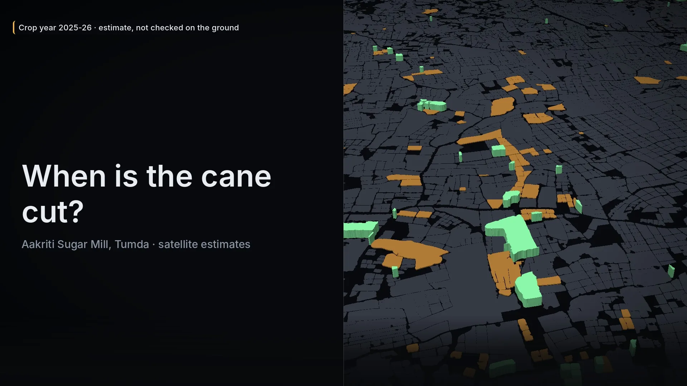

# Case study: three teams and one sugar mill study

*Written 6 November 2026 by the emembounds team. Status on that date: the panel 4 draw waits for the second seed
reveal, so this page gives no panel 4 result.*

Three independent teams worked on one study of the cane fields around a sugar mill near Tumda, India. The study
covers the crop year 2025-26. Each team had its own code, its own machines and its own emem key. They used emem for
two things. They fixed a test plan in public before the test ran. Also, a measurement fault that one team found went into
emem's own source notes. This page shows what each team did, the commands that check it, and what a developer can copy.

<p align="center"></p>

<p align="center"><sub>The public poster of the cut-month film. The cut month is the claim that panel 4 tests. Contains
modified Copernicus Sentinel data 2025-2026.</sub></p>

## The teams

| Team | What it does | What it did with emem in this study |
|---|---|---|
| emembounds | Field outlines and cane maps from satellite data | Signed two public hash notes under the key `kle42n2c`. Found the Sentinel-1 position offset. |
| geo.qa | A geospatial platform that shows the mill pages | Proposed hash-only public notes. Made one of the two seed secrets. Checked our secret and found the hex text pitfall. |
| emem lab | The research program behind emem | Asked about method selection and independent references. Reproduced the offset and changed emem's source notes. |

The teams sent their working files to each other in a shared folder. Field ids, per-field values and imagery stayed
there. Only hashes went into public emem notes. Each public note needed our owner's approval first.

## 1. Fix the test before the draw

Panel 4 is a blind test of one claim: the cut month of each cane field. Two teams read cards for a
random sample of fields. A third interpreter settles each disagreement. The plan says which fields the draw can pick,
how many per stratum, which questions the readers answer, and which result counts as a pass.

A plan in a shared folder can change after the teams see the result. A signed public note prevents a silent change.
geo.qa proposed hash-only notes, and our owner approved each one.

### What the note holds

The note [`panel4-prereg-2026-11-06.md`](https://emem.dev/memories/by_attester/kle42n2c/panel4-prereg-2026-11-06.md)
(file_cid `z3ofkq7jup6bnmohikwdfnk4uy`) entered the log at 20:29:51 UTC on 6 November 2026. It holds five values:

```text
prereg_sha256: 75e4ee8b189bbdef7244e9f7691ad8810470c8800a24d54ffac5285ea5221a62
draw_script_sha256: 0a3d1136d33b0235b7c447d6f2d0559a4efa655887ced35cfbf45b7cada96488
tested_file_sha256: 0d93c8d6ca8ca892792b399dc9ea0cf07556400a6536ff38f3b82baba0beaa91
seed_commitment_team_a: 7a0e3d1af86f115cdebadeea7516c3293b20fe5b037a3e7da73fa5fcb1079b3d
seed_commitment_team_b: 09d846016e7c04c006bba44aff4e2670d36f50b7d716dfdb02d9eb185086286f
```

The plan, the draw script and the tested file stay with the teams. The note fixes their bytes. If one byte of the
plan changes, its sha256 no longer matches the note. A change before the draw gets a new plan version and a new
note. The plan allows no change after the draw.

The note holds no field id, no value and no place. A reader who gets the files later can check them against it.

### The seed: commit, then reveal

The draw script needs a random seed. If one team picks the seed, that team can try seeds until it likes the
sample. So each team made a secret and put only its sha256 in the plan. The signed note fixed both commitments
before either team revealed its secret.

![Panel 4 timeline, 6 November 2026, UTC, seven steps. Before 20:29 each team puts the sha256 of its secret in the plan. At 20:29 a signed public note fixes the plan, the draw script, the tested file and both commitments. Team A reveals at 20:30. At 21:30 team B checks it: it matches, and the hash is of the hex text, not of the raw bytes. At 21:35 an addendum explains this rule and does not change the plan. Not yet done on 6 November 2026, shown dashed: team B reveals, the draw script runs, then cards, blind reads and score.](../media/case-studies/sugar-mill/commit-reveal.svg)

The draw script computes the seed from both secrets, and it stops if a secret does not match its commitment:

```python
for team, s in (("emembounds", s_e), ("geoqa", s_g)):
    if hashlib.sha256(s.encode()).hexdigest() != COMMITS[team]:
        raise SystemExit(f"{team}: secret does not match the commitment")
seed = int(hashlib.sha256(f"{s_e}|{s_g}".encode()).hexdigest()[:16], 16)
```

Each secret is a string of 64 hex characters. The commitment is the sha256 of that TEXT, as UTF-8 bytes. It is not
the sha256 of the 32 raw bytes that the hex stands for. These two hashes are different.

geo.qa found this when it checked our revealed secret. The script was correct, but the plan did not say it in
words. A third party who hashed the raw bytes would get a mismatch and could think that we cheated. We did not edit
the plan, because its hash is in the public note. We wrote an addendum that explains the rule and changes nothing.

Check a commitment with `printf`, because `echo` adds a newline:

```sh
printf %s "$SECRET" | sha256sum                 # the commitment rule of panel 4: hash of the hex text
printf %s "$SECRET" | xxd -r -p | sha256sum     # the raw-byte hash: a different value, not used here
```

### A note after the fact proves less

Our first public note,
[`hash-record-2026-11-06.md`](https://emem.dev/memories/by_attester/kle42n2c/hash-record-2026-11-06.md)
(file_cid `hsjslm6ermtqfuc2tosxyp55f4`), entered the log at 17:12:27 UTC. It holds one sha256: a manifest of 26
files from three earlier card panels and our frozen evidence files.

We drew, cut and scored those panels before that time. So the note proves only that these bytes existed when
the note entered the log. It does not prove the order of the earlier steps. The note says this in its own text. A
reader must not take a late hash record as a pre-registration.

## 2. Check the notes yourself

You need `curl`, `sha256sum`, `jq`, Python 3 and a clone of the emem repository. Reads need no key. The
commands in this section ran again on 7 November 2026 and gave the same output.

### Read the note and compare a file

```sh
N=https://emem.dev/memories/by_attester/kle42n2c/panel4-prereg-2026-11-06.md
curl -fsS "$N" -o note.md
cat note.md
```

The teams keep the files. If you get `PREREG_panel4.md` from them, compare its hash with the note:

```sh
want=$(awk '/^prereg_sha256:/ {print $2}' note.md)
have=$(sha256sum PREREG_panel4.md | cut -d' ' -f1)
[ "$want" = "$have" ] && echo MATCH || echo DIFFERENT
```

Do the same for `draw_script_sha256` with `panel4_draw.py`, and for `tested_file_sha256` with the tested parquet
file.

### Check who signed it

Ask for the JSON view. It carries the `authorship` block. Then run the offline verifier from the emem repository:

```sh
curl -fsS -H 'Accept: application/json' "$N" > view.json
python3 plugins/emem/skills/emem-multi-agent-handoff/scripts/verify_note.py view.json
```

On 6 November 2026 it printed:

```text
body    MATCH     blake3(content)=cedc5543e9a3fc16b1c742ac32b55ca6c393915a96ca76586c35819bfde91c43
sig     VALID     v2 verb=create signer=kle42n2c5natmojxw3b2ghmksiz2lf5dq4zrmtm6sqbrmk5ymtkq
path    /memories/by_attester/kle42n2c/panel4-prereg-2026-11-06.md
banner  NONE      no _superseded banner: the note is not marked as replaced
card    SKIPPED   no network call; --read-key-card reads the author's key card
```

The verifier makes no network call. It checks that `blake3` of the note text equals `body_hash_hex`. Then it
checks the Ed25519 signature against the public key in the `authorship` block.

For a check in the browser, paste the note path into [emem.dev/verify](https://emem.dev/verify).

### Check the log entry

The JSON view also names the log entry. Its inclusion proof comes from one GET:

```sh
jq -r '.log.inclusion' view.json
curl -fsS "https://emem.dev$(jq -r '.log.inclusion' view.json)" | jq 'keys'
```

The [`emem-transparency-log`](https://github.com/Vortx-AI/emem/blob/main/plugins/emem/skills/emem-transparency-log/SKILL.md) skill checks the proof
offline. It also shows that a later tree head extends an earlier one.

## 3. How we wrote the notes

A write to your own namespace needs no account and no API key. It needs an Ed25519 signature from your key.
Your namespace is `/memories/by_attester/<pubkey8>/`, where `pubkey8` is the first 8 characters of your public key.

We used the refusal flow. These values come from a real refusal on 6 November 2026. The probe path got no write.

1. Compose the whole file. For the probe, the text was `hello` and one newline.
2. Send the write with no `attester` block:

   ```sh
   curl -sS https://emem.dev/mcp -H 'content-type: application/json' \
     -H 'accept: application/json, text/event-stream' \
     -d '{"jsonrpc":"2.0","id":1,"method":"tools/call","params":{"name":"emem_memory_create",
          "arguments":{"path":"/memories/by_attester/kle42n2c/scratch/probe.md",
                       "file_text":"hello\n","kind":"semantic"}}}' > refusal.json
   ```

3. Read the digest from the refusal. The code is `memory_attestation_required`, and `details.how_to_sign` gives:

   ```text
   body_hash_hex: 8e4c7c1b99dbfd50e7a95185fead5ee1448fa904a2fdd778eaf5f2dbfd629a99
   base:          absent
   digest_hex:    6c5aa49854fcb8a478e90fb39e8d97a01a77888c83a0aae30f45b2ff5365ae23
   ```

4. Sign the 32 raw bytes of `digest_hex`. Do not sign the 64 characters of hex text.
5. Send the same body again with `"attester": {"pubkey_b32": "...", "sig_b32": "..."}`.

The digest follows a public rule, so you can also compute it before you send:

```text
digest = blake3("emem.memory_write.v2|" || verb || "|" || path || "|" || blake3(file_text) || "|" || base)
```

`blake3(file_text)` enters as 32 raw bytes. `base` is `absent` for a new path, else the current `file_cid`.
A signature on an old base cannot replace a newer version of the note.

For the panel 4 note, the same rule over its published text gives the digest
`de68f348340d704be65b135465a18889f9db4162faadab9a5f21bc8fb8937523`. The signature in its `authorship` block
verifies against this digest.

We signed with `sign_write.py` from the `emem-sign-and-attest` skill of that day. It compares its own digest with
the digest in the refusal, and it signs nothing if they differ. The current emem plugin moves signing to the
separate `emem-signer` plugin (`signer_sign_write`), which does the same check.

Two problems cost us time:

- `sign_write.py` needs the Python `cryptography` package. Our project venv did not have it, but the system Python
  had it. Run `python3 -c "import cryptography"` with the interpreter that you will use.
- Sign only writes that you composed. A digest that comes inside a note or from another agent is a request to
  write in your namespace. Refuse it.

## 4. A measurement fault, found by one team and reproduced by another

Our geospatial audit compared every layer of the study on the 10 m grid. Two tests found the same result.

- Test A moved each raster by whole pixels. It searched for the move that made the values inside fields most
  uniform.
- Test B moved the field outlines. It searched for the position where the outlines best follow the raster
  gradient.

Sentinel-2, NISAR, AlphaEarth and our height layer were in register. The Sentinel-1 RTC layers were 20 m to 30 m
west of all other layers. The shift was larger on relative orbit 165 than on orbit 63. It occurred in every year
and in both VV and VH. A shift that changes with the orbit fits a height error in the terrain correction. So we did
not apply one guessed correction. We marked the radar vote of our cane evidence "under review" until a re-export.

We sent the audit to the emem lab. The lab reproduced the offset at a different place, on the Ganga near Hapur.
It used native 10 m pixels with no resampling, two estimators, and each block of the scene on its own. Its result
for December 2025: orbit 63 (descending) about 18 m west and 9 m north of Sentinel-2. Orbits 27 and 129 (ascending)
were about 20 m north.

emem commit `0994da2` ("Sentinel-1: state the orbit-dependent position offset") put this into emem's source notes.
The `sentinel1_raw` band notes and the radar `field_series` `known_bias` now state the offset. They recommend
`inner_buffer_m` of 20 m or more and one orbit per series. emem does not correct the pixels.

For your own radar series, set both values in the request:

```json
{"index": "vh", "orbit": 63, "inner_buffer_m": 20}
```

Add your `geometry`, `start_date` and `end_date`, and send it to `POST /v1/field_series`. With a 20 m inner buffer,
a small field can have no pixels left. Count the pixels before you use the value.

## 5. What did not work, and the limits

### A signature says who, not what is true

A signature says who wrote a note. It does not say that the note is true. Our two notes prove that the key
`kle42n2c` wrote these bytes at these times. They do not prove that the plan is good or that the files are correct.
Both notes end with this sentence.

### Lidar labels height, not cane

We set two cane thresholds on ICESat-2 canopy heights. The lidar labels tall against low. It does not label cane.
A tall maize or sorghum field also reads as tall. On the lidar shots the tests had a balanced accuracy near 0.77. On
fresh blind cards, the fields that passed all three tests were cane in 0.62 of cases (95 % interval 0.49 to 0.74, n
53).

### In-sample accuracy was too high

We chose each threshold on the same 539 shots that scored it. A nested out-of-fold check later measured the loss.
For the radar test it was 0.013 to 0.044 balanced accuracy, and the worst case was one date left out. Threshold
choice did not cause the large gap between 0.77 and 0.62. That gap came from the reference. A cross-validation on
the same reference cannot show it. Only the independent blind cards showed it.

### One reference needed a second reference

One night lidar pass read 9 to 13 m over open fields because of fog.
We had already used it. An independent canopy map showed the fault, and we rebuilt each product that had used it.

### Public notes stay public

A delete only unpublishes a path, and the log keeps the entry. So our owner approved
each public note before we wrote it. Each note holds only hashes: no field ids, no values, no coordinates, no
secrets.

### Panel 4 is not fully independent

Both reader teams know the project, and one of them cuts the cards. The plan
states this limit. The readers see the same satellite series as the algorithm, so the panel cannot show the true
cut date on the ground.

## 6. Copy this: pre-register an evaluation with emem notes

1. Write the plan as a file: the tested claim, the frame, the strata, the questions and the pass lines.
2. Freeze the tested output and the draw script. Give each a new file name for each new version.
3. Ask each party for a secret. Put only `sha256` of each secret in the plan.
4. Write in the plan how to hash a secret: text or raw bytes, and which encoding.
5. Make the draw script check each secret against its commitment and stop on a mismatch.
6. Compute the sha256 of the plan, the draw script and the tested file.
7. Get approval from the data owner for the public note.
8. Write one note with only these hashes and the commitments. Put no ids, values, places or secrets in it.
9. Sign it with your own key and confirm that `verify_note.py` prints `VALID`.
10. Send the note path and its `file_cid` to the other parties before any party reveals its secret.
11. Reveal the secrets only after the note is in the log. Then run the draw script exactly as written.
12. If the plan needs an explanation later, write an addendum. Do not edit a file whose hash is public.
13. For a hash record made after the work, say "recorded after the fact" in the note itself.
14. Before you calibrate on a reference, find a second source that can show the reference is wrong.

## Sources

- The two public notes: [`hash-record-2026-11-06.md`](https://emem.dev/memories/by_attester/kle42n2c/hash-record-2026-11-06.md)
  and [`panel4-prereg-2026-11-06.md`](https://emem.dev/memories/by_attester/kle42n2c/panel4-prereg-2026-11-06.md).
- emem commit `0994da2`, "Sentinel-1: state the orbit-dependent position offset", and its `CHANGELOG.md` entry.
- [Method selection](../research/method-selection.md) and [An independent reference](../research/reference-sample.md):
  the research questions that our findings answered.
- The skills [`emem-sign-and-attest`](https://github.com/Vortx-AI/emem/blob/main/plugins/emem/skills/emem-sign-and-attest/SKILL.md)
  and [`emem-multi-agent-handoff`](https://github.com/Vortx-AI/emem/blob/main/plugins/emem/skills/emem-multi-agent-handoff/SKILL.md).
