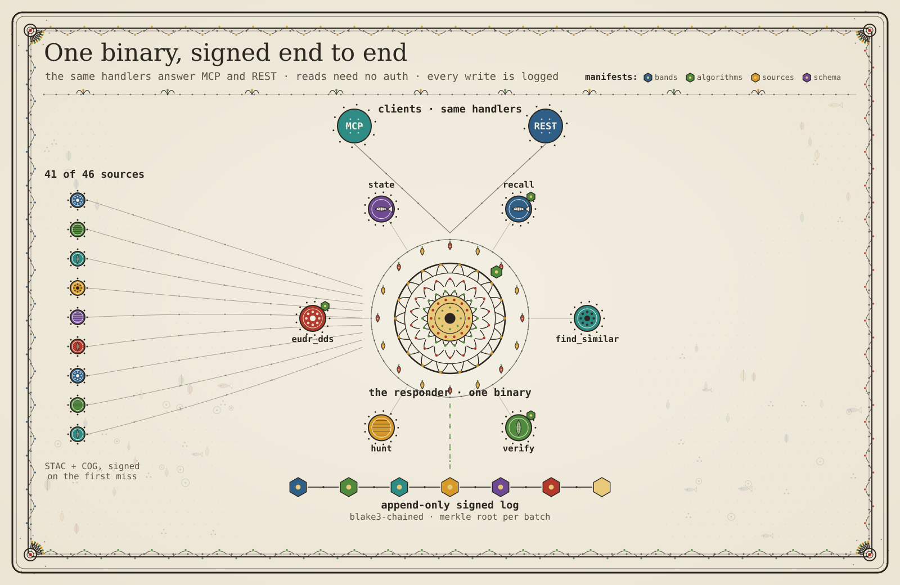

# emem architecture

This page gives the system model of an emem node at version 2.4.4. It
covers the process, the 19 workspace crates, the data, trust and fetch
planes, the auto-materialize loop and the files on disk. Other pages
give more detail:

| Page | Subject |
|------|---------|
| [protocol.md](../protocol.md) | Byte rules: CBOR, CIDs, preimages |
| [agents.md](../agents.md) | How an agent calls emem |
| [operating.md](../operators/operating.md) | How to deploy and run a node |
| [whitepaper-v2.md](../whitepaper-v2.md) | The math and the design reasons |

Counts on this page that can change carry the date of the check. Live
counts come from https://emem.dev on 7 November 2026.

## The shape of the system

One Rust binary, `emem-server`, listens on one port (default
`0.0.0.0:5051`). It serves two surfaces:

- HTTP REST. `/openapi.json` lists 194 paths, 183 of them under `/v1/`
  (7 November 2026).
- MCP JSON-RPC at `POST /mcp`. The registry has 116 tools: 18 core
  and 98 extended. `tools/list` on `/mcp` gives the 18 core tools.
  `tools/list` on `/mcp/full` gives all 116.

No GPU or model sidecar runs. Earlier versions ran Clay, Prithvi,
Galileo and JEPA-v2 on a sidecar. Facts that those models signed still
verify.

The node stores facts in a redb file and a sled database, and it
writes an append-only Merkle log on local disk. Its identity is a
32-byte Ed25519 secret at `<EMEM_DATA>/identity.secret.b32` (mode
0600). The node publishes the public key at `/.well-known/emem.json`,
so any client can verify receipts offline.

Place lookup uses only open data that the binary carries or reads
without a key:

- The binary embeds the GeoNames cities-1000 gazetteer (CC-BY-4.0,
  169 051 populated places), and GeoNames country, admin 1, admin 2
  and admin 3 tables (`crates/emem-fetch/data/`).
- Overture `divisions/division_area` gives admin polygons over
  anonymous S3 (ODbL).
- Photon, then Nominatim, answer the long tail.

Field boundaries (`/v1/field_boundaries`, and `include:["ftw_fields"]`
on `/v1/recall_polygon`) come from the Fields of The World global
product. It has about 3.17 billion field polygons (CC-BY-4.0). The node
reads them with PMTiles range reads.


*The whole stack in one figure. The text diagram below shows the same shape.*

## Process topology

```
+------------------------------------------------------------------+
|                         emem-server (Rust)                       |
|                                                                  |
|  +---------------+   +-----------------+   +------------------+  |
|  |  axum router  |-->|   primitives    |-->|     storage      |  |
|  |  /v1/*  /mcp  |   | recall, etc.    |   | cache+log+ident  |  |
|  +-------+-------+   +--------+--------+   +--------+---------+  |
|          |                    |                     |            |
|          |                    |                     v            |
|          |                    |            +-----------------+   |
|          |                    |            | facts.redb      |   |
|          |                    |            | cache.sled      |   |
|          |                    |            | log/merkle.log  |   |
|          |                    |            +-----------------+   |
|          |                    v                                  |
|          |           +-----------------+                         |
|          |           |  fetch          |--> HTTPS range / S3 /   |
|          |           |  Dispatcher     |    JSON REST (S2,       |
|          |           +-----------------+    Cop-DEM, MODIS, ...) |
+------------------------------------------------------------------+
```

At boot the router builds `AppState = Arc<Server>`
(`emem-storage::server::Server`). `Server` owns the `Storage` trait
object, a `ResponderIdentity` (Ed25519) and `ManifestCids` (registry,
schema, bands, sources). Each primitive call gets `&Server` and returns
a signed `Receipt`.

## Crates (19)

The workspace `Cargo.toml` lists 19 members. `crates/zstd-0.13-compat`
is a patch target, not a member.

| Crate | Role |
|-------|------|
| emem-api-rest | HTTP and MCP router, `AppState`, inline materializers, physics solvers |
| emem-fetch | Upstream connectors, gazetteers and fetch utilities (see [The fetch plane](#the-fetch-plane)) |
| emem-primitives | Read primitives (recall, find_similar, trajectory, compare, diff, verify, query_region), memory, entities, derive |
| emem-core | Registries and core types: bands, algorithms, functions, sources, topics, schema, taxonomy, manifest, tslot, cell |
| emem-cli | 10 binaries: `emem`, `emem-server`, `emem-sled-slim`, `emem-demo`, `emem-livedemo`, `emem-realdemo`, `emem-connect-demo`, `emem-purge-fnkey`, `emem-demo-device`, `emem-ask-eval` |
| emem-storage | `MaterializingStorage` (cache, fetch and log together), `Server`, `AttesterRegistry`, `AttestationLog` |
| emem-mcp | MCP tool registry (116 tools) |
| emem-codec | cell64, cid64, tslot text, vec64, Hilbert curve, geo, alphabet |
| emem-cache | Hot store: redb for facts, sled for memory trees and side indexes |
| emem-intent | `Intent` enum (8 variants) and a rule-based planner |
| emem-fact | `Fact`, `Receipt` and `Attestation` CBOR types, signing |
| emem-attest | Merkle roots and paths, receipt and attestation preimages |
| emem-claim | `Claim` predicate (band, `Op`, value, tslot; no signature) |
| emem-cubes | AgriSynth `.npz` loader and Lance index reader |
| emem-trace | Device execution trace schema (`emem.os_trace.v1`) and its verifier |
| emem-guard | Verdict server for AI inference hooks; a separate binary |
| emem-airgap | Air-gapped node: a folder in, a folder out, no network |
| emem-scorecard | Memory benchmark scorecard against a local node |
| emem-sleep-agent | Opt-in agent that merges contradicted memory into new signed notes |

`emem-storage` holds the system together. `MaterializingStorage`
connects the cache to the fetch `Dispatcher` and to the
`AttestationLog`. Primitives use only its `Storage` trait.

## Invariants

- **CID rule.** `FactCid = base32_nopad_lower(blake3(canonical_cbor(fact)))`.
  It is the full 32-byte digest, 52 characters. The 16-byte rule (26
  characters) applies only to `entity_cid` and `bundle_cid`. Those
  anchor a reference and do not bind a whole body. This page stated the
  16-byte rule for facts until 2026-08-13.
- **Receipt rule.** Each primitive response carries a `Receipt` with an
  Ed25519 signature over the canonical preimage. An empty `cells` or
  `fact_cids` list still writes its segment, so a verifier rebuilds the
  same bytes.
- **Tempo rule.** The node does not serve a band at a tempo finer than
  the cadence in `bands-v0.json`.
- **Sensor-tier rule.** An algorithm with a delivery resolution of 10 m
  or finer must declare an S1, S2 or Landsat input in
  `variance_sources`.
- **Verify on write.** `MaterializingStorage::put_attestation` rebuilds
  the Merkle root from the facts and checks the signature. The cache and
  the log never get a rejected attestation.
- **No silent fallback.** Empty results, missing functions and
  timeouts come back as a typed Absence or a structured error. The node
  never returns a zero in place of a value.

## The data plane

### Fact lifecycle

Each value has one of three `Fact` variants
(`emem-fact/src/fact.rs`): `PrimaryFact`, `DerivativeFact` or
`NegativeFact`. Two encodings of the same fact give the same CID, so
cache hits use content addresses from end to end.

```
Upstream source --> fetch connector --> materializer --> PrimaryFact
                                                            |
                                                            v
                                              ciborium canonical CBOR
                                                            |
                                                            v
                                                blake3 -> FactCid (52 chars)
                                                            |
                                                            v
                                          Attestation { facts, batch_root,
                                                       attester, signature,
                                                       registry_cid, schema_cid }
                                                            |
                                              +-------------+--------------+
                                              v             v              v
                                          facts.redb    merkle.log     fact_proofs
                                          (index +      (segment       (per-cid
                                           facts)       + fsync)       Merkle path)
```

The hot store has two tables. Since the redb cutover they live in
`<EMEM_DATA>/facts.redb` (`emem-cache/src/redb_facts.rs`):

- `emem.canonical_index`: `cell\0band\0tslot_be8` to the fact CID bytes.
- `emem.facts`: the fact CID bytes to the canonical CBOR of the fact.

The same redb file holds `emem.fact_proofs`, `emem.multi_attester_index`
and `emem.state_records`. On a miss the node falls back to the old sled
trees until the background backfill has copied them.
`EMEM_HOT_BACKEND=sled` goes back to the old layout. The sled database
stays open in both modes, because the memory trees and the small side
indexes (attesters, entities, trace gate) live there.

`MaterializingStorage` (`emem-storage/src/lib.rs`) writes one Merkle
inclusion proof for each fact when it writes the attestation. A receipt
can then carry a path from the fact to the batch root.

### Recall path

```
POST /v1/recall {cell, bands?, tslot?}
  -> router: resolve_cell_field (place name -> cell64)
  -> recall: scan_cell(cell, tslot) or lookup_canonical_many(keys)
  -> storage: prefix scan or point gets -> fact_cids
  -> storage: get_facts_many(fact_cids) -> facts
  -> sign_receipt("emem.recall", [cell], cids, ...)
  -> router: blake3(sorted fact_cids) -> ETag
  -> 200 JSON + ETag + Cache-Control: private, max-age=60
```

The router honours `If-None-Match`. A repeat recall with a matching ETag
gets `304 Not Modified` and an empty body. The `served_at` field of the
receipt changes on each call. The ETag comes from the fact CIDs, so it
does not change.

### Auto-materialize on a miss

`recall_with_auto_materialize` (`emem-api-rest/src/lib.rs`) runs
`recall` first. When a requested band has no fact, the node does these
steps:

1. `try_materialize_bands` finds the band in `band_materializer_meta`.
2. It calls the `materialize_*` function for that source. Examples are
   Open-Meteo, ORNL MODIS, NASA POWER, SoilGrids, FIRMS, CHIRPS and
   Sentinel-2 (STAC search, then COG reads).
3. It builds a `PrimaryFact`, or a `NegativeFact` (for example, over
   water).
4. It signs the fact as the responder and writes it to the cache, the
   log and the proof table.
5. It runs the recall again, which now hits the cache.

The response has the facts of the second recall and a
`materialize_notes[]` entry for each band.

Three rules select what to materialize:

1. The request names bands. Each named band with no fact is a
   candidate.
2. The request names no bands and the cell has no facts. The node
   fetches `copdem30m.elevation_mean` and `weather.temperature_2m`, so a
   bare `recall` returns something to cite.
3. The request names no bands and the cell has facts. The node does
   nothing.

Three environment variables control the loop:

| Variable | Default | Effect |
|----------|---------|--------|
| `EMEM_AUTO_MATERIALIZE` | on | `0` or `false` turns it off. |
| `EMEM_MATERIALIZER_TIMEOUT_SECS` | 14 | Time for one upstream call, from 2 to 240 seconds. |
| `EMEM_TIMEOUT_SECS` | 40 | Gateway timeout for a request, from 1 to 600 seconds. |

The responder key signs each materialized fact. Its
`derivation.fn_key` names the function that made the value.

On 7 November 2026, `GET /v1/materializers` lists 113 bands. The
`agent_card` reports 115 materializer-wired band names. Most of them use
these prefix families: `s2.*`, `overture.*`, `weather.*`, `era5.*`, `cams.*`,
`marine.*`, `power.*`, `terraclimate.*`, `modis.*`, `geotessera.*`,
`hansen.*`, `forest_change.*`, `soilgrids.*`, `firms.*`, `chirps.*`.
The dispatch table is `band_materializer_meta` in
`emem-api-rest/src/lib.rs`.

### find_similar (corpus scan)

`POST /v1/find_similar` reads the query vector. The vector comes inline
or from `load_cell_vec(key, band)`. The function then walks the whole
index. It applies the band filter and an optional `Claim` predicate,
loads each candidate and scores it by cosine. It keeps one result for
each cell and signs the top k as `emem.find_similar`. The router adds
latitude and longitude, the nearest GeoNames place (up to 25 km) and
links (`deep_recall_url`, `scene_png_url`) to each neighbour.

The `Hamming` and `HammingThenRerank` modes branch before the full
vector loads. In a binary-only mode the f32 vector never enters the
scoring loop. When a cell has the cosine band and no binary band, the
code derives `bin128` inline with the TurboQuant rotation (seed
`emem.binary_embedding.turboquant.v1`). It does not return
`CidNotFound` in that case. A cache for each cell stops the `Claim`
filter from scanning one cell again for each tslot.

`HammingThenRerank` sets its oversampling factor from an exponential
moving average of `|hamming_top_k ∩ cosine_top_k| / k`. The average
uses lock-free `AtomicU64` storage, decay 0.05 and a warm-up of about
50 calls. Before warm-up the factor is 4.

When the query cell has no vector for the band, `find_similar` returns
`ErrorCode::CidNotFound`. The hint names the bands that the cell does
have.

emem.dev no longer computes the embedding band. Its index holds only
the vectors that it stored before.

### Verify on write

`MaterializingStorage::put_attestation` selects the hash rule from
`att.preimage_version`:

| Version | Leaf | Node | Signature over |
|---------|------|------|----------------|
| 0 (legacy) | `blake3(leaf ‖ leaf)` | `blake3(left ‖ right)` | `blake3(batch_root ‖ registry_cid ‖ schema_cid)` |
| 1 | `blake3(0x00 ‖ leaf)` | `blake3(0x01 ‖ left ‖ right)` | `attestation_preimage_v1` |

Each leaf is the BLAKE3 of the canonical CBOR of one fact, or an edge
digest. The function sorts the leaves bytewise. An odd layer pairs its last
node with itself. Version 1 rejects a batch with two equal leaves,
because `root([A,B,C])` equals `root([A,B,C,C])`. Then the function
compares the root with `att.batch_root` and checks the signature with
`verify_strict` against the attester key.

A failure returns `StorageError::AttestationInvalid` with the reason.
On success the storage does four writes:

1. `cache.put_many`, the index and the fact bodies.
2. `log.append`, the CBOR record, its hash and an fsync.
3. `persist_fact_proofs`, best effort.
4. `attesters.record_attestation`, best effort.

A failure in step 3 or 4 does not fail the write. The verifier gates
steps 1 and 2.

## The trust plane

`load_or_create_identity` in `emem-cli/src/bin/emem-server.rs` selects
the responder key in this order:

1. The `EMEM_SECRET_B32` variable (32-byte Ed25519 secret, base32
   without padding, lowercase).
2. The file `<EMEM_DATA>/identity.secret.b32`, if it exists.
3. A new key, written to that file with mode 0600.

`EMEM_DATA=:memory:` writes nothing to disk, so the key changes at each
restart.

The public key is at `/.well-known/emem.json`. A client verifies a
receipt offline with it and does not contact the responder again.

### Receipt signing

The signer (`sign_receipt_v1_inner` in `emem-storage/src/server.rs`)
and each verifier call the same function,
`emem_attest::receipt_preimage_v2` (`emem-attest/src/lib.rs`). So the
two cannot drift. The function builds a tagged, length-prefixed
preimage:

- The domain prefix is `emem.preimage.v1\x00 || u32-LE(len("receipt")) || "receipt"`.
- A scalar segment is `tag:u8 || u32-LE len || bytes`.
- A list segment is `tag:u8 || u32-LE count || (u32-LE len || bytes)*`.

| Tag | Field | When present |
|-----|-------|--------------|
| `0x01` | request_id | always |
| `0x02` | served_at | always |
| `0x03` | scope_hex | when set |
| `0x04` | as_of_hex | when set |
| `0x05` | edges_hex | when set |
| `0x06` | manifest_hex | when set |
| `0x07` | primitive | always |
| `0x08` | cells | always |
| `0x09` | fact_cids | always |
| `0x0a` | field_hex | when set |
| `0x0b` | merkle_hex | always |

The BLAKE3 of the preimage is the 32-byte digest. These receipts carry
`preimage_version: 2`.

Segment `0x0b` makes a removed proof detectable, so it is always
present. It holds the BLAKE3 of a `"merkle"` sub-preimage over root,
leaf_index, path and rule_version. When the receipt has no proof, it
holds an explicit ABSENT marker. Without the segment, a proof
removed in transit would hash the same as a receipt that never had one.
That was the version 1 behaviour.

Receipts signed under version 1 and version 0 stay valid under their
own rule. Select the rule from the `preimage_version` of the receipt,
not from the current version. A receipt with no `preimage_version`, or
0, uses the legacy pipe rule. `POST /v1/verify_receipt` still accepts
it.

The responder signs the digest with its `ed25519_dalek::SigningKey`. A
verifier calls `vk.verify_strict(digest, sig)`. `GET /v1/verifier_spec`
serves the segment table that the code generates. Use it as the source
of truth.

`Cost.was_cached` is `true` when the store served the read. The
primitives sign every read as cached, find_similar included. The REST
recall handler sets it to `false` when a requested band missed the
cache (`lib.rs`, after the materialize step). `cost` is not part of the
signed preimage, so this change does not break the signature.

### In-browser verification

`/verify` and `/verify/:cid` serve `web/verify.html`. The page loads
`/emem-verify-core.js` from the same node. That file bundles
`@noble/hashes` 1.5.0 (BLAKE3) and `@noble/curves` 1.6.0 (Ed25519). The
page rebuilds the canonical preimage from the receipt fields and checks
the signature in the browser. The server check of the same receipt is
`POST /v1/verify_receipt`.

### Merkle inclusion proofs

`persist_fact_proofs` writes one `MerkleProof { leaf_index, path, root }`
for each fact, keyed by FactCid, into the `emem.fact_proofs` table. It
uses the same hash version as the attestation. `Server::sign_receipt`
reads the proof of the first cited fact and puts it in
`receipt.merkle_proof`. A verifier with the responder public key gets
each other CID from the signed receipt, so one inclusion anchor is
enough.

### Append-only Merkle log

`AttestationLog` (`emem-storage/src/merkle_log.rs`) writes to
`<EMEM_DATA>/log/merkle.log.{0,1,...}`:

- Record format: `[u32_LE len][CBOR bytes][32-byte blake3(CBOR)]`.
- Segment cap: 1 GiB (`SEGMENT_BYTES = 1 << 30`). A new segment opens
  at the cap.
- Each sealed segment ends with `segment_hash = blake3(all_records)`.
- `append()` calls fsync before it returns.
- `verify()` hashes each sealed segment again and reports mismatches.

The node also keeps an RFC 6962 transparency log with a signed tree
head at `GET /v1/log/sth`. [federation.md](../federation.md) describes
it.

### Reputation tracking

`AttesterRegistry` (`emem-storage/src/attesters.rs`) keeps a sled tree,
`emem.attesters`. For each public key it stores `attestations`,
`facts`, `citations`, `unique_cells`, `first_seen`, `last_seen` and
`last_cited`. Each attestation updates the record with an atomic
compare-and-swap. The score is
`citations * 1.0 + ln(1 + facts) * 8.0 + ln(1 + attestations) * 4.0`.
An error in the tracker never fails a read or a write.

## The fetch plane

`emem-fetch::Dispatcher` has no state. `register_default_https`
registers three connectors:

- `HttpsConnector` for `HttpsGeotiff`.
- `HttpsConnector` for `HttpsCogVsicurl`. It sends
  `Accept-Encoding: identity`, so `Range` offsets match the original
  GeoTIFF.
- `GcsConnector` for `GcsCog`. It changes `gs://` to
  `https://storage.googleapis.com`.

The `ConnectorKind` enum (`emem-core/src/sources.rs`) also has
`IpldCid`, `StacPc`, `HttpsJsonApi`, `ParquetS3` and `GpuSidecar`.
`GpuSidecar` stays only so that the sources registry still parses; no
client for it ships. The HTTPS client keeps idle connections for 90 s,
at most 8 for each host. An HTTP 429 becomes `FetchError::RateLimited`
with the `Retry-After` value.

Two groups of code make live facts.

**Modules in `emem-fetch/src/`** (37 files on 7 November 2026):

| Group | Modules |
|-------|---------|
| Data sources | `chirps`, `copernicus_dem`, `dmsp_ols`, `esa_cci_biomass`, `esa_worldcover`, `firms`, `ftw`, `gmrt`, `hansen_gfc`, `jrc_gfc2020`, `jrc_gsw`, `jrc_tmf`, `koppen`, `opera_dist`, `overture`, `parcels`, `radd_alerts`, `terraclimate`, `wdpa`, `worldpop`, `wri_gdm_drivers` |
| Places and boundaries | `admin1`, `admin2`, `admin3`, `countries`, `geonames`, `pois`, `wikidata` |
| Scene search | `stac` (Element84 and Microsoft Planetary Computer, input to the Sentinel materializers) |
| Support | `cache_window`, `cog`, `connectors`, `latency`, `proj`, `template`, `tile_store`, `lib` |

In the support group, `cache_window` joins fetches that are in flight.
`cog` is a pure-Rust COG range reader (Deflate, LZW, predictors 1 to 3,
8, 16 and 32-bit little-endian). `proj` converts WGS84 to UTM, and
`tile_store` keeps local raster copies.

**Inline materializers in `emem-api-rest/src/lib.rs`** also make live
facts. They live in the router crate. This is design debt. The
file has 47 `async fn materialize_*` functions on 7 November 2026.
Examples are `materialize_ornl_modis_band`, `materialize_power_band`,
`materialize_weather_current`, `materialize_cams_band`,
`materialize_era5_band`, `materialize_marine_band`,
`materialize_soilgrids_band`, `materialize_firms_active_fires`,
`materialize_chirps_daily_precip`, `materialize_gmrt_band`,
`materialize_sentinel2_band`, `materialize_sentinel1_vv`,
`materialize_jrc_gsw_layer`, `materialize_esa_worldcover_2021` and
`materialize_koppen`.

`sources-v0.json` declares 46 source schemes. Five have no
materializer: `dynamic_world.v1`, `openet.30m.daily`,
`tropomi.s5p.ch4`, `tropomi.s5p.no2` and `viirs.dnb.monthly`. A recall
of their bands returns a typed `MaterializeMiss` Absence.

## The physics solvers

The physics solvers in `crates/emem-api-rest/src/physics.rs` run in
the process:

- `/v1/heat_solve`: FTCS 2D heat solver on a 3×3 stencil of MODIS
  `lst_day_8day`, CFL safety factor 0.20.
- `/v1/wave_solve`: CTCS 1D shallow-water solver along a seaward
  profile. It rejects a land-locked cell and returns the profile and a
  suggestion.
- `/v1/jepa_predict`: closed-form NDVI AR(2) with fixed coefficients.

[inference.md](inference.md) gives the details.

## The agent surface

REST and MCP serve the same primitives. `POST /mcp` is JSON-RPC 2.0,
from `crates/emem-mcp/src/lib.rs` (116 tools). `tools/list` on `/mcp`
gives the 18 core tools. `tools/list` on `/mcp/full` gives all 116.
Both endpoints run any tool by name through `tools/call`.

MCP is not read-only. It has signed writes, for example
`emem_memory_create`, `emem_derive`, `emem_entity` and `emem_backfill`.
Raw attestations (`POST /v1/attest`, `POST /v1/attest_cbor`) are REST
only.

These well-known endpoints publish what the node can do:

| Path | Content |
|------|---------|
| `/.well-known/emem.json` | Responder public key and service URLs |
| `/.well-known/mcp.json` | MCP transport |
| `/.well-known/agent-card.json` | Agent card with the tool order |
| `/.well-known/agent.json` | Agent card (alias path) |

A new client usually calls these in order:

1. `GET /v1/agent_card`: the tool order to use.
2. `GET /v1/manifests`: the CIDs of bands, algorithms, sources, schema,
   registry and topics.
3. `GET /v1/grid_info`: the cell grid (about 10 m at the equator).
4. `GET /v1/data_availability`: which bands have history.
5. `POST /v1/locate {"place":"<place>"}`: place to cell64. The lookup
   first tries the embedded tables: named regions, countries, admin 1
   to 3, GeoNames cities-1000 and POIs. Then it tries the geocode
   cache, Photon and Nominatim (`lib.rs::locate_inner`). Polygons come
   from Overture
   `divisions/division_area`.
6. `POST /v1/recall`, `/v1/find_similar`, `/v1/verify` or `/v1/diff`.

`GET /v1/tools` lists the REST endpoints by category. `/openapi.json`
has the full schema.

`/v1/recall_many` accepts up to 256 cells in one request. Each cell has
its own signed receipt, so a check of one receipt covers only that cell.

## Storage layout on disk

The data directory is `<EMEM_DATA>/` (default `./var/emem`). The table
of files and directories is in
[self-host.md](../self-host.md#what-is-in-the-data-directory). The main
items are:

```
<EMEM_DATA>/
  identity.secret.b32      0600, Ed25519 secret, base32 without padding
  facts.redb               fact index, fact bodies, fact proofs
  cache.sled/              memory trees, attesters, side indexes
  log/merkle.log.{0,1,...} append-only segments, 1 GiB cap each
  geocoder.sled/           place lookup cache
  tile_store/              local raster copies (EMEM_TILE_STORE_GB)
  lance/                   vector indexes for find_similar and memory search
  acme.cache/              Let's Encrypt state, when TLS is on
```

`EMEM_DATA=:memory:` keeps nothing on disk. The node uses a temporary
store and makes a new Ed25519 key at each start, and it keeps no log.
Receipts from such a process verify only until it restarts.

## Failure modes

| Trigger | Response |
|---------|----------|
| Lock on `cache.sled/` | The server holds an exclusive lock. Stop the server before you run tools such as `emem-purge-fnkey`. |
| Materializer timeout (`EMEM_MATERIALIZER_TIMEOUT_SECS`, default 14 s) | The recall returns the facts it has and a `materialize_notes[]` entry `{band, status:"skipped", reason, reason_class:"timeout", retryable:true, absence:false}`. A timeout is unknown, not a confirmed absence, so the node signs nothing. A true "no data here" returns `status:"materialized"` with a signed Absence `fact_cid`. |
| Attestation rejected | `StorageError::AttestationInvalid` with the reason (root mismatch or bad signature). The cache and the log do not change. |
| Upstream 502 or 503 | `FetchError::Transport`. The materializer returns the error, or signs a `NegativeFact` with a `ReasonCid` (for example, Cop-DEM over water). |
| `EMEM_SCAN_CELL_LIMIT` reached (default 10 000 rows per prefix walk) | The node logs `scan_cell_limit_hit` with target `emem::storage`. A normal cell has one fact for each band and tslot, so the limit points to a schema error or an attack. |
| Topic router warm-up takes more than 90 s | The server starts. The first `/v1/ask` call can wait until the router is ready. |
