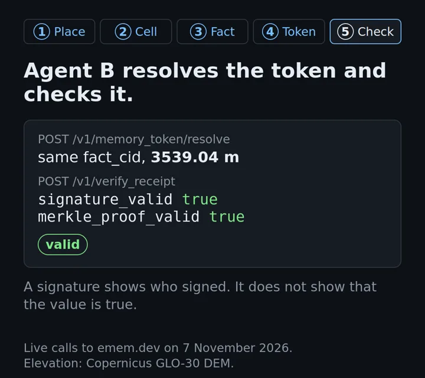
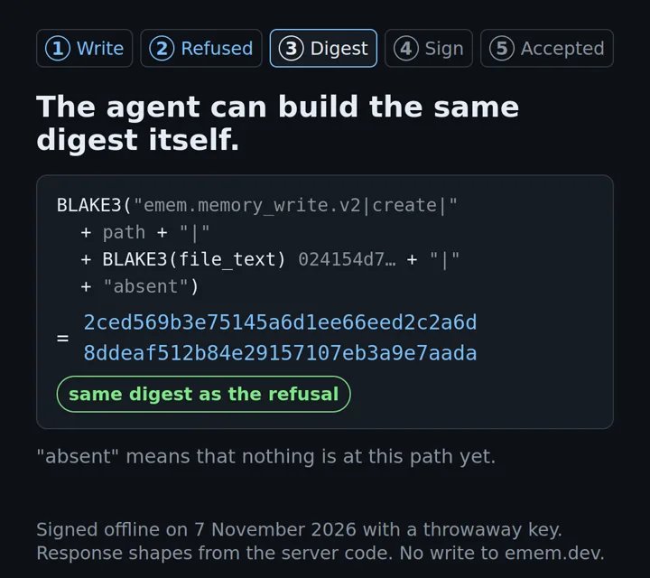
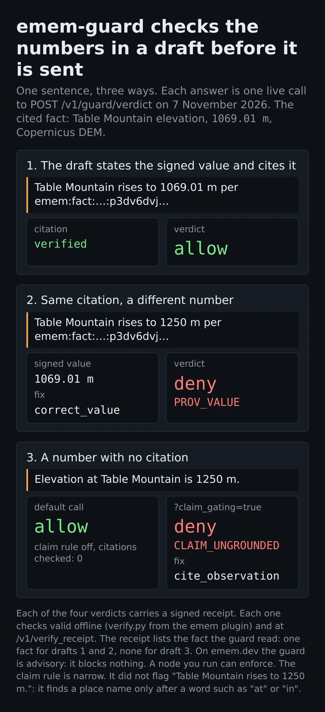

# emem in pictures

Each picture on this page answers one question about emem. The values come from live calls to emem.dev on
7 November 2026, or from the code. Read the pictures in order. They follow one fact from a place name to a check
by a second agent, then show notes, the guard and `/v1/ask`. Each section links to the page that explains it.

The rules for these pictures are in [visual-language.md](visual-language.md). The scripts and the saved
responses are in [stills/src/](stills/src/) and [films/src/](films/src/).

## What is emem, in one live fact?

A place name becomes a cell. emem signs a fact at that cell. Another agent gets a token and checks it offline.

<picture>
<source media="(max-width: 700px)" srcset="stills/one-token-hero-phone.webp">

</picture>

More: [intro.md](../intro.md).

## Do two names for one place give the same cell?

Only when they resolve to the same point. A different point can give a different cell and a different value.

More: [start-here.md](../start-here.md).

## What does one recall return at one cell?

It returns the signed facts at the cell, from several sources, with one receipt over all the fact ids.

More: [agents.md](../agents.md).

## If one bit of a fact changes, does its id change?

Yes. The id is the BLAKE3 hash of the canonical CBOR bytes of the fact.

Silent film, 33 seconds. Select the picture to play the MP4, or get the [WebM](films/emem-one-byte.webm).
More: [whitepaper.md](../whitepaper.md), section 5.

## What bytes does a receipt signature cover?

A fixed header and the receipt fields, in a set order. A change of one character makes the check fail.

More: [protocol.md](../protocol.md), section 7.2.

## Can a second agent check a fact from a token?

Yes. It resolves the token and checks the receipt offline. It does not have to trust the first agent.

Silent film, 33 seconds. Select the picture to play the MP4, or get the [WebM](films/emem-fact-to-check.webm).
More: [start-here.md](../start-here.md).

## Is this fact in the log, and does the log only grow?

An inclusion proof shows the entry under a signed tree head. A consistency proof shows that a later head
extends an earlier one.

![The Mount Fuji elevation fact, 3539.04 m, was signed in a batch of one fact. That batch is entry 2,463,431 of 3,248,898 in the log. A ladder of 22 bars shows its audit path: each bar is one hash, covering from 1 entry at the bottom to 2,097,152 entries at the top. The root computed from them matches the signed tree head of size 3,248,898, and the Ed25519 signature is valid. One character changed in hash 10 gives a different root, and inclusion is invalid. Below, a 14-hash consistency proof links the head of size 3,248,892 (09:28:13 UTC) to the head of size 3,248,898 (09:28:53 UTC): valid.](stills/log-proof.webp)

More: [protocol.md](../protocol.md). The film [emem-log-climb.mp4](films/emem-log-climb.mp4) climbs the same
audit path one hash at a time.

## Can a second agent check a bundle of facts?

Yes. One bundle token names many facts. The second agent resolves each one and checks each receipt.

More: [emem-in-depth.md](../emem-in-depth.md).

## How does a refused note write become an accepted one?

The refusal gives the digest to sign. The agent builds the same digest, signs it with its own key and sends
the write again.

Silent film, 35 seconds. Select the picture to play the MP4, or get the [WebM](films/emem-note-write.webm).
The film wrote nothing to emem.dev. More: [memory.md](../memory.md).

## When does the guard deny a draft?

It denies a draft that states a value different from the fact it cites. By default it allows a draft with no
citation. With `claim_gating` true, it denies that draft.

More: [agents.md](../agents.md).

## Which stages are behind one `/v1/ask` answer?

Four stages: located, routed, recalled and scored. Each stage has an address that commits to the stage before it.

More: [agents.md](../agents.md).

## What these pictures do not prove

A valid signature shows which key signed the bytes. It does not show that the value is true. Values from
weather or new scenes can change after 7 November 2026. To check the pictures against emem.dev again, run
`python3 docs/media/stills/src/recheck.py` from the repository root.
