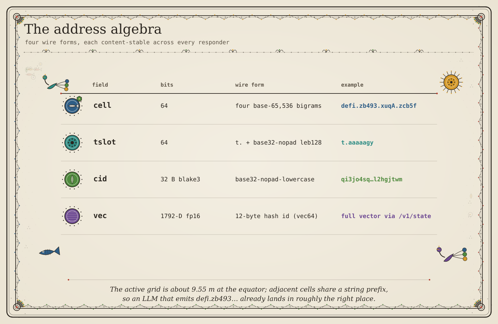
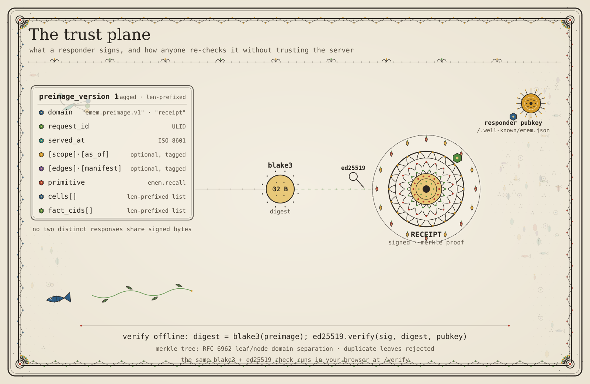

# emem protocol (v1.2.1)

This page defines the bytes on the wire. Use it to build a client, a
verifier or a second responder in another language. The formal object,
the property table and the memory algebra are in
[the memory model](model.md).

## What this document promises

If you follow this page line by line, your code makes receipts that are
byte-identical to the Rust responder. This is true when both use the
same registry CIDs.

The source code is the reference. If this page and the code do not
agree, the code is correct and this page has a bug. The code is in
`crates/emem-codec`, `crates/emem-fact`, `crates/emem-attest` and
`crates/emem-storage`. Each encoding rule gives the file and the line
that defines it. Line numbers move when the code changes. If a line
number is wrong, search the file for the function name.

## How to read this document

You do not have to read every section. Find your task in this table and
read the sections it names.

| Your task | Sections to read |
|---|---|
| Check one receipt now, with no code to write | [Check your first receipt](#check-your-first-receipt) |
| Check a receipt that a responder gave you | [§7 Receipt](#7-receipt), then the Python verifier in [§7.4](#74-offline-verification-python) |
| Check that a fact is in a signed batch | [§8 Merkle inclusion proof](#8-merkle-inclusion-proof) |
| Check that a fact or a memory note is in the transparency log | [§9.6 Transparency log](#transparency-log), then the steps in [§9.6.1](#961-check-an-inclusion-proof-by-hand) |
| Check that the log only grew since a head you kept | The steps in [§9.6.1.1](#9611-check-a-consistency-proof-by-hand) |
| Check a witness co-signature on a tree head | The steps in [§9.6.2.1](#9621-check-a-witness-co-signature-by-hand) |
| Calculate a `fact_cid` from a fact | The steps in [§5.5](#55-recompute-a-fact_cid-by-hand), then [§3 CID](#3-cid-and-factcid) and [§4 CBOR](#4-cbor-canonicalisation) for the rules |
| Change a latitude and a longitude into a cell64 | [§1 Cell64](#1-cell64-the-spatial-primitive) |
| Change a time into a tslot | [§2 Tslot](#2-tslot-temporal-addressing) |
| Sign a memory write | [§7.5 Signed memory writes](#75-capability-binding-for-memory-writes) |
| Check who wrote a memory note | The steps in [§7.5.1](#751-check-a-notes-authorship-by-hand) |
| Check what the responder read from a url or a file range | [§9.7](#97-signed-readings-of-things-emem-did-not-measure), then the steps in [§9.7.1](#971-check-a-range_hash-receipt-by-hand) |
| Prove that one chunk or file is in a pointer or directory note | [§9.8](#98-merkle-trees-inside-notes-ememtree) |
| Choose which token to cite, and know what it binds | [The tokenverse](#the-tokenverse) |
| Test your own encoder or verifier | [§12 Conformance gates](#12-conformance-gates-the-four-cids), [§13 Test vectors](#13-test-vectors) |

To check a receipt, a note or a log proof with no code of your own, use a
verifier from the Claude Code plugin. Each plugin script uses only the
Python standard library. Each section in the table shows how to run it.

| Check | Script in `plugins/emem/skills/` | Section |
|---|---|---|
| Receipt signature | `emem-verify-receipt/scripts/verify.py` | [§7.4](#74-offline-verification-python) |
| Note authorship | `emem-multi-agent-handoff/scripts/verify_note.py` | [§7.5.1](#751-check-a-notes-authorship-by-hand) |
| Signed tree head, inclusion or consistency proof | `emem-transparency-log/scripts/verify_log.py` | [§9.6.1](#961-check-an-inclusion-proof-by-hand), [§9.6.1.1](#9611-check-a-consistency-proof-by-hand) |
| Witness co-signature | None. Use the script in the section. It needs `blake3` and `pynacl`. | [§9.6.2.1](#9621-check-a-witness-co-signature-by-hand) |

The words cell64, tslot, fact, receipt and responder have one meaning
each. The [glossary](glossary.md) gives it.

## Check your first receipt

Do this before you read the formal sections. It takes four commands and
needs no key and no package. Run them from the root of a clone of this
repository.

1. Get a signed answer. This recall reads the elevation of one cell:

   ```sh
   curl -s -X POST https://emem.dev/v1/recall -H 'content-type: application/json' \
     -d '{"cell":"defi.zb592.nUkO.zEzE","bands":["elevation"]}' > recall.json
   ```

2. Check the signature offline. The script rebuilds the signed bytes
   from the receipt and checks them with the key on the receipt:

   ```sh
   python3 plugins/emem/skills/emem-verify-receipt/scripts/verify.py recall.json
   ```

   It prints `VALID`, the `digest` it rebuilt and the `signer` key.
   The digest changes with each answer. The output looks like this:

   ```text
   VALID
   preimage_v2:  328 bytes
   digest:       3ba3d0ff86ec0e63c873e94b3e73291dd50e07455e62ffcbf4d95389feae8cf1
   signer:       777er3yihgifqmv5hmc2wwmyszgddzderzhsx6rex4yoakwomvka
   primitive:    emem.recall
   cells:        1
   fact_cids:    1
   ```

3. Make sure that the signer is the emem.dev responder. Compare the key
   from step 2 with the published key:

   ```sh
   curl -s https://emem.dev/.well-known/emem.json \
     | python3 -c 'import json,sys; print(json.load(sys.stdin)["responder"]["pubkey_b32"])'
   ```

4. Optional: ask the responder to check the same receipt. Its digest
   must be equal to the digest from step 2:

   ```sh
   python3 -c 'import json; print(json.dumps({"receipt": json.load(open("recall.json"))["receipt"]}))' \
     | curl -s -X POST https://emem.dev/v1/verify_receipt -H 'content-type: application/json' -d @- \
     | python3 -c 'import json,sys; d=json.load(sys.stdin); print(d["valid"], d["preimage_blake3_hex"])'
   ```

On 7 November 2026 at 03:22 UTC, step 2 printed `VALID` and step 4
printed `True` with the same digest. The signer in step 2 and the key in
step 3 were both `777er3yihgifqmv5hmc2wwmyszgddzderzhsx6rex4yoakwomvka`.

To see a failure, change one signed field and run step 2 again:

```sh
python3 -c 'import json; d=json.load(open("recall.json")); d["receipt"]["served_at"]="2000-01-01T00:00:00Z"; json.dump(d, open("tampered.json","w"))'
python3 plugins/emem/skills/emem-verify-receipt/scripts/verify.py tampered.json
```

The script prints `INVALID` and a different digest, and exits with
status 1. [§7](#7-receipt)
tells which fields the signature covers and how to rebuild the digest
yourself.

---

## 1. Cell64: the spatial primitive

A cell64 is the name of one small square on the Earth. At the equator the
square is about 9.55 m on each side. Every point in the square gets the
same cell64, so two agents that ask about the same place get the same
address.

A Cell64 is a 64-bit integer that addresses a quantised lat/lng bucket on
the WGS-84 ellipsoid. The wire form is four base-65,536 digits joined by
dots, for example `defi.zb400.bafi.baba`. Hashes and comparisons use the
integer form. Facts and receipts contain the dotted text form.


*The full address pipeline in one picture. Section 4 walks each box; the SVG also names every constant the encoder uses.*

### 1.1 Bit layout

Defined in `crates/emem-codec/src/geo.rs:41-50`.

```
 bit  63           60 59         52 51         44 43 42         22 21          0
      +-------------+--------------+-------------+--+-------------+--------------+
      |  mode (4)   | resolution(8)|   base (8)  |R |  lat_q (21) |  lng_q (22)  |
      |   0b0001    |     21       |     0xab    |0 |             |              |
      +-------------+--------------+-------------+--+-------------+--------------+
```

| Bits | Field | Value | Purpose |
|------|-------|-------|---------|
| 63..60 | mode | `0b0001` | distinguishes cell from edge/vertex/set |
| 59..52 | resolution | `21` | encoded as the lat-axis bit count |
| 51..44 | base | `0xab` | "geo aperture" marker, separates this layout from H3-style cells |
| 43..43 | reserved | `0` | must be zero on encode; pass-through on decode |
| 42..22 | lat_q | 21 bits | quantised latitude, `[0, 2^21)` over the 180° range |
| 21..00 | lng_q | 22 bits | quantised longitude, `[0, 2^22)` over the 360° range |

The lat axis carries one fewer bit than the lng axis on purpose.
180° / 2^21 ≈ 360° / 2^22, so the bucket is square at the equator.
Each axis is about 9.55 m. The test `cell_pitch_at_equator_is_955m`
in `crates/emem-codec/src/geo.rs` pins this.
Equal bit counts would give 1:2-rectangular cells.

### 1.2 Encoding rule (lat/lng → Cell)

Defined in `crates/emem-codec/src/geo.rs:137-172`. The code below
removes the comments from the source:

```rust
pub fn cell_from_latlng(lat_deg: f64, lng_deg: f64) -> Cell {
    let lat = if lat_deg.is_finite() {
        lat_deg.clamp(-90.0, 90.0)
    } else {
        0.0
    };
    let lng = if lng_deg.is_finite() {
        ((lng_deg + 180.0).rem_euclid(360.0)) - 180.0
    } else {
        0.0
    };
    let lat_q = (((lat + 90.0) / 180.0) * GEO_LAT_MAX as f64).round() as u64 & GEO_LAT_MASK;
    let mut lng_q = (((lng + 180.0) / 360.0) * GEO_LNG_MAX as f64).round() as u64 & GEO_LNG_MASK;
    if lng_q == GEO_LNG_MAX {
        lng_q = 0;
    }
    let lng_q = if lat_q == 0 || lat_q == GEO_LAT_MAX {
        0
    } else {
        lng_q
    };
    let path = (lat_q << GEO_LNG_BITS) | lng_q;
    Cell::from_raw(GEO_PREFIX | path)
}
```

Constants (geo.rs:55-104):
`GEO_LAT_BITS=21`, `GEO_LNG_BITS=22`,
`GEO_LAT_MAX=(1<<21)-1=2_097_151`,
`GEO_LNG_MAX=(1<<22)-1=4_194_303`,
`GEO_RES=21` (resolution tag),
`GEO_BASE=0xab` (aperture marker),
`GEO_PREFIX = (1 << 60) | (21 << 52) | (0xab << 44) = 0x115a_b000_0000_0000`.

The encoder applies these rules in this order:

1. A latitude or a longitude that is NaN or infinite becomes `0.0`.
2. Latitude clamps to `[-90, 90]`.
3. Longitude wraps with `rem_euclid`, so `-181°` becomes `+179°`.
4. Quantisation is `f64::round` (round-half-away-from-zero).
5. Dateline rule: `lng_q == GEO_LNG_MAX` becomes `lng_q = 0`. Thus
   `+180°`, `-180°` and `179.99999999°` give the same cell.
6. Pole rule: on the two pole rows (`lat_q` is `0` or `GEO_LAT_MAX`),
   `lng_q` becomes `0`. Thus each pole has one cell.

`try_cell_from_latlng` (geo.rs:179) is the strict form. It returns an
error for an input out of range or not finite, and does not clamp.

### 1.3 Text form: 4 bigrams + dots

Defined in `crates/emem-codec/src/cell64.rs:14-24`. The code splits the 64-bit integer
into four 16-bit lanes (`d0=raw>>48`, `d1=raw>>32`,
`d2=raw>>16`, `d3=raw`, each masked to 16 bits) and each lane indexes
a 65,536-entry alphabet built deterministically in
`crates/emem-codec/src/alphabet.rs:22-46`:

- Consonants: `b c d f g h j k l m n p q r s t v w x y z` (21).
- Vowels: `a e i o u A E I O U` (10).
- Bigrams: outer product `c1·v1·c2·v2`, in that exact loop order →
  21 × 10 × 21 × 10 = 44,100 bigrams covering indices 0..44,099.
- Synthetic codepoints fill indices 44,100..65,535:
  `z<hex4>`, where `<hex4>` is the four-digit lowercase hex of the
  index itself.

Index → bigram is `O(1)` through `ALPHABET[i]`. Bigram → index is `O(1)`
through the precomputed reverse map `ALPHABET_INDEX`.

### 1.4 Worked example: lat=0.0, lng=0.0

Apply `cell_from_latlng`:

1. `lat_q = round(0.5 × 2_097_151) = 1_048_576` (round-half-away-from-zero).
2. `lng_q = round(0.5 × 4_194_303) = 2_097_152`.
3. `path = (1_048_576 << 22) | 2_097_152 = 0x0000_0400_0020_0000`.
4. `raw = GEO_PREFIX | path = 0x115a_b000_0000_0000 | 0x0000_0400_0020_0000
   = 0x115a_b400_0020_0000`.

The four 16-bit lanes are
`d0=0x115a (4442)`,
`d1=0xb400 (46080)`,
`d2=0x0020 (32)`,
`d3=0x0000 (0)`.

Index `i` in the structured-bigram region (0..44,099) decomposes as
`i = c1·2100 + v1·210 + c2·10 + v2` from `alphabet.rs`. Indices ≥
44,100 fall into the synthetic `z<hex4>` region.

- `d0 = 4442 = 2·2100 + 1·210 + 3·10 + 2` → `d e f i` → **`defi`**.
- `d1 = 46080` ≥ 44,100 → `"z" + "b400"` → **`zb400`**.
- `d2 = 32 = 0 + 0 + 3·10 + 2` → `b a f i` → **`bafi`**.
- `d3 = 0` → `b a b a` → **`baba`**.

Cell64 for `(lat=0.0, lng=0.0)` is

```
defi.zb400.bafi.baba
```

On 7 November 2026, `POST /v1/locate` on emem.dev with
`{"lat":0.0,"lng":0.0}` returned this cell64.

### 1.5 Decode rule (cell64 → lat/lng)

`latlng_from_cell64` (geo.rs:284-305) reverses the encode in four steps:

1. Parse the four bigrams with `from_cell64` (cell64.rs:62-75).
2. Reject the cell if `(raw & 0xFFFF_F000_0000_0000) != GEO_PREFIX`.
   This check stops legacy cells (see §1.7).
3. Unpack `lng_q = raw & GEO_LNG_MASK` and
   `lat_q = (raw >> 22) & GEO_LAT_MASK`.
4. Convert with `lat_deg = (lat_q/GEO_LAT_MAX)·180 - 90` and
   `lng_deg = (lng_q/GEO_LNG_MAX)·360 - 180`.

The bucket bbox extends `±half_lat / ±half_lng` from the centre. The
decoder clips the latitude of the bbox to `[-90, 90]`.

### 1.6 Round-trip and edge cases

The tests in `geo.rs:357-700` pin the contract. The polar clamp and the
longitude wrap are rules in the encoder (`geo.rs:141-150`), not tests.
`roundtrip_antimeridian` tests only the point (-30, 179.99).

| Case | Required result | Test in `geo.rs` |
|---|---|---|
| Two points 9e-6° apart (about 1 m) | The same cell. This is the grain of the cell, not a bug. | `cells_collide_under_1_metre` (444-448) |
| Two points 1.08e-4° apart (about 12 m) | Different cells | `cells_distinguish_12_metre_neighbors` (433-439) |
| `lng = 179.99` | Round-trips | `roundtrip_antimeridian` (424-426) |
| `lng = -181` | Wraps to `+179` | Encoder rule 3 in [§1.2](#12-encoding-rule-latlng--cell) |
| `lat = 95` | Clamps to `90` | Encoder rule 2 in [§1.2](#12-encoding-rule-latlng--cell) |
| Bucket at the equator | 8 to 12 m on each axis; the two axes agree to within 5% | `buckets_are_square_at_equator` (453-471) |
| `lng = +180`, `-180` and `179.99999999` | One cell | `dateline_collapses_to_single_cell` (495-501) |
| `lat = 90` with `lng` of `0`, `137.5` and `-42.7` | One cell. The same is true at `lat = -90`. The two pole cells are different. | `poles_collapse_lng_to_zero` (508-521) |

### 1.7 Legacy 16-bit grid: rejected

Pre-0.0.3 emem used a `GEO_RES = 12` (16-bit-per-axis, ~305 m) grid.
The current codec does **not** decode that encoding. The test
`legacy_16bit_grid_rejected` (`geo.rs:478-487`) makes a legacy-shaped raw word. It confirms that
`latlng_from_cell64` returns `Err(CodecError::NotGeoCell)`. The
resolution field changed (12 → 21) and `GEO_PREFIX_MASK` keys on it.
So legacy strings fail closed; they do not put a fact hundreds of
metres from its true place. A responder or client MUST NOT serve, accept,
or quietly upgrade legacy cell64 strings.

---

## 2. Tslot: temporal addressing

A tslot is the time part of an address. Each band has a cadence, for
example one hour for weather or one year for soil. The tslot counts how
many periods of that cadence have passed since 1 January 1970.

A `Tslot` is a `u64` bucket index of the Unix timeline at a band's
declared tempo cadence. Defined in `crates/emem-core/src/tslot.rs:19-21`.

### 2.1 Anchor: Unix epoch, not emem epoch

Pre-0.0.3 emem anchored tslot at `2026-01-01T00:00:00Z` (`EMEM_EPOCH_UNIX
= 1_767_225_600`). That broke history: every pre-2026 observation
collapsed to `Tslot(0)`. The current code (tslot.rs:64-76) computes

```
Tslot(unix_seconds.max(0) / tempo.slot_seconds())
```

The code keeps the constant `EMEM_EPOCH_UNIX` as protocol metadata only;
nothing in the encode path subtracts it. Pre-1970 (negative Unix)
inputs clamp to `Tslot(0)`.

### 2.2 Tempo class

Defined in `tslot.rs:23-43` (the enum) and `tslot.rs:49-62`
(`slot_seconds`). The enum has seven variants. The table shows where each variant is in use on 7 November 2026. The
"registry" column counts the entries of the `bands` list in
`crates/emem-core/data/bands-v0.json` that declare the variant. The list
has 43 entries. Each entry has a `key`. The `family` field is a different,
larger group (13 values), and the table does not count it. The
"materializer" column names bands whose `MaterializerMeta` in
`crates/emem-api-rest/src/lib.rs` uses it. `GET /v1/data_availability`
reports that tempo for each band.

| Variant | Serde name | `slot_seconds()` | Cadence | Registry entries (`key`) | Materializer examples |
|---------|------------|------------------|---------|------------------------|-----------------------|
| `Static` | `static` | 0 | never changes | 12, for example `dem`, `koppen`, `admin` | `copdem30m.elevation_mean`, `koppen`, `terraclimate.*` |
| `Slow` | `slow` | 31_536_000 | 365 d | 19, for example `geotessera`, `soilgrids`, `landcover` | `geotessera` vintages, `overture.*` |
| `Composite16Day` | `composite_16day` | 1_382_400 | 16 d | 0 | `modis.ndvi_mean` |
| `Composite8Day` | `composite_8day` | 691_200 | 8 d | 0 | `modis.lst_day_8day`, `modis.et_8day`, `modis.gpp_8day`, `modis.lai_8day` |
| `Medium` | `medium` | 2_592_000 | 30 d | 2: `climate`, `terraclimate` | `modis.burned_area_monthly` |
| `Fast` | `fast` | 86_400 | 1 d | 10, for example `sentinel2_raw`, `indices`, `air_quality` | Sentinel-2 bands and indices, `sentinel1_raw`, `power.*` |
| `UltraFast` | `ultra_fast` | 3_600 | 1 h | 0 | `weather.*`, `cams.*`, `era5.*`, `marine.*` |

The two columns can disagree. For example, the `terraclimate` entry is
`medium` in the registry, but `MaterializerMeta` gives `terraclimate.*`
bands `Static`. The doc comments on the enum in `tslot.rs` name older
sample bands. Use the table, not those comments.

`/v1/data_availability` writes the tempo without the underscore, for
example `composite16day` and `ultrafast`. A fact does not carry its
tempo. `bands-v0.json` uses the serde names in the table.

`Static` returns `Tslot(0)` regardless of input; the slot is
meaningless for a band that never refreshes. `to_unix_start` is the
inverse: the Unix second at which the slot opened.

### 2.3 Cadence overlap

```
seconds since 1970   ─────────────────────────────────────────────►
                     0                                            now

Static     [   one bucket forever                               ]
Slow       [365d][365d][365d][365d][365d][365d][365d][365d][365d]
Medium     |30d|30d|30d|30d|30d|30d|30d|30d|30d|30d|30d|30d|30d|
Fast       ||||||||||||||||||||||||||||||||||||||||||||||||||||||
UltraFast  ::::::::::::::::::::::::::::::::::::::::::::::::::::::

Sample-band cadences:
- Tessera annual:  one Slow slot per year         (Slow)
- MODIS NDVI:      one slot per 16-day composite  (Composite16Day)
- Open-Meteo:      one UltraFast slot per hour    (UltraFast)
```

### 2.4 Text form: `t.<base32-nopad-leb128>`

Defined in `crates/emem-codec/src/tslot_text.rs:9-13`. The code encodes
the integer as little-endian LEB128 (varint). Then it encodes the byte string
with `data_encoding::BASE32_NOPAD` and makes it lowercase.

```rust
fn to_tslot_text(t: Tslot) -> String {
    let mut buf = [0u8; 10];
    let n = encode_varint(t.0, &mut buf);
    format!("t.{}", BASE32_NOPAD.encode(&buf[..n]).to_lowercase())
}
```

Worked examples. The test at tslot_text.rs:70-76 uses these four values.
That test checks only that decode reverses encode. It does not check the
text. We checked the text below with Python's `base64.b32encode`:

- `Tslot(0)` → varint `[0x00]` → base32 `"AA"` → text `t.aa`.
- `Tslot(1)` → varint `[0x01]` → base32 `"AE"` → text `t.ae`.
- `Tslot(26)` → varint `[0x1A]` → base32 `"DI"` → text `t.di`.
- `Tslot(1024)` → varint `[0x80, 0x08]` → base32 `"QAEA"` → text
  `t.qaea`.

Decode inverts the chain (tslot_text.rs:16-23): strip `t.`, uppercase
the body, base32-decode, LEB128-decode.

---

## 3. CID and FactCid

A CID is the name of a block of bytes. A hash of the bytes makes the
name, so the same bytes always get the same CID. If one byte
changes, the CID changes. A `fact_cid` is the CID of one fact.

Facts and manifests use BLAKE3 over canonical CBOR. The text form of the hash bytes is
`data_encoding::BASE32_NOPAD`, in lowercase. Three lengths are in use:

| Form | Bytes | Chars | Source | Use |
|------|-------|-------|--------|-----|
| `cid64` | 8 | 13 | `crates/emem-codec/src/cid64.rs:9-11` | short visible ID for inline text |
| `entity_cid`, `bundle_cid` | 16 | 26 | `crates/emem-primitives/src/entity.rs:251` (`compute_entity_cid`), `crates/emem-primitives/src/memory_bundle.rs:159` (`compute_bundle_cid`) | a reference to an object, not a binding of its whole body ([§3.2](#32-factcid)) |
| `FactCid`, manifest CID | 32 | 52 | `crates/emem-cache/src/sled_hot.rs:813-820` (`fact_cid_of`), `crates/emem-core/src/manifest.rs:111-119` | durable storage and signing |

`fact_cid_of` hashes the fact's CBOR bytes once and keeps all 32 bytes.
A `cid64` is the first 8 bytes of a 32-byte CID like this one. An `entity_cid` and a
`bundle_cid` are not prefixes of any fact CID. Each hashes its own text
preimage (`emem.entity.v1|...` or `emem.memory_bundle.v1|...`) and keeps the
first 16 bytes.

### 3.1 cid64

```rust
pub fn to_cid64(cid: &[u8; 32]) -> String {
    BASE32_NOPAD.encode(&cid[..8]).to_lowercase()
}
```

8 bytes = 64 bits → `ceil(64/5) = 13` base32 characters. Decode-only
inversion (`from_cid64`, cid64.rs:15-25) returns the `[u8; 8]`
prefix; full collision resistance requires the full 32-byte CID.

### 3.2 FactCid

`FactCid` is a string newtype (cid.rs:25). The construction is

```text
FactCid = base32_nopad_lowercase( blake3( canonical_cbor(fact) ) )
```

A `fact_cid` uses the **full 32-byte digest**, which is 52 base32
characters. Do not truncate it. A truncated identifier never matches a
real `fact_cid`. Every lookup then misses and every signature check
fails. The failure looks like a corrupt corpus, not like a wrong rule.
On 6 November 2026 a recall at Mount Fuji on emem.dev returned
`fact_cid` values of 52 characters.

This page said `[..16]` until 2026-08-13, and so did the agent guide. The
whitepaper's own errata called that the most serious error in the v1
draft. But the error was still live in two other documents. This repo
finds that failure often: a correction lands where someone noticed it,
not where people read it. `dpwotikn` reported the widths as
inconsistent across our documents while building a telescope pipeline,
and they were right.

The truncated rule is real, but it belongs to two other identifiers.
`entity_cid` and `bundle_cid` are `blake3(...)[..16]`, 26 characters.
They anchor a reference; they do not bind a whole body.

A change to any field of the fact changes its CBOR bytes and therefore its
FactCid. The round-trip test at `crates/emem-fact/tests/round_trip.rs`
(CBOR → decode → re-encode → byte-equal) pins this.

`cid.rs:25-38` declares seven more string newtypes in the same way:
`RegistryCid`, `SchemaCid`, `ReasonCid`, `BatchCid`, `CoverageCid`,
`EdgeCid` and `StateCid`. The newtype fixes only the Rust type. The code
that makes each value chooses the hash input and the length. For
example, a `reason_cid` hashes the reason text and keeps 16 bytes
([§5.3](#53-negativefact)).

### 3.3 Manifest CID

A manifest CID names one version of a registry, for example the band
list. Two responders with the same manifest CIDs read the same
registries. `crates/emem-core/src/manifest.rs:111-119` computes it with
the same recipe as a `FactCid`:

```text
manifest_cid = base32_nopad_lowercase( blake3( canonical_cbor(manifest) )[..32] )
```

Full 32 bytes (52 chars). The bigger size is acceptable here because a
manifest CID appears once per response in `registry_cid` / `schema_cid`,
not once per fact.

`GET /v1/manifests` lists the digests that the responder serves. On
6 November 2026 emem.dev returned ten: `algorithms_cid`, `bands_cid`,
`device_platforms_cid`, `functions_cid`, `registry_cid`, `schema_cid`,
`sources_cid`, `substrates_cid`, `topics_cid` and
`trace_encodings_cid`. The registries are in
`crates/emem-core/data/`. [Registries](registries.md) describes each
one.

---

## 4. CBOR canonicalisation

A fact must have exactly one byte form. If two programs write the same
fact with different bytes, they get different CIDs and different
signatures. This section gives the rules that make the byte form unique.

Defined in `crates/emem-fact/src/cbor.rs:21-27`.

```rust
pub fn to_canonical_cbor<T: serde::Serialize>(v: &T) -> Result<Vec<u8>, ...> {
    let mut buf = Vec::new();
    ciborium::ser::into_writer(v, &mut buf)?;
    Ok(buf)
}
```

The encoder is `ciborium::ser::into_writer`. `ciborium` emits RFC 8949
deterministic encoding **when** the input traversal is deterministic.
For serde-derived structs that holds: fields serialise in declaration
order. For freeform maps (`ciborium::Value::Map`) callers MUST present
the map with already-sorted keys; emem does not re-sort silently.

### 4.1 emem CBOR tags

`crates/emem-fact/src/cbor.rs:6-13` defines four tag numbers. On
7 November 2026 no code writes these tags. A fact writes `cell` as a
text string, `tslot` as a plain unsigned int, and each CID as a text
string (`cid.rs`, `serde(transparent)` over `String`), with no tag.
Do not add tags when you rebuild a fact, because the CID would change.
`cbor.rs` reserves these numbers:

| Tag | Meaning | Tagged value |
|-----|---------|--------------|
| 65000 | emem cell | u64 packed per §1.1 |
| 65001 | emem tslot | u64 |
| 65002 | emem vec64 | 32-byte vector CID |
| 42 | IPLD CID | base32 multibase string (`b...`) |

Two encoders MUST produce byte-identical CBOR for the same fact.
A round-trip test (encode → decode → encode → byte-compare) is the
gate; `crates/emem-fact/tests/round_trip.rs` enforces it.

### 4.2 What "canonical" means here, concretely

- Length encodings minimal (CBOR head byte is the shortest form
  `ciborium` emits).
- Field order = serde declaration order. For `PrimaryFact` that is
  `cell, band, tslot, value, unit?, confidence, uncertainty?, sources,
  derivation, privacy_class, schema_cid, signer, signed_at, served_via?`
  (fact.rs:73-112).
- `Option::None` fields with `#[serde(skip_serializing_if =
  "Option::is_none")]` are absent from the CBOR map (not encoded as
  null).
- A float takes the shortest CBOR form that keeps its exact value
  (f16, f32 or f64). `ciborium` makes this choice. For example `0.0`
  encodes as `f9 00 00` (test at cbor.rs:123-129).
- Before it signs its own facts, the responder changes every NaN to the
  one quiet NaN `f9 7e 00`. It also changes `-0.0` to `0.0`. The code is
  `canonical_float` (cbor.rs:43-53) and `Fact::canonicalize_floats`
  (fact.rs:32). The responder does not change facts that other
  attesters submit, because that would break their signatures.

---

## 5. Fact

In plain words: a fact is one signed value at one address and one time
slot. There are three kinds:

| kind (`"kind"` on the wire) | Rust type | What it says |
|---|---|---|
| `primary` | `PrimaryFact` | "I measured this value here, from these sources." |
| `derivative` | `DerivativeFact` | "This value comes from these parent facts by this operation." |
| `absence` | `NegativeFact` | "I looked here and found no data. This is what I looked at." |

All three carry `signer: AttesterKey` (a 32-byte ed25519 public key)
and `signed_at: String` (ISO 8601 UTC). Thus you can find who signed a
fact without its attestation. The `signed_at` field is the signing
time. The data time is the `tslot`.

### 5.1 PrimaryFact

In plain words: a primary fact is a value that the responder read from
an upstream source. `sources` names that source, and `derivation` names
the recipe that read it. Defined in `crates/emem-fact/src/fact.rs:73-112`.

```rust
struct PrimaryFact {
    cell: String,                       // cell64 string
    band: String,                       // e.g. "indices.ndvi"
    tslot: u64,                         // bucket per band tempo
    value: ciborium::Value,             // band-typed (number, vector, enum)
    unit: Option<String>,               // SI unit when applicable
    confidence: f32,                    // 0..1
    uncertainty: Option<Uncertainty>,
    sources: Vec<Source>,               // ≥1
    derivation: Derivation,             // recipe for re-execution
    privacy_class: String,              // serialised at attest time
    schema_cid: SchemaCid,
    signer: AttesterKey,                // [u8; 32]
    signed_at: String,                  // ISO 8601 UTC
    served_via: Option<ServedVia>,      // omitted when None
}
```

Serde skips `unit`, `uncertainty` and `served_via` when they are
`None`. The fact then has no key for them, not a `null`.

`served_via` records which compute tier made the value (`tier`,
`model`, `device`, and an optional `fallback_reason` and
`model_blake2b_hex`). The responder does not set it now. Only older
facts from the retired foundation-model tier carry it. Because serde
skips it when it is `None`, facts without it keep their CID.

Worked example (Fast-tempo NDVI composite over a single Sentinel-2 capture):

```jsonc
{
  "kind": "primary",
  "cell": "defi.zb400.bafi.baba",
  "band": "indices.ndvi",
  "tslot": 19797,
  "value": 0.42, "confidence": 0.95,
  "sources": [{ "scheme": "sentinel_s2_l2a",
                "id": "https://…/T43PFT_20240315T101031_B08_10m.tif ; https://…/T43PFT_20240315T101031_B04_10m.tif",
                "captured_at": "2024-03-15T10:10:31Z" }],
  "derivation": { "fn_key": "sentinel2_l2a_indices_ndvi@1", "args": [/* lat, lng, scene, cloud, days, …, catalogue, dn_offset */] },
  "privacy_class": "public",
  "schema_cid": "bn7c...",
  "signer": [/* 32 bytes */],
  "signed_at": "2024-03-15T11:02:14Z"
}
```

`tslot=19797` at Fast tempo (86_400 s) inverts to Unix
`19797 × 86_400 = 1_710_460_800 = 2024-03-15T00:00:00Z`, the start of the
capture's day.

### 5.2 DerivativeFact

In plain words: a derivative fact is a value computed from other facts.
`parents` lists their CIDs. The responder signs some derivatives
itself. A caller can register others with `POST /v1/derive`. Defined in
`fact.rs:150-175`.

```rust
struct DerivativeFact {
    cell: String, band: String,
    tslot_window: [u64; 2],             // inclusive [start, end]
    op: String,                         // delta | mean | trend | rate | anomaly
    parents: Vec<FactCid>,              // input fact CIDs
    value: ciborium::Value,
    confidence: f32,
    derivation: Derivation,
    schema_cid: SchemaCid,
    signer: AttesterKey,
    signed_at: String,
}
```

The comment on `op` lists five names, but `op` is free text. The
responder itself signs derivatives with these `op` and `fn_key` values
(from the code on 7 November 2026):

| `op` | `fn_key` | made by |
|---|---|---|
| `attribution_ledger` | `change_attribution@1` | `change_attribution.rs` (the change ledger) |
| `index_series` | the series recipe | `field_series.rs` |
| `rain_series` | the series recipe | `rain_series.rs` |
| `band_raster`, `dem_raster`, `forest_raster`, `embedding_raster`, `raster_bundle`, `band_cube`, `median_composite` | `<op>@1`, except `s2_median_composite@1` | `band_raster.rs` |
| `histogram` | `lossyear_histogram@1` | `lib.rs` (forest loss by year) |

`/v1/diff` also builds a derivative with `op` `delta` and `fn_key`
`nd.delta@1` (`emem-primitives/src/diff.rs`). It returns that
derivative unsigned as `delta_fact`. The `emem.diff` receipt covers only
the two parent CIDs.

A caller-registered derivative (`POST /v1/derive`, below) carries the
`op` and `fn_key` that the caller sent.

A real derivative from emem.dev, read on 7 November 2026, is the change
ledger at Mount Fuji. Its fields other than `value` are:

```jsonc
{
  "kind": "derivative",
  "cell": "defi.zb592.nUkO.zEzE",
  "band": "change_attribution.ledger",
  "tslot_window": [20649, 20754],
  "op": "attribution_ledger",
  "parents": ["anecibzr6k66...", "gxg3wspuquah...", /* 5 parents in all */],
  "confidence": 1.0,
  "derivation": { "fn_key": "change_attribution@1" },
  "schema_cid": "d24rgwlq47a5ism5vkkbiuav3wi2voewqqgy4x4ttnhdnzziyfkq",
  "signer": [255, 254, 72, /* 32 bytes */],
  "signed_at": "2026-11-07T00:36:24Z"
}
```

Its token is
`emem:fact:defi.zb592.nUkO.zEzE:tu734ucbc2asymi4l6gwtcnd4r64ejxpzy45yr7r3tr7bt3nw6qa`.
§5.5 recomputes its `fact_cid` from this JSON.

The ledger `value` is a map. A derivative with a number value has this
shape. It is not a stored fact, and `agg.mean@1` is not a registered
recipe:

```jsonc
{
  "kind": "derivative",
  "cell": "defi.zb400.bafi.baba",
  "band": "indices.ndvi",
  "tslot_window": [665, 667],
  "op": "mean",
  "parents": ["fc6...52char", "ab2...52char", "9k4...52char"],
  "value": 0.39, "confidence": 0.92,
  "derivation": { "fn_key": "agg.mean@1" },
  "schema_cid": "bn7c...",
  "signer": [/* 32 bytes */],
  "signed_at": "2024-04-01T03:11:00Z"
}
```

The `signed_at` of a derivative is part of its CID. Thus a responder
derivative that must stay the same across calls takes `signed_at` from
its inputs, not from the wall clock. The change ledger
(`change_attribution@1`) signs the `signed_at` of the newest parent (or
the epoch when it read no parent). Equal inputs then give one fact and
one token. A repeat call returns the stored fact with
`persistence: "existing_derivative_fact"`. The attestation and the
receipt still record when the responder signed.

#### Caller-registered derivations (`POST /v1/derive`)

In plain words: a caller can register a value that it computed from
facts that this responder holds. The result is an ordinary
`DerivativeFact` with an ordinary `emem:fact:<cell64>:<fact_cid>` token.
A stranger can resolve the token, verify it, and follow `parents` down
to the signed measurements of the responder. The responder signs that
the caller submitted the value. It does not sign that the value is
true.

Three rules apply.

**1. Every parent must resolve here.** The responder parses and fetches
each `inputs[]` entry, and checks it against the cell that it names.

| Problem | Response |
|---|---|
| The token names a fact that this responder does not hold. | `404 derive_parent_unresolved`, with the index of the bad entry |
| A real `fact_cid` under a different cell. | `409 derive_parent_cell_mismatch` |

Without this check, a token could seem to end in signed measurements
when it ends in nothing.

**2. The provenance class must be a caller class.** The caller declares
one of `model_output`, `human_curated` or `estimator`, and the responder
validates it. Use `estimator` for a quantity fitted from data. A third
party with your signed inputs, your named estimator and your seed can
then reproduce it exactly. The responder records your declaration. It
does not vouch for it.

The responder refuses `direct_sensor` and `deterministic_index` with
`400 derive_provenance_class_refused`. Those two classes say "a sensor
made this" or "anyone can recompute this from the raw source". The
caller did the arithmetic, so the responder cannot say either at write
time. The one exception is a recomputation that matches (see rule 3).
Then the responder stores `deterministic_index` itself.

**3. An attester must sign it, and the signature means something narrow.**

> **What the responder's signature attests:** that this attester
> submitted this derivation, over these parent facts, at this time, and
> that the responder stored it. It does **not** attest that the value is
> true, unless the response carries `recomputation.verified: true`.

By default the responder does not recompute the value. It recomputes
only when the caller sends a `code_cid` and one of these is true:

| case | how it recomputes | match rule |
|---|---|---|
| `op` is `delta`, `mean` or `sum`, and every parent value is a number | runs the op over the parent values (`delta` is `inputs[1] - inputs[0]`) | exact float equality. `mean` and `sum` over more than two parents allow 4 ULP |
| `fn_key` names a registered algorithm that has an `evaluation` tree | evaluates that tree over the parents, keyed by band | exact float equality |

The fact has no separate provenance field. On a match, the responder
writes `deterministic_index` to
`derivation.args.recomputation.effective_provenance_class`.
`derivation.args.provenance_class` keeps the class that the caller
declared, because the caller signed it. When the responder recomputes,
the `recomputation` map holds these keys in this order: `verified`, `op`,
`recomputed_via`, `responder_recomputed`, `effective_provenance_class`,
`recomputed_at`, `rule`, `ulp_gap`, `ulp_tolerance`. When the caller sent
a `code_cid` but the responder cannot recompute the op, the map is
`{verified: false, reason}`. The `reason` is `op_not_tier1_pure` or
`parent_values_not_all_scalar`. The `fact_cid` covers the map. On no
match, or for any other op, the value stays as the caller declared it.
Without a `code_cid`, the responder does no arithmetic.

The `signer` on the fact is the key of the **responder**. The caller
signed the derive preimage, not the fact body. A fact that names the
caller as `signer` would be a forgery. The responder records the
signature of the caller inside `derivation.args`. Thus the `fact_cid`
covers it, and the signature of the responder covers the `fact_cid`.
`derive_core` stores the top-level `args` keys in alphabetical order.
The nested `recomputation` map keeps the order given above:

```jsonc
"derivation": {
  "fn_key": "same_doy_ndvi_delta@1",     // the CALLER's recipe name
  "args": {
    "attester_pubkey_b32": "...",        // whose claim this is
    "attester_sig_b32": "...",           // the caller's own ed25519 signature
    "body_hash_hex": "...",              // what that signature covers
    "code_cid": null,
    "inputs": ["emem:fact:...", "..."],  // the parent tokens as submitted
    "preimage": "blake3(\"emem.memory_write|derive|/v1/derive|\" || body_hash)",
    "provenance_class": "model_output",  // as the caller declared it
    // "recomputation": { "verified", "op", ..., "ulp_tolerance" }
    //   present when the caller sent a code_cid
    "submitted_via": "emem.derive.v1"
  }
}
```

You can get every field of the signed body back from the stored fact.
Thus a third party with only the fact can rebuild `body_hash` and the
preimage. It can then check the signature of the **caller** without the
original HTTP request. This proves that this key signed *this*
derivation.

##### The preimage

The binding uses the v1 memory-write attester scheme
(`attester_preimage` in `crates/emem-primitives/src/memory_acl.rs`),
with `verb = "derive"` and `path = "/v1/derive"`. Memory file writes
moved to a v2 preimage that also binds a `base` (§7.5). Derive still
uses the v1 form below. A replayed derive body returns the token that
already exists (see the idempotency rule below).

```text
sig       = ed25519(blake3("emem.memory_write|derive|/v1/derive|" || body_hash))
body_hash = blake3(cbor(DeriveBody))
```

One scheme needs one verifier. The verb separates the domains. No
memory-file verb is `derive`, so nobody can replay a signature for a file write
as a derivation, and the reverse. `emem.memory_write|` is the
v1 domain, and derive still uses it. Memory file writes now sign under
`emem.memory_write.v2|` (§7.5). A new name for the v1 domain would make
every derive signature already issued invalid, so the name stays.

`cbor(DeriveBody)` is a **definite-length 10-entry map whose keys appear
in declaration order**:

| # | key | encoding |
|---|---|---|
| 1 | `fn_key` | text |
| 2 | `inputs` | array of text, in caller order (the signature covers the order) |
| 3 | `cell` | text |
| 4 | `band` | text |
| 5 | `tslot_window` | array of two unsigned ints |
| 6 | `op` | text |
| 7 | `value` | RFC 8949 §4.2 deterministic; floats canonicalised first |
| 8 | `confidence` | **CBOR float32** (`0xfa` + IEEE-754 binary32) |
| 9 | `provenance_class` | text |
| 10 | `code_cid` | text, or CBOR null when omitted |

A generic encoder gets two things wrong:

- The outer map is **not** key-sorted as in RFC 8949 §4.2.1. The keys
  are in declaration order. A canonical-CBOR library sorts the keys and
  gives the wrong digest.
- `confidence` is a **float32**, not a float64.
  `DerivativeFact::confidence` is an `f32`, and the signed body must
  match the stored fact bit for bit.

The encoder sorts nested maps *inside* `value` by their encoded key
bytes, as in §4.2.1. Thus the digest does not change with the JSON key order of
the caller.

**You do not have to build this digest yourself.** Send the request
with no `attester` block. The `401 derive_attestation_required` response
carries `details.how_to_sign.sign_this.digest_hex`. These are the exact
32 bytes that the responder verifies, with the full byte rules and a
worked example. Sign that digest. Then send the same body again, byte
for byte, with the signature. The digest depends only on the request,
so it is not secret and it does not expire. The rules above are for
verifiers that rebuild a digest from a stored fact, and for clients
that sign in one round trip.

##### Tenancy: derived facts are attester-scoped

Treat a caller-registered derivative as untrusted input. It must never appear
in a default read of another agent. The storage layout prevents this
for the keyed reads:

> `fact_canonical_key` returns `None` for the `Derivative` variant
> (`crates/emem-cache/src/sled_hot.rs`). So the store keeps a derivative
> content-addressed, but **never writes it to the canonical index**, the
> multi-attester index, or the scope index.

Every keyed read uses one of those indexes. Thus `recall`,
`recall_polygon`, `state`, `query_region`, `memory_search` and
`find_similar` cannot return a derivation of a caller. No one has to
remember to apply six filters. A registered derivation gets citation
and resolution. It does not become part of the shared default reads.

`/v1/derive` also writes three side indexes (`derive_core` in
`crates/emem-api-rest/src/lib.rs`):

| Index | Key | Used by |
|---|---|---|
| `emem.derived_by_attester` | attester key, cell, band, then `fact_cid` | `POST /v1/derived` |
| `emem.derived_by_cell` | a 0.1 degree tile prefix, then cell, `fn_key`, `signed_at`, attester key | `/v1/inferences`, and the `research_nearby` pointers |
| `emem.derived_by_body_hash` | attester key and body hash | the idempotency rule below |

`/v1/ask` and `/v1/locate` read `emem.derived_by_cell` and can attach a
`research_nearby` block. That block holds pointers only: a token,
`fn_key`, attester nick and tier, distance and `signed_at`. It never
holds a derived value, so the answer and its receipt do not change.

Three reads reach a derivation. Each one names the derivation, its
attester, or a trust policy:

| Read | What you give | Notes |
|---|---|---|
| `POST /v1/memory_token/resolve`, or `GET /v1/facts/<fact_cid>` | the token or the `fact_cid` | A derivation is a fact, not a new token family. |
| `POST /v1/derived` | `attester_pubkey_b32` (required) | There is no all-attesters form. |
| `POST /v1/inferences`, or `GET /v1/inferences?cell=...` | a place | The trust policy of the reader decides which attester keys it admits. The response states the policy. |

A required pubkey is a stronger guarantee than an optional filter on
`recall`. With an optional filter, a later `attester: None` could start
to mean "everyone" and nobody would notice.

`POST /v1/derive` is **idempotent per `(attester, body_hash)`**. A
repeat submission returns the token that the responder already minted,
with `deduplicated: true`. Thus you can safely retry a call that timed
out. An explicit index does this, not content addressing. The fact
carries `signed_at`, so two equal submissions in one second give one
CID, but two submissions one second apart do not. Dedup is per
attester. When two keys make the same claim, these are two claims, and
each gets its own token.

### 5.3 NegativeFact

In plain words: a negative fact says that the responder looked for a
value and found none. `reason_cid` names the reason. Defined in
`fact.rs:177-198`.

```rust
struct NegativeFact {
    cell: String, band: String, tslot: u64,
    reason_cid: ReasonCid,              // base32 of BLAKE3(reason text)[0..16]
    confidence: f32,
    sources: Vec<Source>,               // ≥1
    schema_cid: SchemaCid,
    signer: AttesterKey,
    signed_at: String,
}
```

A negative fact is **not** the same as a missing record:

| State | Meaning |
|---|---|
| Missing | No responder attested this (cell, band, tslot). |
| Negative | "I looked and found nothing. `reason_cid` names the reason, and `sources` names what I looked at." |

The API must keep these two states apart (no silent fallbacks). See §10.

#### Signed Absence

The codebase calls a `NegativeFact` a **signed Absence**. An Absence
has a `FactCid`, the responder signs it, and you can cite it like a
Primary or Derivative fact.

The responder writes the reason as one line of text. Most reason texts
start with a short code and a colon. Some texts have no code:

| Source | Start of the text |
|---|---|
| MODIS | `no valid <product> <variable> observation in ...` |
| Hansen GFC | `Hansen GFC v1.13 tile ... not present ...` |
| Algorithms | `algorithm '...': missing input bands ...` |
| NASA POWER | `nasa power response missing ...`, `nasa power nodata sentinel ...` |
| SoilGrids (HTTP 404 outside the land mask) | `soilgrids status 404 Not Found for ...` |
| Open-Meteo Marine | `marine response missing ...`, `marine response had no hour ...`, `marine hourly.<field>[<i>] is null ...` |

For these texts, the text before the first colon is not a code.
`reason_cid` is the content address of the reason text
(`reason_cid_for`, `crates/emem-api-rest/src/lib.rs`):

```text
reason_cid = lowercase(base32_nopad(blake3(reason_text)[0..16]))   // 26 characters
```

Recall responses serve the text as `reason`, next to `reason_cid`. You
can hash the text and compare it with `reason_cid`. The responder
signed some absences before it stored reason text. For those, `reason` is
`null`.

The reason codes in `crates/emem-api-rest/src/lib.rs` on 7 November
2026 are below. The code is the text before the first colon. emem.dev
retired the `nightlights` band (`RETIRED_UPSTREAM_GONE_BANDS`), so it
no longer emits `dmsp_ols_out_of_bounds`. Old absences
with that code still verify.

| Reason code | When the responder emits it |
|---|---|
| `copdem_coverage_gap` | Cop-DEM GLO-30 has no tile here, or gives 0 m or no data (open ocean). |
| `esa_worldcover_no_tile`, `esa_worldcover_no_class` | ESA WorldCover has no tile here, or the pixel is the no-data value 0. |
| `esa_cci_biomass_coverage_gap` | The cell is outside ESA CCI Biomass v7.0 coverage (-50° to +80° latitude, or no 10° tile). |
| `jrc_gsw_unmapped`, `jrc_gsw_no_data` | The JRC Global Surface Water pixel is 255 (outside the mapped domain, or no valid observation). |
| `koppen_no_data` | The Köppen-Geiger pixel is 0 (outside the land domain). |
| `dmsp_ols_out_of_bounds` | The cell is outside the DMSP-OLS latitude range of -65° to +75°. |
| `worldpop_empty_aoi` | WorldPop gives no positive value in the 1 km² window. |
| `wdpa_no_match` | The Overpass query finds no protected-area polygon that contains the point. |
| `no_detections`, `outside_window` | FIRMS finds no fire in the cell, or the time slot is outside its 24-hour window. |
| `jrc_gfc2020_coverage_gap`, `jrc_tmf_coverage_gap` | The cell is outside the latitude band of the forest dataset. |
| `jrc_gfc2020_tile_not_found` | The 10° JRC GFC2020 tile is not in the published tile list. |
| `wri_gdm_coverage_gap`, `wri_gdm_no_hansen_loss` | The cell is outside the WRI driver dataset, or Hansen finds no loss event to attribute. |
| `radd_coverage_gap`, `radd_no_alert` | The cell is outside the RADD humid-tropics area, or RADD has no alert here. |
| `opera_dist_no_alert`, `opera_dist_no_alert_date` | OPERA DIST shows no disturbance, or a status with no alert date after 2020-12-31. |
| `gmrt_coverage_gap`, `gmrt_not_implemented` | The cell is outside the GMRT bathymetry area, or the GMRT read path cannot serve this request. |
| `out_of_bounds`, `before_record`, `nodata` | CHIRPS: the cell is outside ±50° latitude, the date is before 1981-01-01, or the pixel is -9999. |
| `geotessera_no_tile` | Tessera publishes no embedding tile for this cell and year. |
| `s2_scl_pixel_unusable` | Every Sentinel-2 scene in the search window has an unusable scene class (SCL) at this pixel, for example cloud or shadow. |
| `soilgrids_outside_mask` | The cell is outside the SoilGrids 2.0 latitude range of -60° to +84°. |
| `soilgrids_no_data`, `soilgrids_non_finite` | ISRIC gives no value for one or more depth slices, or the depth average is not a finite number. |
| `soilgrids_missing_unit_scale` | ISRIC gives no usable `d_factor`, so the responder cannot convert the value to its documented unit. |
| `overture_no_road_within_50m` | The Overture release has no carriageway segment within 50 m of the point. Footways, paths and pedestrian areas do not count. |
| `needs_backfill` | A `temporal_diff` read has no stored fact at the earlier time slot. The text names the `POST /v1/backfill` call. |

The OpenAPI `Fact` schema also lists a typed `absence_reason` label
(for example `outside_coverage` or `unavailable_capability`). That
label is not part of the signed fact. The signature covers only
`reason_cid`.

A signed Absence is a working answer, not an error. A verifier can
replay the same upstream call and expect the same empty result. An
agent can then rely on "the responder looked and found nothing". It
does not have to guess why a recall came back empty.

### 5.4 Tagged enum on the wire

`fact.rs:9-18`. The `Fact` enum serialises with `#[serde(tag = "kind",
rename_all = "snake_case")]`. The CBOR shape is one map. The key
`"kind"` holds `"primary"`, `"derivative"` or `"absence"`, and the
fields of the variant follow in the same map.

A recall response gives each fact as JSON. That JSON is not the signed
byte form. It differs from the CBOR map in four ways:

| In the served JSON | In the signed CBOR |
|---|---|
| Keys are in alphabetical order, also inside `sources` and `served_via`. | Keys are in struct declaration order, with `kind` first (§4.2). |
| Extra keys: `fact_cid`, `cid_v1`, `memory_token`, `observed_at`, `signer_pubkey_b32`, `band_metadata`, `value_verbatim`, and `reason` on an absence. | These keys are not there. The responder adds them after it signs (`enrich_facts_with_cid`, `enrich_facts_with_metadata`). |
| `signer` is an array of 32 numbers. | `signer` is a CBOR array of 32 unsigned integers, not a byte string. |
| A NaN inside a vector value is `null`, because JSON has no NaN. | The NaN is the float `f9 7e 00`. |

`cid_v1` is the same digest as `fact_cid` in IPFS CIDv1 form. Its bytes
are `01 55 1e 20` (version 1, raw codec, BLAKE3, 32 bytes) and then the
digest. The text form is base32 with a leading `b`.

### 5.5 Recompute a fact_cid by hand

In plain words: you can rebuild the signed bytes of a fact from the
JSON that a recall gives you. Then you hash them and compare the result
with `fact_cid`. No key and no responder code is necessary.

1. Recall a fact.

   ```sh
   curl -s -X POST https://emem.dev/v1/recall \
     -H 'content-type: application/json' \
     -d '{"cell":"defi.zb592.nUkO.zEzE","bands":["copdem30m.elevation_mean"]}' \
     -o recall.json
   ```

2. Remove the served-only keys that the table in §5.4 lists.
3. Put the remaining keys in struct order, with `"kind"` first. Remove
   each optional key that is absent or `null`.
4. Encode the map as CBOR with the rules in §4.2. Use the shortest
   float form that keeps the exact value.
5. Hash the bytes with BLAKE3. Encode the 32-byte digest as lowercase
   base32 with no padding.
6. Compare the result with `fact_cid`. They must be equal.

This script does steps 2 to 6 for a primary fact, an absence or a
derivative. Save it as `recompute_fact_cid.py`. It needs Python 3 and
the `blake3` package (`pip install blake3`).

```python
import base64, json, struct, sys
from blake3 import blake3

def head(major, n):
    if n < 24: return bytes([major << 5 | n])
    for code, fmt in ((24, ">B"), (25, ">H"), (26, ">I"), (27, ">Q")):
        if n < 1 << (8 * struct.calcsize(fmt)):
            return bytes([major << 5 | code]) + struct.pack(fmt, n)

def enc_float(x):
    if x != x: return b"\xf9\x7e\x00"
    for tag, fmt in ((0xf9, ">e"), (0xfa, ">f")):
        try:
            b = struct.pack(fmt, x)
        except OverflowError:
            continue
        if struct.unpack(fmt, b)[0] == x: return bytes([tag]) + b
    return b"\xfb" + struct.pack(">d", x)

def enc(v):
    if v is None: return b"\xf6"
    if v is True: return b"\xf5"
    if v is False: return b"\xf4"
    if isinstance(v, int): return head(0, v) if v >= 0 else head(1, -1 - v)
    if isinstance(v, float): return enc_float(v)
    if isinstance(v, str): b = v.encode(); return head(3, len(b)) + b
    if isinstance(v, list): return head(4, len(v)) + b"".join(enc(x) for x in v)
    return head(5, len(v)) + b"".join(enc(k) + enc(x) for k, x in v.items())

ORDER = {
    "primary": ["cell", "band", "tslot", "value", "unit", "confidence",
                "uncertainty", "sources", "derivation", "privacy_class",
                "schema_cid", "signer", "signed_at", "served_via"],
    "absence": ["cell", "band", "tslot", "reason_cid", "confidence",
                "sources", "schema_cid", "signer", "signed_at"],
    "derivative": ["cell", "band", "tslot_window", "op", "parents", "value",
                   "confidence", "derivation", "schema_cid", "signer",
                   "signed_at"],
}
SOURCE = ["scheme", "id", "cid", "hash", "captured_at", "url"]
SERVED_VIA = ["tier", "model", "device", "fallback_reason", "model_blake2b_hex"]

def pick(obj, keys):
    return {k: obj[k] for k in keys if obj.get(k) is not None}

doc = json.load(open(sys.argv[1]))
if "facts" in doc:
    fact = doc["facts"][int(sys.argv[2])]
else:
    fact = {**doc["fact"], "fact_cid": doc["fact_cid"]}
body = {"kind": fact["kind"], **pick(fact, ORDER[fact["kind"]])}
if "sources" in body:
    body["sources"] = [pick(s, SOURCE) for s in body["sources"]]
if "derivation" in body:
    body["derivation"] = pick(body["derivation"], ["fn_key", "args"])
if "served_via" in body:
    body["served_via"] = pick(body["served_via"], SERVED_VIA)
if isinstance(body.get("value"), list):
    body["value"] = [float("nan") if x is None else x for x in body["value"]]

digest = blake3(enc(body)).digest()
cid = base64.b32encode(digest).decode().rstrip("=").lower()
print("computed", cid)
print("served  ", fact["fact_cid"])
print("MATCH" if cid == fact["fact_cid"] else "MISMATCH")
```

Run it on the first fact of a recall file:

```sh
python3 recompute_fact_cid.py recall.json 0
```

On 7 November 2026 the output was:

```text
computed qejpz7cgvk347ordd6vrdtmwzprqlzcnkmotsjton2x4y2jjbplq
served   qejpz7cgvk347ordd6vrdtmwzprqlzcnkmotsjton2x4y2jjbplq
MATCH
```

At 03:27 UTC on 7 November 2026, a recall with no `bands` field at
that cell gave 369 facts: 366 primary facts and 3 absences. The script
gave `MATCH` for each of the 369 facts. That set included a vector
value with NaN entries and one fact with `served_via`. The count grows
when the responder stores new facts at the cell.

For an absence you can also check `reason_cid`. Hash the `reason` text
with BLAKE3, keep the first 16 bytes, and encode them as in step 5
(§5.3). All three absences matched.

A recall does not return a derivative fact (§5.2). To check one, get
its token and resolve the token. The change ledger gives a derivative
token for a cell:

```sh
curl -s -X POST https://emem.dev/v1/change_attribution \
  -H 'content-type: application/json' \
  -d '{"cell":"defi.zb592.nUkO.zEzE"}' | jq -r .ledger_fact.token
curl -s -X POST https://emem.dev/v1/memory_token/resolve \
  -H 'content-type: application/json' \
  -d '{"token":"<token from the first call>"}' -o derivative.json
python3 recompute_fact_cid.py derivative.json
```

The resolve response has the fact under `fact` and the CID under
`fact_cid`. The script reads both. On 7 November 2026 the token was
`emem:fact:defi.zb592.nUkO.zEzE:tu734ucbc2asymi4l6gwtcnd4r64ejxpzy45yr7r3tr7bt3nw6qa`
and the output was `MATCH`. The ledger `value` is a JSON map. The
responder converts it to a CBOR map with the keys in alphabetical
order (`json_to_cbor`). The served JSON has the same order, so the
script keeps it. A `null` in that map is the CBOR value `f6`.

The first `change_attribution` call at a cell can store a new ledger
fact that the responder signs (`persistence:
"stored_derivative_fact"`). A repeat call returns the same CID with
`persistence: "existing_derivative_fact"`.

A `MISMATCH` means that the served JSON is not the signed fact. It can
also mean that your encoder breaks a rule in §4.2. Do not trust the
value until you find which one.

---

## 6. Attestation envelope

In plain words: an attestation is the signed batch that carries facts
into storage. The attester hashes each fact, builds a Merkle root over
the hashes, and signs the root with the registry and schema CIDs. The
responder checks all of this before it stores anything. A receipt (§7)
is a different object: it is what a read returns.

A writer sends an attestation to `POST /v1/attest` (JSON) or
`POST /v1/attest_cbor` (canonical CBOR). Both routes call
`put_attestation_gated`, which runs the checks in §6.2. In the JSON
form, `batch_root`, `attester` and `signature` are arrays of byte
integers (32, 32 and 64 elements), not base32 or hex text. To check an
attestation by hand, follow the steps in §6.2.

Defined in `crates/emem-fact/src/attest.rs:13-64`.

```rust
struct Attestation {
    facts: Vec<Fact>,
    edges: Vec<EdgeFact>,               // omitted from JSON when empty
    batch_root: [u8; 32],               // merkle root over the fact and edge leaves
    attester: AttesterKey,
    attester_key_epoch: KeyEpoch,
    registry_cid: RegistryCid,
    schema_cid: SchemaCid,
    signature: Signature,               // [u8; 64]
    attested_at: String,                // ISO 8601 UTC
    scope: Option<Scope>,               // index hint; not signed; omitted when None
    preimage_version: u8,               // 0 or 1; omitted when 0
}
```

| Field | Note |
|---|---|
| `edges` | Typed temporal edges. Each edge adds the leaf `blake3(canonical_cbor(edge))`. With no edges, the leaf set is the same as before edges existed. |
| `scope` | A tenant index hint for storage. It is not in `batch_root` or in the signed preimage. |
| `preimage_version` | Selects the signature rule and the Merkle rule. `1` is current. `0` (or absent) is the legacy rule. |

### Which rule signs an attestation

The responder signs new attestations with
`Attestation::build_and_sign_v1`, so they carry `preimage_version: 1`.
Attestations with `preimage_version` absent or `0` still verify under
the v0 rule. A verifier must read the version and use its rule.

| `preimage_version` | Signed message | Merkle rule (§6.1) | Duplicate leaves |
|---|---|---|---|
| `1` (current) | `attestation_preimage_v1` | `merkle_root_v1` | refused |
| `0` or absent (legacy) | `blake3(batch_root ‖ registry_cid ‖ schema_cid)` | `merkle_root` | not checked |

**v1.** The signed message is the 32-byte digest of a v1 preimage
stream with the domain `attestation`
(`emem_attest::attestation_preimage_v1`). The stream rules are the
same as for the v1 receipt (§7.1):

```text
stream = "emem.preimage.v1\x00"                 // 17 bytes
      || u32_le(11) || "attestation"            // domain
      || 0x01 || u32_le(32)  || batch_root       // 32 raw bytes
      || 0x02 || u32_le(len) || registry_cid     // UTF-8 of the CID text
      || 0x03 || u32_le(len) || schema_cid       // UTF-8 of the CID text
signature = ed25519_sign( blake3(stream) )
```

The tags and the lengths keep segment boundaries fixed. Under v0,
`("abc", "def")` and `("abcd", "ef")` give the same bytes. Under v1
they do not. `GET /v1/verifier_spec` lists these segments under
`other_signed_objects` (name `attestation`). The responder builds that
list from the same constants it signs with.

**v0 (legacy).** The `signature` is over

```text
ed25519_sign( blake3( batch_root || registry_cid_bytes || schema_cid_bytes ) )
```

`registry_cid_bytes` and `schema_cid_bytes` are the **string bytes**
(UTF-8 of the lowercase base32 CID), not the raw hash bytes. The v0
branch of `verify_attestation` (`crates/emem-storage/src/lib.rs`)
passes these bytes to BLAKE3. The code below is a short form of that
branch and the signature check after it:

```rust
let mut h = Hasher::new();
h.update(&att.batch_root);
h.update(att.registry_cid.as_str().as_bytes());
h.update(att.schema_cid.as_str().as_bytes());
let msg = h.finalize();
let pk = ed25519_dalek::VerifyingKey::from_bytes(&att.attester.0)?;
let sig = ed25519_dalek::Signature::from_bytes(&att.signature.0);
pk.verify_strict(msg.as_bytes(), &sig)?;
```

### 6.1 Merkle root construction

Both rules start the same way. Each fact gives the leaf
`blake3(canonical_cbor(fact))`, and each edge gives
`blake3(canonical_cbor(edge))`. The signer and the verifier sort the
leaves bytewise before they call the rule. The root functions do not
sort. An empty input gives `[0u8; 32]`. The rules differ in how they hash a
leaf and a node:

| Step | v1 (`merkle_root_v1`, current) | v0 (`merkle_root`, legacy) |
|---|---|---|
| Promote a leaf | `blake3(0x00 ‖ leaf)` | `blake3(leaf ‖ leaf)` |
| Hash a node | `blake3(0x01 ‖ left ‖ right)` | `blake3(left ‖ right)` |
| Odd layer | the last element pairs with itself | the last element pairs with itself |
| Duplicate leaves | the verifier refuses the batch | not checked |
| Code (`crates/emem-attest/src/lib.rs`) | `promote_leaf_v1`, `node_v1`, `merkle_root_v1`, `fold_to_root_v1` | `merkle_root`, `self_hashed_layer`, `fold_to_root` |

The leaf of a fact is the BLAKE3 digest of the same CBOR bytes that
give its `fact_cid` (§5.5). So a fact leaf is the 32 raw bytes that
`fact_cid` encodes in base32.

The topology is the same in both rules, so a verifier still checks a
path by index (§8).

Why v1 exists: under v0, a promoted leaf `blake3(L ‖ L)` has the same
shape as a node `blake3(A ‖ A)`. Also, the last element of an odd layer
pairs with itself, so `root([A, B, C]) == root([A, B, C, C])`. This is
the CVE-2012-2459 pattern. The v1 prefixes `0x00` and `0x01` (as in
RFC 6962) separate leaves from nodes. Sorted leaves put duplicates next
to each other, so the v1 verifier refuses any batch where
`has_adjacent_duplicate` is true. The signer refuses to build such a
batch (`AttestBuildError::DuplicateLeaf`).

Tests that pin the rules (same file): `single_leaf_is_self_hashed`
(v0, `merkle_root([leaf]) == blake3(leaf ‖ leaf)`),
`odd_cardinality_last_leaf_self_pairs`, `v1_root_differs_from_v0_root`,
`v1_leaf_and_node_domains_are_separated` and
`v1_duplicate_last_leaf_detected`.

The tree below uses the v0 rule. For 4 facts with sorted CBOR hashes
`C0 ≤ C1 ≤ C2 ≤ C3`:

```
                          root
                       blake3(L01 || L23)
                      /                 \
              L01 = blake3(l0 || l1)  L23 = blake3(l2 || l3)
              /          \             /          \
       l0 = b3(C0||C0)  l1=b3(C1||C1)  l2=b3(C2||C2)  l3=b3(C3||C3)
            |               |               |              |
       CBOR(fact0)     CBOR(fact1)     CBOR(fact2)     CBOR(fact3)
```

Under the current v1 rule the shape is the same. `Ci` are the same
sorted CBOR hashes as above. Each leaf is `blake3(0x00 ‖ Ci)`, and each
node is `blake3(0x01 ‖ left ‖ right)`.

### 6.2 Verify-on-write

In plain words: storage proves that the signer signed exactly these
facts. Then it checks that the signer may write them. It does both
before it stores anything.

`put_attestation` in `crates/emem-storage/src/lib.rs` calls
`verify_attestation` first, and `verify_attestation` calls
`verify_fact_subjects`. No write path skips these steps:

1. Each fact subject must be a cell64 or an `emem:entity:` identity.
2. CBOR-encode each fact and take `blake3(bytes)` as its leaf. Add the
   leaf of each edge.
3. Sort the leaves bytewise.
4. If `preimage_version >= 1`, refuse adjacent duplicate leaves.
5. The root (`merkle_root_v1` for v1, `merkle_root` for v0) must equal
   `att.batch_root`.
6. Decode `attester` as an Ed25519 public key
   (`VerifyingKey::from_bytes`).
7. `verify_strict` must accept the signature over the message of the
   rule for this version (v1 preimage, or the v0 hash).
8. This step applies when the batch has a primary fact or an absence.
   The attester must be an enrolled device, or `FactPlanePolicy::admits`
   must accept it. `admits` accepts the responder's own key and a key in
   `EMEM_FACT_PLANE_WRITERS`. With `EMEM_FACT_PLANE_OPEN=1` it accepts
   every key. A batch with no primary fact and no absence skips this
   step (`attestation_takes_an_address`). Examples are a batch of
   derivative facts and a batch of edges only.

If one of steps 1 to 7 fails, storage refuses the write with
`StorageError::AttestationInvalid`. `StorageError::wire_code` in
`crates/emem-storage/src/lib.rs` gives the error code
(`crates/emem-core/src/error.rs`). `From<StorageError> for ApiError` in
`crates/emem-api-rest/src/lib.rs` maps that code to an HTTP status:

| Failed check | Error code | HTTP |
|---|---|---|
| Step 1 (subject in no address space) | `unaddressable_subject` | 400 |
| An enrolled device writes a subject outside its profile's address space (`put_attestation_gated`) | `unaddressable_subject` | 400 |
| Steps 2 to 7 (duplicate leaf, root mismatch, bad key, bad signature) | `bad_signature` | 422 |
| Step 8 (key not allowed on the fact plane) | `level_too_low` | 403 |

The step 8 message starts with `LevelTooLow: fact_plane_closed:`. It
tells the caller to use `POST /v1/derive` (§5.2) for a value of its own. See
`docs/errors.md` for the full refusal.

---

## 7. Receipt


*The five-step trust pipeline. Section 7.2 specifies the preimage byte-by-byte; sections 8 and 9 cover the Merkle path and the append-only log.*

In plain words: every read response carries a receipt. The receipt names
the facts the responder served and the cells they belong to. The
responder signs a BLAKE3 digest of those names with its Ed25519 key. You
rebuild the digest from the receipt alone and check the signature with
the public key the receipt carries. You do not need a second call. Then
you can check the receipt's Merkle proof (§8) and the log entry it points
to (§9.6).

To check a receipt by hand:

1. Read `preimage_version` (§7.1). Rebuild the segment stream under that
   rule, not under the newest rule.
2. Take `blake3(stream)`. Verify `signature` over those 32 bytes with
   `responder`.
3. Fold `merkle_proof` from `fact_cids[0]` to `root` (§8). Use the rule
   that `merkle_proof.version` names.
4. Optional: prove `merkle_proof.log_entry_hash` into a signed tree head
   with `GET /v1/log/inclusion` (§9.6).

The script in §7.4 does steps 1 and 2. On 7 November 2026 it verified a
live `POST /v1/recall` receipt from emem.dev without changes.

The struct is `Receipt` in `crates/emem-fact/src/receipt.rs`.

| Field | Type | Notes |
|-------|------|-------|
| `request_id` | `String` | ULID generated per request |
| `served_at` | `String` | ISO 8601 UTC, second precision (`iso8601_now` in `crates/emem-storage/src/server.rs`) |
| `primitive` | `String` | namespaced wire form: `"emem.recall"`, `"emem.find_similar"`, `"emem.verify"`, `"emem.query_region"`, `"emem.memory_file"`, `"emem.memory_bundle"`, `"emem.memory_contradictions"`, … (the bare form without `emem.` is internal-only; wire receipts always carry the prefix) |
| `intent` | `Option<String>` | set when the response comes through `/v1/intent`; omitted from JSON when None. Not signed |
| `cells` | `Vec<String>` | cell64 strings cited in the response. For `emem.memory_file` primitives, `cells[0]` is the memory path; when the caller sent an attester block, `cells[0] = "pubkey:<b32>"` and `cells[1]` is the path |
| `fact_cids` | `Vec<FactCid>` | every fact CID returned. For `emem.memory_file`, `fact_cids[0]` is the new `file_cid`; for `emem.memory_bundle`, the spatial `fact_cids` cited inside the bundle in citation order |
| `as_of` | `Option<AsOfReceipt>` | `{valid_time?: u64, transaction_time?: ISO8601}`. Present only when the read sets at least one bi-temporal bound; absent for current-state reads so pre-bi-temporal receipts deserialise byte-identically |
| `schema_cid` | `SchemaCid` | active CDDL profile. Not signed here; the signed copy is `source_versions.schema_cid` |
| `merkle_proof` | `Option<MerkleProof>` | inclusion proof for `fact_cids[0]` when persisted; omitted from JSON when None. Bound into the signature from `preimage_version: 2` on, so do not strip it (see §7.3.1) |
| `responder` | `AttesterKey` | ed25519 pubkey, `[u8; 32]` |
| `responder_key_epoch` | `KeyEpoch` | `u32` rotation counter. Not signed |
| `responder_pubkey_b32` | `String` | base32-nopad-lowercase of `responder`. A copy for JSON readers. The signature does not cover it, and the responder omits it when empty |
| `signature` | `Signature` | ed25519 `[u8; 64]` |
| `signature_b32` | `String` | base32-nopad-lowercase of `signature`. A copy, like `responder_pubkey_b32` |
| `source_versions` | `BTreeMap<String, String>` | manifest pins. On emem.dev on 7 November 2026 it held four keys: `bands_cid`, `registry_cid`, `schema_cid`, `sources_cid`. Signed through the `0x06` segment when not empty |
| `registry_cid` | `RegistryCid` | function registry CID in force. Not signed here; the signed copy is `source_versions.registry_cid` |
| `cost` | `Cost` | self-declared (see below). Not signed |
| `scope` | `Option<Scope>` | `{user_id, agent_id, run_id, org_id}` when the caller set a scope; omitted otherwise. Signed through the `0x03` segment |
| `edge_cids` | `Vec<EdgeCid>` | temporal edge CIDs the response cited; omitted when empty. Signed through the `0x05` segment |
| `field` | `Option<FieldBinding>` | `{aoi_cid, derivation_cid}` on field responses only. Signed through the `0x0a` segment |
| `preimage_version` | `u8` | the signing rule: `2` on 7 November 2026, `1` for older receipts. Omitted when `0` (legacy rule) |

`Cost` (also in `receipt.rs`):

```rust
struct Cost {
    credits: u64,
    latency_p50_ms: u32,
    latency_p99_ms: u32,
    // Age of the STALEST source cited, seconds. `None` when nothing in
    // the response carries a dated source; never 0 as a stand-in.
    source_freshness_s: Option<u32>,
    was_cached: bool,
    // Calls of this primitive the latencies are read over, since the
    // responder started. The latencies are measured percentiles reported as
    // histogram bucket upper bounds (1, 2, 5, 10, ... 5000, 10000 ms), hence
    // round numbers. Unsigned, like the rest of `cost`.
    latency_samples: Option<u64>,
}
```

### 7.1 Signature preimage

The exact preimage construction is one function per version in
`crates/emem-attest/src/lib.rs`: `receipt_preimage_v1`, and
`receipt_preimage_v2` for everything signed after 2026-08-05. The live
`GET /v1/verifier_spec` gives the same date. The signer
(`crates/emem-storage/src/server.rs`) and the verifier (`POST
/v1/verify_receipt`) call the same function you would.

Current receipts carry `preimage_version: 2`. Read the version from
the receipt and rebuild under that rule. Do not assume the newest rule.
A verifier that hardcodes v1 rejects every receipt signed after the
cutover. A verifier that hardcodes v2 rejects every receipt signed
before it. Both versions stay valid, and both must verify.

The signed digest is `blake3` over a domain-separated, tagged,
length-prefixed segment stream:

1. The stream opens with the 17 bytes `emem.preimage.v1\x00`, then
   `u32-LE(len(domain))`, then the domain string. For receipts the
   domain is `receipt`. Receipts under v1 and v2 both use this prefix.
   The `v1` in it names the stream format, not the receipt rule.
2. A scalar segment is `tag:u8 || u32-LE len || bytes`.
3. A list segment is `tag:u8 || u32-LE count || (u32-LE len || bytes)*`.
4. An absent optional scalar segment does not appear at all, not even its
   tag, so presence and absence are unambiguous. An empty list still
   appears as its tag with count 0.

The receipt segments, in tag order (constants live in
`emem_attest::receipt_tag`, `crates/emem-attest/src/lib.rs`):

| Tag | Segment | Kind | Presence |
|-----|---------|------|----------|
| `0x01` | `request_id` | scalar | required |
| `0x02` | `served_at` | scalar | required |
| `0x03` | `scope_hex` | scalar | optional |
| `0x04` | `as_of_hex` | scalar | optional |
| `0x05` | `edges_hex` | scalar | optional |
| `0x06` | `manifest_hex` | scalar | optional |
| `0x07` | `primitive` | scalar | required |
| `0x08` | `cells` | list | required |
| `0x09` | `fact_cids` | list | required |
| `0x0a` | `field_hex` | scalar | optional |
| `0x0b` | `merkle_hex` | scalar | required in v2, absent in v1 |

Each optional digest is the blake3-hex of the canonical CBOR of one
receipt field:

| Digest | Field it covers |
|---|---|
| `scope_hex` | the non-empty `Scope` |
| `as_of_hex` | the bounded `as_of` |
| `edges_hex` | the sorted `edge_cids` |
| `manifest_hex` | the sorted `source_versions{registry_cid, schema_cid, bands_cid, sources_cid}` |

Each digest enters the stream as text: its 64 lowercase hex characters,
as ASCII bytes. It does not enter as 32 raw bytes. The same applies to
`field_hex` and `merkle_hex` below.

`bands_cid` is inside the manifest digest, so the signature also
attests the active band set.

The last two segments are digests of their own sub-preimages. Each
sub-preimage uses the same stream rules as above, with its own domain.

- `field_hex` is present only when the receipt carries a `field` object
  (field responses). It is the lowercase hex of
  `emem_attest::field_binding_v1`: domain `field`, then
  `seg(0x01, aoi_cid)` and `seg(0x02, derivation_cid)`. It is not a
  hash of the JSON object.
- `merkle_hex` is the lowercase hex of `emem_attest::merkle_binding_v2`,
  domain `merkle`. When the receipt carries a `merkle_proof`, it has
  four segments:
  `seg(0x01, root)` (32 raw bytes),
  `seg(0x02, u32-LE leaf_index)`,
  `seg(0x03, path)` (the 32-byte siblings joined as one segment) and
  `seg(0x04, [version])` (one byte). The JSON omits `version` when it
  is 0. With no proof, the only segment is `seg(0x05, "")`.
  A v2 receipt always writes `0x0b`, so a stripped proof changes the
  digest.

The value that ed25519 signs is `blake3(stream)`, the 32-byte digest,
not the raw stream. The signature is
`ed25519_dalek::SigningKey::sign(digest)` emitted as a 64-byte
`Signature`.

Key order in `manifest_hex` is the `BTreeMap` order: a plain
lexicographic sort of the key strings. It is not the RFC 8949 §4.2.1
order, which sorts by encoded bytes and so puts shorter keys first. For
the four real keys the two orders differ. If you use the RFC order, every
valid receipt fails (`Server::manifest_versions_blake3_hex` in
`crates/emem-storage/src/server.rs`).

`GET /v1/verifier_spec` (also `/.well-known/emem-verifier.json`) serves
the canonical segment table. The responder makes it from the same
compiled `emem_attest` constants that the signer uses. So it cannot
drift from the wire. If it and this page disagree, trust the endpoint.

#### Legacy v0 receipts

Receipts with `preimage_version` absent or `0` use the pre-cutover untagged pipe rule
`blake3(request_id|served_at|[scope|][as_of|][edges|][manifest|]primitive|cell,*|cid,*)`;
`POST /v1/verify_receipt` still verifies those, but no responder emits
v0 anymore.

#### What the preimage does not cover

The segments above are the complete signed surface. These items are not in the preimage:

- The caller's free-text `place` or `q` string. A wrong-place geocode
  gives a clean signature for the wrong cell64. The trust chain attests
  *the responder claims these facts at these cells*. It never attests
  *these cells were the right answer to the question*. Agents make that
  decision themselves, with `selected.is_high_confidence` from
  `POST /v1/locate`.
- The caller's raw `lat` and `lng`. `cell_from_latlng` quantises the
  input to a cell *before* the responder signs. The receipt binds the
  cell, not the input coordinate.
- The requested `bands[]`, `tslot` and `intent`. The receipt names what
  the responder returned. The agent decides if those facts answer its
  question.

The receipt alone does not show how the responder read the question.
If a later reader needs *"the user asked X and the responder agreed"*,
send the original query with the receipt.

#### How the `as_of` block enters the preimage

A read can carry a
bi-temporal bound: `as_of_tslot`, `as_of_signed_at`, or both. Then the
receipt body carries an `as_of: {valid_time?, transaction_time?}`
block. Its blake3-hex over canonical CBOR goes into the stream as the
optional `0x04` segment (`as_of_hex`). A verifier recomputes that
digest from the `as_of` block. A current-state read omits the block and
the segment.
Before it encodes `transaction_time`, the signer normalises a UTC
time to `YYYY-MM-DDTHH:MM:SSZ` (`normalise_rfc3339_utc`). It removes
fractional seconds and changes `+00:00` or `-00:00` to `Z`. A
verifier must do the same, or a valid receipt fails. The signature binds
the bound in two ways: directly through `as_of_hex`, and through the
`fact_cids` that the bound selected.

#### Each responder makes its own fact identity

Each `Primary`, `Absence`
(`NegativeFact`) and `Derivative` fact body includes `signed_at`, the ISO 8601 wall clock
at materialisation time. `signed_at` is part of the canonical CBOR that
gives `fact_cid`. So two responders that materialise the same
`(cell, band, tslot)` from byte-identical upstream pixels make
**different `fact_cid`s**. This is intentional: each responder signs
under its own identity. To ask "does any responder have this
observation", join on `(cell, band, tslot)`, not on `fact_cid`.

#### Fan-out endpoints sign each cell separately

Fan-out endpoints over many cells, for example
`POST /v1/recall_polygon`, emit one separately signed receipt per
cell under `by_cell.<cell>.receipt`. The top-level `merged_facts[]`
is for convenience only. **No** signature covers the merged list.

### 7.2 Worked example: preimage layout

Given a current-state recall receipt (no scope, `as_of`, edges, or
`source_versions`, so all four optional segments are absent):

- `request_id = "01HZX0K9V3"` (ULID, 26 chars in practice; this short
  example is illustrative)
- `served_at = "2026-05-08T11:22:33Z"`
- `primitive = "emem.recall"` (every emitted primitive name carries the `emem.` namespace; `recall` in `crates/emem-primitives/src/recall.rs` calls `sign_receipt_with_edges("emem.recall", …)`)
- `cells = ["dedi.zaf00.bafi.baba", "dedi.zaf00.bafi.babe"]` (the
  signer hashes these strings as bytes and does not decode them; they
  are not geo cells, so `latlng_from_cell64` refuses them)
- `fact_cids = ["bn7cabcdefghij1234567890ab"]` (a real `fact_cid` has 52
  characters; this short value is also illustrative)

This example has no `0x0b` segment, so it is the v1 stream. A v2 receipt
appends `seg(0x0b, merkle_hex)` after `0x09` (or after `0x0a` when a field
binding is present), so its digest differs.

The blake3 stream is the domain prefix followed by the required
segments, each tagged and length-prefixed (bytes shown hex):

```
emem.preimage.v1\x00                    656d656d2e707265696d6167652e763100
u32-LE(7) "receipt"                     07000000 72656365697074
0x01 u32-LE(10) "01HZX0K9V3"            01 0a000000 3031485a58304b395633
0x02 u32-LE(20) "2026-05-08T11:22:33Z"  02 14000000 …
0x07 u32-LE(11) "emem.recall"           07 0b000000 …
0x08 u32-LE(2) (20,cell0)(20,cell1)     08 02000000 14000000 … 14000000 …
0x09 u32-LE(1) (26,fact_cid0)           09 01000000 1a000000 …
```

The signed value is `blake3(stream)`:

```
eea12d3ae157cd40fb427ca0937e8f71a0af8faed3779ace0869764e872fefe3
```

Then `signature = ed25519_sign( blake3(stream) )`. The same receipt
with empty `cells` still writes the `0x08` segment with count 0
(`08 00000000`); its digest is
`da65c4ee7514a370b8158f103a085461850cb5776761781a38d2aeaa278885c0`.
A read can carry a scope, a bi-temporal bound, edges, or
`source_versions`. Then the signer puts the matching optional segment
(`0x03`/`0x04`/`0x05`/`0x06`) before `0x07`, in tag order. Each one is
the blake3-hex of the field's canonical CBOR (see §7.1).

### 7.3 Merkle proof attachment

`Server::sign_receipt_v1_inner` (`crates/emem-storage/src/server.rs`)
attaches `merkle_proof` for `fact_cids[0]` only.
The receipt's signature already binds **all** cited CIDs together,
because they are in the preimage. So one inclusion anchor to the
attestation tree is enough. The verifier checks the signature, then
checks the one inclusion proof. Then it knows that the whole batch
came from the declared attester.

If the cited facts pre-date the proof tree (ephemeral run, or facts
written before `persist_fact_proofs` shipped), `merkle_proof` is
absent. The receipt is still a valid signed statement; only the
attestation-tree anchor is missing. Under v2 the signature also covers
that absence: `merkle_binding_v2(None)` hashes an explicit ABSENT marker.
So "I have no proof" is a statement that the responder made. An
intermediary cannot make that gap.

The binding covers `leaf_index`, `path`, `root` and `version`. Three more
fields are in the proof, but the signature does **not** cover them. They
tell where the proof sits:

- `fact_cid`: the fact the proof is for (`fact_cids[0]`). `leaf_index` is
  that fact's place in its own attestation's batch, sorted bytewise, not its
  place in the receipt's list, so it can exceed the list's length.
- `leaf_count`: how many facts the batch tree holds. The batch tree pairs
  an odd node with itself, so every path has exactly
  `ceil(log2(leaf_count))` siblings. Reject any other length before you
  fold.
- `log_entry_hash`: the transparency-log entry of the attestation that carried
  the batch, `blake3(attestation CBOR)` in base32.
  `GET /v1/log/inclusion?entry_hash=` (or `?fact_cid=`) proves it into a
  signed tree head. The full chain is fact → batch root → attestation →
  log entry → STH.

All three are absent on proofs written before the responder recorded them.
The batch tree and the log tree are different trees with different rules:

| Tree | Leaf order | Odd node |
|---|---|---|
| batch tree | sorted leaves | paired with itself |
| log tree | append order | promoted alone |

`GET /v1/log/test_vectors` gives known answers for both.

### 7.3.1 A receipt is byte-for-byte or nothing

In short: keep the receipt exactly as the responder sent it. If you
change, drop or re-encode a signed field, the signature fails, even when
the data is true. Integrators often report this failure as a bug.

v1 covers every field listed in §7.1 except the proof, and v2 also
covers the proof. So **no signed field can change and still verify.** The
fields that the table above marks "Not signed" (`intent`, `cost`,
`responder_key_epoch`, the top-level `schema_cid` and `registry_cid`,
and the two base32 copies) can change without a signature failure. Do
not trust them on their own. Some
SDKs drop `merkle_proof` because it looks redundant, re-key a field,
summarise the envelope, or round-trip it through a lossy format. Each
of these gives `signature_valid: false` on data that nobody changed.
That is not a defect in the verifier. The same property stops an
intermediary that removes a proof in transit. Store and forward the
responder's exact bytes.

Only two omissions reach a signature failure. A live recall receipt has
16 keys. If you drop `responder_pubkey_b32` or `signature_b32`, nothing
changes, because each is a copy of a byte-array field. If you drop any of
the other twelve required keys, the deserialiser refuses the receipt with
a 400 `invalid_argument`. The two that fall through are v2's own:

- `merkle_proof`, which v2 binds, so its removal changes the preimage.
- `preimage_version`, which deserialises to `0` when absent and so
  silently selects the v0 rule. This is the worse of the two. The
  inclusion proof does not change and still walks to its root. So the
  response reports `merkle_proof_valid: true` next to a signature that
  it calls invalid. That pair shows this failure; it is not a
  contradiction.

On the wire, this failure looks the same as real tampering. A false
"forged" costs more than a missed one: it teaches an agent to distrust
the one thing that it could prove. So `POST /v1/verify_receipt` names
the cause *where it can prove the difference*:

1. The responder still holds the receipt's first fact.
2. It rebuilds the receipt under v2 with the inclusion proof that it
   recorded.
3. It checks the same signature again.
4. If that passes, it reports `reason: receipt_reshaped_after_signing`
   with a `failure_detail`, not `signature_invalid`.

It never returns `valid: true` for such a receipt. A body changed in any
other place also fails the restored rebuild. So this check is not a way
back to the v1 downgrade.
`crates/emem-attest/src/lib.rs::restoring_a_proof_rescues_only_an_untouched_body`
pins that. An offline verifier holds no recorded proof, so it cannot
tell the two cases apart. `web/verify.html` reports only that the
signature does not match the digest. It does not call the receipt forged.

### 7.4 Offline verification (Python)

This verifier mirrors `emem_attest::receipt_preimage_v1` and
`emem_attest::receipt_preimage_v2` byte for byte. It encodes the segment
table that `GET /v1/verifier_spec` serves. It needs two packages:
`pip install blake3 pynacl`.

The script does these steps in this order:

1. It reads the Ed25519 public key from the `responder` field of the receipt.
2. It hashes each optional field (scope, `as_of`, edges, source versions,
   field binding) to a hex digest. An empty field adds no segment.
3. It writes the segment stream from §7.1 under the receipt's own
   `preimage_version`. A v2 receipt always adds the `merkle` segment.
4. It hashes the stream with BLAKE3 to a 32-byte digest.
5. It checks the signature over that digest, not over the stream.

Get a receipt to check. These two calls are reads and need no key:

```sh
curl -s -X POST https://emem.dev/v1/recall -H 'content-type: application/json' \
  -d '{"cell":"defi.zb592.nUkO.zEzE","bands":["elevation"]}' \
  | python3 -c 'import json,sys; json.dump(json.load(sys.stdin)["receipt"], open("receipt.json","w"))'
```

Save the script below as `verify74.py` in the same directory. Then run
`python3 verify74.py`. When the signature is
good, it prints the preimage digest. When the signature is bad, it raises
`BadSignatureError`. To compare with the responder, send the same receipt
to `POST /v1/verify_receipt` as `{"receipt": ...}`. Its
`preimage_blake3_hex` must equal the digest that the script prints.

```python
import json, re
from blake3 import blake3
from nacl.signing import VerifyKey

receipt = json.load(open("receipt.json"))

# The signing key travels ON the receipt, so verifying needs no second call.
# (`responder` under /.well-known/emem.json is an object describing the
# encoding, not the key itself; `responder.pubkey_b32` there is the key.)
pk_bytes = bytes(receipt["responder"])             # [u8; 32]

def le32(n): return n.to_bytes(4, "little")
def seg(tag, s):
    # str for the text segments, bytes for the merkle sub-preimage below.
    b = s.encode() if isinstance(s, str) else bytes(s)
    return bytes([tag]) + le32(len(b)) + b
def seg_list(tag, items):
    out = bytes([tag]) + le32(len(items))
    for s in items:
        b = s.encode(); out += le32(len(b)) + b
    return out

# Minimal canonical CBOR (mirrors ciborium) for the optional digests.
def cbor_head(m, n):
    mt = m << 5
    if n < 24: return bytes([mt | n])
    if n < 0x100: return bytes([mt | 24, n])
    if n < 0x10000: return bytes([mt | 25]) + n.to_bytes(2, "big")
    if n < 0x100000000: return bytes([mt | 26]) + n.to_bytes(4, "big")
    return bytes([mt | 27]) + n.to_bytes(8, "big")
def cbor_text(s): b = s.encode(); return cbor_head(3, len(b)) + b
def cbor_uint(n): return cbor_head(0, n)
def b3hex(b): return blake3(b).hexdigest()

def manifest_hex(r):
    sv = r.get("source_versions") or {}
    ks = sorted(sv)                                # BTreeMap key order
    if not ks: return None
    body = cbor_head(5, len(ks)) + b"".join(cbor_text(k) + cbor_text(str(sv[k])) for k in ks)
    return b3hex(body)
def edges_hex(r):
    e = sorted(map(str, r.get("edge_cids") or []))
    if not e: return None
    return b3hex(cbor_head(4, len(e)) + b"".join(cbor_text(x) for x in e))
def scope_hex(r):
    sc = r.get("scope") or {}
    p = [(k, str(sc[k])) for k in ("user_id","agent_id","run_id","org_id") if sc.get(k) is not None]
    if not p: return None
    return b3hex(cbor_head(5, len(p)) + b"".join(cbor_text(k) + cbor_text(v) for k, v in p))
def norm_utc(s):
    # Mirrors emem_fact::normalise_rfc3339_utc. The signer hashes this form,
    # so "...00.000Z" and "...00+00:00" both become "...00Z". A non-UTC
    # offset or a malformed string returns None, and the raw text is hashed.
    m = re.fullmatch(r"(\d{4}-\d{2}-\d{2})(?:T| )(\d{2}:\d{2}:\d{2})(?:\.\d+)?(Z|[+-]00:00)", s)
    return f"{m.group(1)}T{m.group(2)}Z" if m else None
def as_of_hex(r):
    a = r.get("as_of") or {}
    body, n = b"", 0
    if a.get("valid_time") is not None:
        body += cbor_text("valid_time") + cbor_uint(a["valid_time"]); n += 1
    if a.get("transaction_time") is not None:
        tt = str(a["transaction_time"])
        body += cbor_text("transaction_time") + cbor_text(norm_utc(tt) or tt); n += 1
    if n == 0: return None
    return b3hex(cbor_head(5, n) + body)

def field_hex(r):
    # Mirrors emem_attest::field_binding_v1: a digest over the two cids,
    # never a hash of the JSON object.
    f = r.get("field")
    if not f: return None
    inner = b"emem.preimage.v1\x00" + le32(len("field")) + b"field"
    inner += seg(0x01, f["aoi_cid"]) + seg(0x02, f["derivation_cid"])
    return b3hex(inner)

def merkle_hex(r):
    """v2 sub-preimage over the inclusion proof, or an explicit ABSENT marker.

    Absence is HASHED rather than expressed by omitting the segment. If it
    were omitted, a receipt whose proof was stripped in transit would hash
    identically to one that never had a proof, which is exactly the v1
    behaviour v2 replaces.
    """
    inner = b"emem.preimage.v1\x00" + le32(len("merkle")) + b"merkle"
    p = r.get("merkle_proof")
    if not p:
        return b3hex(inner + seg(0x05, b""))        # ABSENT
    path = b"".join(bytes(h) for h in p["path"])
    inner += seg(0x01, bytes(p["root"]))
    inner += seg(0x02, int(p["leaf_index"]).to_bytes(4, "little"))
    inner += seg(0x03, path)
    # `version` is omitted from the wire when 0 (legacy unprefixed hashing),
    # so the default here has to be 0. Defaulting to 1 rebuilds a digest the
    # responder never signed.
    inner += seg(0x04, bytes([p.get("version", 0)]))
    return b3hex(inner)

# Rebuild under the receipt's OWN version. A verifier that hardcodes either
# version is wrong: v1 receipts are still valid and v2 receipts are current.
version = receipt.get("preimage_version", 0)
if version not in (1, 2):
    raise SystemExit(f"v{version} receipts use the legacy pipe rule, see 7.1")

stream  = b"emem.preimage.v1\x00" + le32(len("receipt")) + b"receipt"
stream += seg(0x01, receipt["request_id"])
stream += seg(0x02, receipt["served_at"])
for tag, h in ((0x03, scope_hex(receipt)), (0x04, as_of_hex(receipt)),
               (0x05, edges_hex(receipt)), (0x06, manifest_hex(receipt))):
    if h: stream += seg(tag, h)
stream += seg(0x07, receipt["primitive"])
stream += seg_list(0x08, receipt.get("cells") or [])
stream += seg_list(0x09, [str(c) for c in (receipt.get("fact_cids") or [])])
if field_hex(receipt):
    stream += seg(0x0a, field_hex(receipt))
if version >= 2:
    # ALWAYS written in v2, never conditional. Omitting it here is what makes
    # a broken verifier compute the same digest a downgrade attacker does.
    stream += seg(0x0b, merkle_hex(receipt))

digest = blake3(stream).digest()                   # 32 bytes; NOT the raw stream
VerifyKey(pk_bytes).verify(digest, bytes(receipt["signature"]))
print("signature OK, preimage_blake3_hex", digest.hex())
```

On 7 November 2026 this script passed on a live receipt from the call
above. It printed the same `preimage_blake3_hex` as
`POST /v1/verify_receipt`, which also gave `merkle_proof_valid: true`.

CI runs this listing unchanged on each push and pull request to `main`.
CI starts a fresh node. `scripts/spec_verifier_check.py` then gets a
receipt from that node and runs the block. A receipt that does not
verify fails the build. A manual run of the same check against emem.dev
passed on 7 November 2026 at 03:35 UTC.

The check runs the first `python` block in this file that contains both
`emem.preimage.v1` and `VerifyKey`. The witness block in §9.6.2.1 also
contains both. If you edit this page, keep the §7.4 block before it.

The Claude Code plugin ships a second verifier that needs no packages.
It reads a saved `POST /v1/recall` response or a bare receipt:

```sh
curl -s -X POST https://emem.dev/v1/recall -H 'content-type: application/json' \
  -d '{"cell":"defi.zb592.nUkO.zEzE","bands":["elevation"]}' > recall.json
python3 plugins/emem/skills/emem-verify-receipt/scripts/verify.py recall.json
```

It prints `VALID` or `INVALID`, then the digest it rebuilt. On
7 November 2026 it printed `VALID` and the same digest as the script
above.

Neither script checks legacy receipts (`preimage_version` absent or
`0`). Those use the v0 pipe rule from §7.1. `POST /v1/verify_receipt`
handles all versions and is the reference verifier. The scripts use the
key in the receipt. Compare that key with the published key once
([Check your first receipt](#check-your-first-receipt), step 3).

<a id="75-capability-binding-for-memory-writes"></a>

### 7.5 Signed memory writes

In short: the author of a note signs it with their own Ed25519 key. The
responder stores that signature next to the note. Any reader can check
it later, offline, without trust in the responder. §7.5.1 shows the
check step by step.

Memory file writes can carry an `attester: {pubkey_b32, sig_b32}`
block. The *caller* (not the responder) computes this signature over
a separate preimage. The responder checks this
signature before it stores the write, and rejects it if the path
namespace belongs to a different attester.

```
attester_preimage = blake3(
    "emem.memory_write.v2|" || verb || "|" || path || "|" || body_hash
    || "|" || base
)
attester_sig = ed25519_sign(caller_signing_key, attester_preimage)
```

Where:

- `verb ∈ {create, str_replace, insert, delete, rename, supersede}`
- `path` is the canonical memory path beginning with `/memories/`, the
  path the verb writes *to*: for `rename` that is the `new_path`
- `body_hash = blake3(canonical body bytes)`, where each verb has its
  own canonical body:

| verb | canonical body |
|---|---|
| `create` | the `file_text` string's UTF-8 bytes |
| `str_replace` | the whole file's UTF-8 bytes *after* the replacement |
| `insert` | the whole file's UTF-8 bytes *after* the insertion |
| `delete` | the empty string: `blake3("")` |
| `rename` | the `old_path` string's UTF-8 bytes |
| `supersede` | the UTF-8 bytes of `superseded_by + "\|" + reason` (`reason` is empty when omitted) |

The body is the *content*, never the JSON envelope the caller POSTs.
For the edit verbs, the caller must apply the edit locally and hash the
result. Then the signature commits to the file that the responder will
store, not to the patch that made it.

`base` is the `file_cid` now at `path`. When the path holds nothing,
`base` is the literal text `absent`, so a create of a new path signs
`absent`. Thus each signature names the version it replaces. Nobody can
take an old signature from the public ledger and replay it later.

The v1 preimage is the same without `.v2` and without
`|| "|" || base`. Since 5 November 2026 the responder refuses a write
signed with v1, for every verb (`reason: v1_retired`). Notes signed with
v1 before that date still verify when read.

`memory_view` returns an `authorship` block that says which version the
author signed. It has `preimage_version` (1 or 2), `base`, and
`preimage_version_source`:

| `preimage_version_source` | Meaning |
|---|---|
| `recorded_at_write` | the write stored the version |
| `reverified_at_read` | an older row; the responder checked v2 with `base = absent`, then v1 |
| `unknown` | neither version verifies |

Verify against the stated version. Do not try both.

`rename` binds both ends of the move with one signature: the
destination is the preimage's `path`, the source is its `body_hash`.
A second check of the same signature against a preimage built from
`old_path` would check one signature against two messages. No ed25519
signature can pass both. So a responder MUST treat the source as a
namespace question. If `old_path` is under `by_attester`, the attester
key MUST own it. If not, the responder returns 403
`memory_namespace_violation` (`reason: source_namespace`).

The reference code is in `crates/emem-primitives/src/memory_acl.rs`:

```rust
pub fn attester_preimage(verb: &str, path: &str, body_hash: &[u8; 32]) -> [u8; 32]
pub fn attester_preimage_v2(verb: &str, path: &str, body_hash: &[u8; 32],
                            base: &str) -> [u8; 32]
pub fn verify_attester(verb: &str, path: &str, body_hash: &[u8; 32],
                       attester: &MemoryAttester) -> AttestationVerdict
pub fn verify_attester_versioned(verb: &str, path: &str, body_hash: &[u8; 32],
                                 base: &str, attester: &MemoryAttester)
                                 -> (AttestationVerdict, PreimageVersion)
```

`attester_preimage` is v1 and `attester_preimage_v2` is v2.
`verify_attester_versioned` tries v2 first. It falls back to v1 for
every verb except `delete` and `rename` (`V2_REQUIRED_VERBS`). The write handler
(`validate_attester_binding` in `crates/emem-api-rest/src/lib.rs`) then
refuses a v1 result for every verb with `reason: v1_retired`. The read
path (`memory_view`) uses the same function to report which version the attester
used for an older note.

Only one key can write under `/memories/by_attester/<pubkey_short>/`.
`pubkey_short` is the first 8 characters of
`base32_nopad_lower(pubkey_bytes)` for that key. The responder returns
these errors:

| Write | Status and code |
|---|---|
| valid signature, namespace of a different key | 403 `memory_namespace_violation` |
| signature does not verify | 401 `memory_attestation_invalid` |

The responder's memory-write policy, not the namespace rule, controls
bare `/memories/...` paths (no `by_attester` segment). A
release build refuses every unattested write by default, with 401
`memory_attestation_required`. An operator sets the policy with an
environment variable, read once at start:

| Setting | Effect on bare paths |
|---|---|
| `EMEM_MEMORY_REQUIRE_ATTESTER=1` | every write needs a signature (the release default, stated explicitly) |
| `EMEM_MEMORY_OPEN=1` | opens them to the unsigned Anthropic memory-tool form |
| `EMEM_MEMORY_HARDEN_DESTRUCTIVE=1` | admits unattested `create` / `str_replace` / `insert`; `delete` and `rename` still need a signature |

If the operator sets more than one, `REQUIRE_ATTESTER` wins, then `OPEN`, then
`HARDEN_DESTRUCTIVE` (`memory_write_policy` in
`crates/emem-api-rest/src/lib.rs`). A
conforming client MUST NOT assume the bare namespace accepts unattested
writes; it MUST treat 401 `memory_attestation_required` as the expected
response and sign. The policy never relaxes `by_attester`, which
requires a valid attester under every setting.

For attested writes, the responder's own receipt (§7.1) carries
`cells = ["pubkey:<b32>", path]`, so the path → attester binding
is reproducible from the receipt body. Two signatures cover the
write: the caller's over `attester_preimage`, and the responder's
over §7.1. The first proves authority over the namespace, the
second proves the responder persisted the bytes.

#### 7.5.1 Check a note's authorship by hand

This check proves which key wrote the bytes of a note at its path. It
does not prove that the note is true. Reads need no key.

1. Read the note's metadata with the MCP tool `emem_memory_view` and the
   argument `{"path": "<path>"}`. Keep the `authorship` block.
2. Read the raw note bytes with `GET https://emem.dev<path>`, where
   `path` is the current path in the view. Use the bytes as served. Do
   not decode and re-encode them.
3. If `authorship.caller_signed` is `false`, stop. No caller signature
   exists, so you cannot check authorship.
4. For `create`, `str_replace` and `insert`, compute `blake3(bytes)`.
   It must equal `body_hash_hex`.
5. Build the digest under `preimage_version`. Do not try the other
   version. For version 2, use the `base` value from the block.
6. Decode `attester_pubkey_b32` and `sig_b32` as lowercase base32
   without padding. Verify the Ed25519 signature over the 32-byte digest.
7. If `signed_path` is under `/memories/by_attester/`, the next path
   segment must equal the first 8 characters of the key.

`signed_path` is the path at write time. It differs from the current path
after a `rename`. Fetch the bytes at the current `path`, and use
`signed_path` only to build the digest. The `memory_view` receipt carries
`cells = ["pubkey:<b32>", path]`, so the responder's signature (§7.1)
also covers the key and the path it served.

The script below runs steps 4 to 7. It needs the Python packages
`blake3` and `cryptography`. Save the object inside the MCP result
(`result.content[0].text`) as `view.json` and the raw bytes as `note.md`.

```python
import base64, json, sys
import blake3
from cryptography.hazmat.primitives.asymmetric.ed25519 import Ed25519PublicKey

view = json.load(open(sys.argv[1]))           # the memory_view result object
body = open(sys.argv[2], "rb").read()         # GET https://emem.dev<path>
a = view["authorship"]

def b32(s):
    s = s.upper()
    return base64.b32decode(s + "=" * (-len(s) % 8))

# Step 4: the body hash binds the signature to these bytes.
assert blake3.blake3(body).hexdigest() == a["body_hash_hex"], "body hash"
# Step 5: rebuild the digest under the stated version.
assert a["preimage_version"] == 2
digest = blake3.blake3(
    b"emem.memory_write.v2|" + a["verb"].encode() + b"|" + a["signed_path"].encode()
    + b"|" + bytes.fromhex(a["body_hash_hex"]) + b"|" + a["base"].encode()
).digest()
# Step 6: check the Ed25519 signature with the author's key.
Ed25519PublicKey.from_public_bytes(b32(a["attester_pubkey_b32"])).verify(
    b32(a["sig_b32"]), digest)
# Step 7: the namespace names the first 8 characters of the key.
short = a["attester_pubkey_b32"].lower()[:8]
assert a["signed_path"].startswith(f"/memories/by_attester/{short}/")
print("ok", short, digest.hex())
```

On 6 November 2026 this script passed on the public note
`/memories/by_attester/k572x7go/note-20261106-welcome-to-kle42n2c.md`
(2408 bytes, `verb: create`, `base: absent`, version 2,
`preimage_version_source: recorded_at_write`). It printed:

```
ok k572x7go 85bb86669faa0abaf21853ac53ebfab5bfc2da612c83ee5055463c1b45cda755
```

On 7 November 2026 at 07:32 UTC the script passed again on the same
note and printed the same line. The served bytes had not changed.

`verify()` raises `InvalidSignature` when the signature fails. For a v1
note, drop `.v2` and the final `"|" + base` from the digest.

The plugin ships a fuller checker that needs no third-party packages. It
also checks a `_superseded` banner. Give it the same two files:

```sh
python3 plugins/emem/skills/emem-multi-agent-handoff/scripts/verify_note.py view.json note.md
```

On 7 November 2026 it printed `body MATCH`, `sig VALID` and
`banner NONE` for the same note. With `--read-key-card` it also reads
the author's key card from emem.dev.

The note's write is also in the transparency log. The `log` block of the
`memory_view` result names `entry_hash_b32` and an `inclusion` URL. §9.6.1
checks that proof, and §9.6.3 describes memory entries in the log.
On 7 November 2026 at 07:32 UTC, the `inclusion` URL for the note above
put it at leaf 3239630 in a tree of 3247672 entries. Its 19-hash audit
path led to the signed root.

---

## 8. Merkle inclusion proof

In plain words: one attestation signs a batch of facts at once. The batch
is a Merkle tree, and the attestation signs its root. A receipt's
`merkle_proof` is the list of sibling hashes that leads from one fact up
to that root. If the fold ends on `root`, the fact was in the signed
batch.

The struct is `MerkleProof` in `crates/emem-fact/src/receipt.rs`:

```rust
struct MerkleProof {
    leaf_index: u32,                    // position in sorted-leaves order
    path: Vec<[u8; 32]>,                // sibling hashes from leaf upward
    root: [u8; 32],                     // expected root
    version: u8,                        // 0 (omitted) or 1: the hashing rule
    fact_cid: Option<String>,           // not signed, see §7.3
    leaf_count: Option<u32>,            // not signed, see §7.3
    log_entry_hash: Option<String>,     // not signed, see §7.3
}
```

The leaf is the 32 bytes of the fact's `fact_cid`: base32-decode the
52-character string. Those bytes are `blake3(CBOR(fact))`.

`leaf_index` is the position of the leaf in the **sorted** batch (the
same sort that produced `batch_root`), not the original fact index.
`persist_fact_proofs` in `crates/emem-storage/src/lib.rs` makes this
conversion at write time.

### Which rule a proof uses

`version` names the hashing rule. Read it from the proof. Do not guess it.
`persist_fact_proofs` writes version 1 for every attestation signed under
the v1 attestation rule (§6), and 0 for older ones.

| `version` | Leaf promotion | Internal node | Code |
|---|---|---|---|
| `0`, or absent | `blake3(C \|\| C)` | `blake3(left \|\| right)` | `verify_merkle_path`, `crates/emem-attest/src/lib.rs` |
| `1` | `blake3(0x00 \|\| C)` | `blake3(0x01 \|\| left \|\| right)` | `promote_leaf_v1`, `verify_merkle_path_v1`, `crates/emem-attest/src/lib.rs` |

`C` is the leaf: the 32 bytes of the `fact_cid`. Both rules use the same
tree shape. An odd layer pairs its last node with itself. Version 1
separates leaves from nodes with the `0x00` and `0x01` prefixes, so a leaf
cannot pass as a node. A version 1 verifier that holds the whole batch
(the attestation, §6) must also refuse a batch with a duplicate leaf
(`has_adjacent_duplicate`). Without that check, `root([A,B,C])` equals
`root([A,B,C,C])`. A receipt proof alone does not show the other leaves,
so this check needs the attestation.

On 6 November 2026, a live `POST /v1/recall` receipt from emem.dev carried
`version: 1`, `leaf_count: 1` and an empty `path`. Its root was
`blake3(0x00 || C)`, as §8.3 says. A receipt served at
`2026-11-07T01:11:55Z` had the same shape, and its root also matched.

### 8.1 verify_merkle_path

The verifier walks the path bottom-up. At each layer, an even `idx`
means the accumulator is the left child: `acc := H(acc, sibling)`. An
odd `idx` means it is the right child: `acc := H(sibling, acc)`. Then
`idx /= 2`. At the end, `acc` must equal `root`. `H` is the node hash
from the table above.

A verifier must obey two rules:

1. The `leaf` argument is the **promoted** leaf, not the raw `C`. Promote
   it with the rule that `version` names before you fold. The tests
   `single_leaf_is_self_hashed` (version 0) and
   `v1_paths_round_trip_via_verify` (version 1) in
   `crates/emem-attest/src/lib.rs` show the pattern.
2. The path is **bottom-up**: `path[0]` is the leaf's sibling at
   layer 0; `path[k]` is the sibling at layer `k`.

`POST /v1/verify_receipt` does the same walk when the responder still
holds the fact. It reports the result as `merkle_proof_valid`.

### 8.2 Worked path: leaf 1 of a 4-leaf tree

Four facts give the sorted leaves `[C0, C1, C2, C3]`. Their promoted
forms are `[l0, l1, l2, l3]`. This trace uses the version 0 node
hash `b3(left || right)`. For version 1, read each `b3(x || y)` as
`b3(0x01 || x || y)`; the steps do not change.

```
                  root = b3(L01 || L23)
                 /                     \
        L01 = b3(l0 || l1)         L23 = b3(l2 || l3)
         /          \                /          \
       l0          l1               l2          l3
```

The inclusion proof for the fact at sorted index 1 (promoted leaf `l1`) is:

- `leaf_index = 1`
- `path = [ l0, L23 ]`
- `root = b3(L01 || L23)`

Trace `verify_merkle_path(l1, 1, [l0, L23], root)`:

1. `acc = l1`, `idx = 1`.
2. Layer 0: `idx % 2 == 1` → `acc := b3(l0 || acc) = b3(l0 || l1) = L01`.
   `idx /= 2 → 0`.
3. Layer 1: `idx % 2 == 0` → `acc := b3(acc || L23) = b3(L01 || L23) =
   root`.
4. Loop ends. `acc == root` → `true`.

### 8.3 Single-leaf case

For a one-fact attestation, `path` is empty because no sibling exists.
The promoted leaf **is** the root (test
`single_leaf_path_is_empty_and_root_is_self_hash`). The loop does not
run, so the verifier only compares `leaf` with `root`. Under version 1
the root is `blake3(0x00 || C)`.

### 8.4 Odd-cardinality case

When a layer has an odd number of nodes, the last node pairs with itself
(`merkle_root_and_paths` in `crates/emem-attest/src/lib.rs`). The
recorded sibling for that node at that layer is the node itself.
`verify_merkle_path` needs no special case for this. The last index is
even, so `acc := b3(acc || acc)`.
Test: `odd_cardinality_last_leaf_self_pairs`.

### 8.5 Fold a live proof by hand

The quick start script `verify.py` checks the signature only. It does
not fold `merkle_proof`. This script does the fold for both versions.
It uses the BLAKE3 code that ships with the plugin, so it needs no
package. Save it as `fold_proof.py` in the root of your clone:

```python
import base64, json, sys
sys.path.insert(0, "plugins/emem/skills/emem-verify-receipt/scripts")
from emem_crypto import blake3

r = json.load(open(sys.argv[1]))["receipt"]
p = r["merkle_proof"]
cid = r["fact_cids"][0]
leaf = base64.b32decode(cid.upper() + "=" * (-len(cid) % 8))
v1 = p.get("version", 0) == 1

def node(a, b):
    return blake3((b"\x01" if v1 else b"") + a + b).digest()

acc = blake3(b"\x00" + leaf).digest() if v1 else blake3(leaf + leaf).digest()
idx = p["leaf_index"]
for s in p["path"]:
    s = bytes(s)
    acc = node(acc, s) if idx % 2 == 0 else node(s, acc)
    idx //= 2
print("MATCH" if acc == bytes(p["root"]) else "MISMATCH", "version", p.get("version", 0))
```

Run it on the `recall.json` file from the quick start:

```sh
python3 fold_proof.py recall.json
```

On 7 November 2026, a live elevation recall printed `MATCH version 1`.
That proof had `leaf_count: 1` and an empty `path`, as in §8.3. A copy
with one changed character in `fact_cids[0]` printed `MISMATCH`. At
07:40 UTC the same day, a recall at Mount Fuji (`defi.zb592.nUkO.zEzE`)
gave a proof with `leaf_count: 11`, `leaf_index: 0` and 4 path hashes,
which is `ceil(log2(11))`. It also printed `MATCH version 1`. The
same fold also matched every leaf of random trees of 1 to 7 leaves,
built with the layer rule of `merkle_root_and_paths` and
`merkle_root_and_paths_v1`.

A `MATCH` shows that the fact is in the batch whose root the signature
covers. The signature check from the quick start is still necessary,
because v2 binds `merkle_proof` into the signed digest (§7.3.1).

---

## 9. Append-only attestation log

In short: every attestation the responder accepts goes into a log file
on disk before any index changes. A second structure, the transparency
log (§9.6), puts a signed Merkle tree over that log. With it, you can
prove that one entry is in the log, and that the log only grew. You can
check both proofs by hand (§9.6.1).

The code is in `crates/emem-storage/src/merkle_log.rs`. You can recover
the on-disk format without the database.

### 9.1 Layout

Segment files live under `<EMEM_DATA>/log/` and have the name
`merkle.log.<u64-segment-index>`. `EMEM_DATA` is the data directory of
the server (`emem_core::data_dir`). `MaterializingStorage::rooted` opens
the log in its `log/` subdirectory.

Each record (`AttestationLog::append_cbor`):

```
+--------+-----------------------------+--------------------+
| u32 LE | CBOR(Attestation)           | blake3(CBOR) [32B] |
| length |                             |                    |
+--------+-----------------------------+--------------------+
```

The trailing `blake3(CBOR)` is the *entry hash*. It is the value that
§9.6 puts into the transparency tree.

A segment that rotation sealed (`seal_segment`) has a trailer:

```
< all records >  || segment_hash = blake3(all_records) [32 B]
```

The responder opens a new segment each time the process starts. It does
not write a trailer to the segment of the previous process. So only
segments that rotation sealed have a trailer.

To read the records of one segment without the server, do these steps:

1. Start at byte 0. Read a `u32` little-endian length `len`.
2. If fewer than `4 + len + 32` bytes remain, stop. The bytes that
   remain are the trailer, or nothing.
3. Read `len` bytes of CBOR, then the 32-byte entry hash.
4. To check the record, compute `blake3` of the CBOR and compare it with
   the entry hash.
5. Move to the next record and go back to step 1.

The server walks a segment in the same way (`leaf_hashes_from`). It
takes the stored entry hash as the leaf. It does not hash the CBOR again.

The same directory also holds three cache files. They are not part of
the format. A reader can ignore them, and the server builds them again
from the segments.

| File | Contents | When the server uses it |
|---|---|---|
| `merkle.leaves.<n>.v1` | Magic `EMEMLVS1`, the segment length, the leaf count, a `blake3` of the leaves, then the entry hashes of segment `<n>` | Only when the segment length and the checksum both match. Otherwise it reads the segment. |
| `merkle.counts.v1` | Text lines `<file name> <length> <record count>` for segments of earlier processes | Only when the length on the line matches the file. |
| `merkle.rootidx.v1` | Magic `EMEMRIX1`, a row count, then 20-byte rows sorted by the first 8 bytes of `batch_root` | To find the log entry of an older fact for `/v1/log/inclusion?fact_cid=` |

None of the three files changes a segment. The server reads only files
with the name `merkle.log.<n>` as segments.

### 9.2 Append semantics

`AttestationLog::append` encodes the attestation as CBOR, hashes it,
and builds the `[len][cbor][hash]` record. `append_cbor` does the same
for an entry that is not an attestation, such as a memory write.

Records go into a queue. The next task that gets the log lock writes
all queued records in arrival order (group commit). It uses one write
and one `sync_all()` for each segment. Then it updates the segment hash.
The write runs as a separate task. Thus a caller that stops waiting
cannot put the bytes and the hash chain out of step. The data is on
disk (fsynced) before `append` returns. Receipts depend on this.

`AppendOutcome` gives `segment_index`, `offset_in_segment` and
`record_hash`. These values are enough to find the record again.

### 9.3 Rotation

Before a write that would make the open segment larger than 1 GiB
(`SEGMENT_BYTES = 1 << 30`), `seal_segment` completes the segment hash.
It appends the 32-byte hash as a trailer, fsyncs, and increments
`segment_index`. The next record goes into a new segment.

### 9.4 Verify

`AttestationLog::verify` reads each `merkle.log.*` file. It removes the
last 32 bytes, computes `blake3` of the remaining bytes, and compares.
It counts the matches in `sealed_ok` and lists the mismatches in
`VerifyReport.bad`. A segment without a trailer (the open segment, or
one that a restart closed) also goes into `bad`. `verify` skips a file
shorter than 32 bytes, so that file is in neither list. Thus on a node that
restarted, `verify` flags each restart-closed segment. No code in the
workspace calls `verify` on 7 November 2026. The server does not check
segments at start or while it writes. It is a tool for an operator.

### 9.5 Snapshot / replication trait

`SegmentBackup` is a trait for a backup backend. An operator writes one
to copy sealed segments to S3, IPFS or a different store. The backend
also pulls them back to replay and restore. The trait has two methods.
`push_segment` sends a segment file and its `SegmentManifest`
(`index`, the trailer `hash`, and the length in `bytes`).
`pull_segment` gets a segment back by index.

No backend ships. On 7 November 2026 the workspace has no
`impl SegmentBackup`, and the server does not copy segments anywhere. The
protocol does not specify a backend. The wire contract is the segment
file format and the trailer hash.

<a id="transparency-log"></a>

### 9.6 Transparency log

In short: the log in §9.1 to §9.5 makes entries durable. The
transparency log lets a third party prove two more things. An entry is
in the log, and the log did not change its history.

The tree uses the
[RFC 6962](https://www.rfc-editor.org/rfc/rfc6962) construction, with
BLAKE3-256 instead of SHA-256. Its leaves are the entry hashes of the
log (§9.1), in append order. The code is in
`crates/emem-attest/src/translog.rs`. RFC 6962 §2.1 requires SHA-256.
Thus this log is **not RFC 6962 conformant**, and no Certificate
Transparency client, auditor or monitor can read it. emem uses only the
construction. For this reason the STH field `algorithm.hash` says
`"blake3-256"`.

This tree is **different from the batch-root tree** in §6.1. Here a lone
node goes up to its parent unchanged (promotion). The batch-root tree
pairs a lone node with itself. Thus `mth([A,B,C]) != mth([A,B,C,C])`,
and the root of the first `m` entries is a true prefix of the root of
the first `n >= m` entries. Consistency proofs need this prefix
property. The batch-root tree cannot give consistency proofs. It pairs
the odd node with itself, which is the CVE-2012-2459 shape, and it
removes duplicate leaves to prevent that attack.

- Leaf: `blake3(0x00 || entry_hash)`. Node: `blake3(0x01 || left || right)`.
- The leaves come from `AttestationLog::leaf_hashes()` in append order.

Three read-only endpoints serve the tree. You do not have to trust the
responder, because each proof verifies offline.

- `GET /v1/log/sth` returns a **Signed Tree Head** (STH) inside `sth`.
  A `note` and a `spec` link come next to it: `{sth: {tree_size, root_b32,
  signed_at, responder_pubkey_b32, signature_b32, log_id, algorithm},
  note, spec}`. Read `d.sth.tree_size`, not `d.tree_size`.
  `algorithm` is an object that states the hash, leaf, node, tree and
  STH preimage rules in text. `log_id` is the responder key. The
  signature is ed25519 over `PreimageV1("emem.translog.sth.v1")` with
  segments `1:u64_be(tree_size), 2:root, 3:signed_at, 4:responder_pubkey`
  (the same preimage rules as receipts, §7.1).
- `GET /v1/log/inclusion` returns an audit path that proves one entry is
  under the STH. Give one of `leaf_index=<i>`, `entry_hash=<base32>` or
  `fact_cid=<cid>`. An optional `tree_size=<n>` asks for the proof at an
  earlier size. `entry_hash` also accepts the blake3 of a memory note's
  bytes. The answer field `matched` says which key found the entry:
  `entry_hash`, `fact_cid` or `memory_note_content`. Verify with
  `translog::verify_inclusion`, or by hand (§9.6.1).
- `GET /v1/log/consistency?first=<m>&second=<n>` returns a proof that
  the tree of size `m` is a prefix of the tree of size `n`. Verify with
  `translog::verify_consistency` against the root of the STH that you
  kept at size `m`. A mismatch means that the log changed its history.

To use the consistency proof, keep (pin) an STH. Later, request
`/v1/log/consistency` to prove that the log only grew. That is all it
proves: append-only behaviour, to a client that kept an earlier head. A
client that connects for the first time has no earlier head, so the
endpoints prove nothing to it.

#### 9.6.1 Check an inclusion proof by hand

This check connects a receipt to the signed head. Each step uses only
values from the responses, BLAKE3 and Ed25519.

1. Get an STH: `curl -s https://emem.dev/v1/log/sth`.
2. Rebuild the STH digest. Use the `PreimageV1` rules of §7.1 with
   domain `emem.translog.sth.v1` and the four segments above.
   `tree_size` is 8 bytes big-endian. `root` and `responder_pubkey` are
   the raw 32 bytes from base32. `signed_at` is the UTF-8 text. The
   base32 values are lowercase with no padding. In Python, decode with
   `base64.b32decode(s.upper() + "=" * (-len(s) % 8))`.
3. Verify `signature_b32` over that 32-byte digest with
   `responder_pubkey_b32`.
4. Get a proof at the size of the step 1 STH. Use the `log_entry_hash`
   from a receipt's `merkle_proof`:
   `curl -s 'https://emem.dev/v1/log/inclusion?entry_hash=<log_entry_hash>&tree_size=<tree_size>'`.
   Or use `fact_cid=<cid>` in place of `entry_hash`. Without `tree_size`,
   the proof is for the newest head. The log grows all the time, so that
   root can be different from the root you checked in step 3.
5. Compute `leaf = blake3(0x00 || entry_hash)`. It must equal
   `leaf_hash_b32`.
6. Walk `audit_path_b32` from the leaf to the root with the rule
   below (RFC 9162 §2.1.3.2). The result must equal the STH `root_b32`.
7. Optional: get the entry bytes with
   `GET /v1/log/entries?start=<leaf_index>&end=<leaf_index+1>`. Then
   `blake3(entry_cbor_b32 decoded)` must equal `entry_hash`. For an
   attestation, the CBOR field `batch_root` must equal the receipt's
   `merkle_proof.root`. The CBOR holds `batch_root` as an array of 32
   integers, not a byte string. Convert it with `bytes(...)` before you
   compare. That connects the fact (§8) to the log entry.

The path walk for step 6, in Python:

```python
fn, sn, r = leaf_index, tree_size - 1, leaf
for p in audit_path:                 # 32-byte siblings, bottom up
    assert sn != 0
    if fn % 2 == 1 or fn == sn:      # sibling on the left
        r = blake3(b"\x01" + p + r).digest()
        while fn % 2 == 0 and fn != 0:
            fn >>= 1; sn >>= 1       # promoted lone node: skip a level
    else:                            # sibling on the right
        r = blake3(b"\x01" + r + p).digest()
    fn >>= 1; sn >>= 1
assert sn == 0 and r == root
```

On 6 November 2026 these steps passed against emem.dev. The STH had
`tree_size` 3,243,053. The receipt from a `POST /v1/recall` had
`log_entry_hash` `quzqrplqfultmmku5efrp4pnghwqpf37rimscveyxbonqxnsk33a`.
That entry was leaf 2,463,431, with an audit path of 22 hashes. Its
1,235 CBOR bytes hashed to the entry hash, and its `batch_root` was the
receipt's Merkle root. On 7 November 2026 the same steps passed again
for the same entry at three sizes: 3,243,767, 3,245,735 (02:19 UTC) and
3,247,662 (07:27 UTC).

The Claude Code plugin ships a verifier for steps 2, 3 and 6. It needs
no packages. It does step 5 only when the response has no
`leaf_hash_b32`. Otherwise it uses `leaf_hash_b32` as given, so do
step 5 yourself. The `inclusion` command checks the proof against the
STH inside the same response. So for the plugin, get the step 4 proof
without `tree_size`. Then the proof and its STH have the same size. A
proof at an older `tree_size` gives `INVALID` when the log has grown
(live on 7 November 2026: proof at 3,245,000, STH at 3,245,620). Save the
step 1 and step 4 responses, then run:

```sh
python3 plugins/emem/skills/emem-transparency-log/scripts/verify_log.py sth sth.json
python3 plugins/emem/skills/emem-transparency-log/scripts/verify_log.py inclusion inclusion.json
```

The STH inside the step 4 response can be newer than the step 1 STH.
To connect the two, check a consistency proof from the step 1 size to
the size in the step 4 response (§9.6.1.1). The same script does that
check with its `consistency` command. Step 7 is not in the script.

##### 9.6.1.1 Check a consistency proof by hand

This check shows that the log only grew between two heads. It needs an
STH that you kept from an earlier time. A new client has no such STH, so
this check gives it nothing.

1. Keep an STH from `GET /v1/log/sth`. Call its size `m`.
2. Later, get a new STH. Call its size `n`. Verify the signatures of
   both STHs with steps 2 and 3 of §9.6.1.
3. Get the proof:
   `curl -s 'https://emem.dev/v1/log/consistency?first=<m>&second=<n>'`.
   The answer holds `first_size`, `second_size`, `first_root_b32`,
   `second_root_b32` and `consistency_proof_b32`.
4. Do not trust `first_root_b32` from the answer. Use the root from the
   STH that you kept.
5. Run the algorithm below (RFC 9162 §2.1.4.2). It rebuilds the old root and
   the new root from the proof. The old root must equal your kept root.
   The new root must equal the root of the step 2 STH.

If `m` is a power of two, the old root is the first node of the proof.
The responder does not send it, so the script adds it. If `m` equals
`n`, the proof is empty and the two roots must be equal. The script
below does not handle that case. The Rust function is
`translog::verify_consistency` in `crates/emem-attest/src/translog.rs`.

Save the three answers as `old.json`, `new.json` and `cons.json`. Save
this script as `check_consistency.py`. Run it with Python 3 and the
`blake3` package:

```python
import base64, json, sys
from blake3 import blake3

def b32(s):
    return base64.b32decode(s.upper() + "=" * (-len(s) % 8))

old = json.load(open(sys.argv[1]))["sth"]    # the STH you pinned
new = json.load(open(sys.argv[2]))["sth"]    # a later STH
prf = json.load(open(sys.argv[3]))           # /v1/log/consistency answer

m, n = old["tree_size"], new["tree_size"]
old_root, new_root = b32(old["root_b32"]), b32(new["root_b32"])
proof = [b32(h) for h in prf["consistency_proof_b32"]]
assert (prf["first_size"], prf["second_size"]) == (m, n)
assert 0 < m < n and proof

def node(l, r):
    return blake3(b"\x01" + l + r).digest()

if m & (m - 1) == 0:                 # m is a power of two:
    proof = [old_root] + proof       # the old root is the first node
fn, sn = m - 1, n - 1
while fn % 2 == 1:                   # skip the old tree's right edge
    fn >>= 1; sn >>= 1
fr = sr = proof[0]
for c in proof[1:]:
    assert sn != 0                   # proof too long
    if fn % 2 == 1 or fn == sn:      # c is a left sibling in both trees
        fr, sr = node(c, fr), node(c, sr)
        while fn % 2 == 0 and fn != 0:
            fn >>= 1; sn >>= 1
    else:                            # c is a right sibling, new tree only
        sr = node(sr, c)
    fn >>= 1; sn >>= 1
assert sn == 0
assert fr == old_root, "old root differs: the log changed its history"
assert sr == new_root, "new root differs from the later STH"
print("CONSISTENT", m, "->", n)
```

```sh
python3 check_consistency.py old.json new.json cons.json
```

On 7 November 2026 this script passed against emem.dev. The kept STH
had `tree_size` 3,243,767 (signed at 00:28:18Z). The new STH had
`tree_size` 3,245,195 (signed at 01:47:53Z). The proof had 20 hashes.
A proof from size 4,096 (a power of two) to the same head also passed,
with 10 hashes. A kept root with one changed character made the script
stop with "old root differs". The plugin command
`verify_log.py consistency old.json new.json cons.json` also checks both
STH signatures. It gave VALID for the same three files. At 02:19 UTC
both scripts passed again, from a head kept at 3,245,579 to 3,245,735,
with a proof of 15 hashes.
At 07:27 UTC both passed from 3,247,646 to 3,247,662, with 13 hashes.

#### 9.6.2 Witnesses, and what they do not prove

An external party can counter-sign a `(tree_size, root)` head through
`POST /v1/log/witness`. `GET /v1/log/witnesses` lists the
co-signatures. The witness preimage is
`PreimageV1("emem.translog.witness.v1"){1:u64_be tree_size, 2:root,
3:witness_pubkey}`. The responder keeps a co-signature only when the
signature verifies and the root agrees with its own history at that
size.

**Witnesses do not make split-view equivocation detectable today.** The
party that a client checks also serves the STH, the proofs and the
witness list. A responder that equivocates can give each client a view
that agrees with itself in all three. Clients have no gossip channel,
and without one you cannot detect a split view. There is also no
witness allowlist or trust anchor. `POST /v1/log/witness` accepts any
well-formed ed25519 key. Thus a co-signature proves only that *some* key
signed a `(size, root)` pair. It does not prove that the key is
independent of the responder. Treat witness co-signing as a mechanism
that waits for a network of operators.

For this reason `GET /v1/log/witnesses` puts each witness key in a tier:

| tier | meaning |
|---|---|
| `key_only` | The signature verifies. emem knows nothing more. |
| `org_vouched` | DNS TXT or well-known evidence under a domain, less than 30 days old, from `GET /v1/enlist`. |
| `self_operator` | The key of this node, or a key that its own domains vouch for. |

`independent_operator_count` counts distinct `org_vouched` domains, not
keys, because keys cost nothing and domains do not. The co-signatures of
a key share the per-key write rate limit. On emem.dev, a liveness job
outside the server co-signs the head about once a minute with
`self_witness_pubkey_b32` (live on 7 November 2026). The server binary
does not do this, so another node does it only if its operator runs such
a job. Thus
`head_is_witnessed` tells you little about outside oversight.
`head_is_independently_witnessed` removes that key, but it still counts
every `key_only` key, and keys cost nothing. Use
`head_is_witnessed_by_independent_operator`. It is true only when an
`org_vouched` domain other than this node's own signed the current head.
On 7 November 2026 at 07:05 UTC it was `false`. `independent_operator_count`
was 1, and `independent_witness_count` was 112 keys.

##### 9.6.2.1 Check a witness co-signature by hand

This check shows that a key signed a `(tree_size, root)` pair, and that
the pair is a prefix of the current signed head. It does not show that
the key is independent of the responder. You decide that in step 5.

1. Get co-signatures: `curl -s 'https://emem.dev/v1/log/witnesses?limit=5'`.
   To get the co-signatures for one size, add `&tree_size=<n>`. The
   `limit` still applies (default 20, maximum 200), so set it higher.
2. For each row, rebuild the digest. Use the `PreimageV1` rules of §7.1
   with domain `emem.translog.witness.v1` and three segments.
   `tree_size` is 8 bytes big-endian. `root` and `witness_pubkey` are the
   raw 32 bytes from base32. There is no time segment, so the signature
   does not cover `cosigned_at`.
3. Verify `signature_b32` over that digest with `witness_pubkey_b32`.
   The script below does steps 2 and 3 for every row in the file.
4. Connect the witnessed root to a signed head. Use the row as the kept
   STH of §9.6.1.1. The row has the two fields that the consistency
   script reads, `tree_size` and `root_b32`.
5. Identify who holds the key. For an `org_vouched` row, read
   `vouched_by_domain`, then get `https://<domain>/.well-known/emem-agents.json`.
   The key must be in `agents[].key`. Read `organisation` in the same
   document. Then decide if that organisation is independent of the
   operator of the responder.

Save the step 1 answer as `witnesses.json`. Save this script as
`check_witness.py`. It needs Python 3 and the `blake3` and `pynacl`
packages. Step 4 also needs `jq` and the `check_consistency.py` script
of §9.6.1.1:

```python
import base64, json, sys
from blake3 import blake3
from nacl.signing import VerifyKey

def b32(s):
    return base64.b32decode(s.upper() + "=" * (-len(s) % 8))

def preimage_v1(domain, segs):
    h = blake3(b"emem.preimage.v1\x00")
    h.update(len(domain).to_bytes(4, "little") + domain.encode())
    for tag, b in segs:
        h.update(bytes([tag]) + len(b).to_bytes(4, "little") + b)
    return h.digest()

for w in json.load(open(sys.argv[1]))["witnesses"]:
    pk = b32(w["witness_pubkey_b32"])
    digest = preimage_v1("emem.translog.witness.v1", [
        (1, w["tree_size"].to_bytes(8, "big")),
        (2, b32(w["root_b32"])),
        (3, pk),
    ])
    VerifyKey(pk).verify(digest, b32(w["signature_b32"]))  # raises if bad
    print("VALID", w["tree_size"], w["tier"], w["witness_pubkey_b32"][:8])
```

For step 4, put one row in the shape of an STH answer. Then get a new
STH and a consistency proof from the row's size to the new size. The
commands below use the first `org_vouched` row, because step 5 is about
that row. Do not use the first row of the list. It is often the
`self_operator` row for the current head, and then the two sizes are
equal. Each row has `entries_behind_current`. When it is 0, the sizes
are equal and `check_consistency.py` stops at `assert 0 < m < n`. Then
compare the row's `root_b32` with the STH `root_b32`. They must be equal.

```sh
python3 check_witness.py witnesses.json
jq '{sth: (.witnesses | map(select(.tier == "org_vouched")) | .[0])}' witnesses.json > old.json
curl -s https://emem.dev/v1/log/sth > new.json
curl -s 'https://emem.dev/v1/log/consistency?first=<old size>&second=<new size>' > cons.json
python3 check_consistency.py old.json new.json cons.json
```

The Rust function for steps 2 and 3 is `witness_preimage` in
`crates/emem-api-rest/src/lib.rs`. The plugin script `verify_log.py`
does not check witness co-signatures.

On 7 November 2026 these steps passed against emem.dev at 01:55 UTC.
Three keys had co-signed `tree_size` 3,245,195: one `org_vouched`, one
`key_only` and one `self_operator`. All three signatures were VALID. A
root with one changed character gave `InvalidSignature`. The consistency
proof from 3,245,195 to the STH at 3,245,579 gave CONSISTENT. The
`org_vouched` key `r6eqktcl…` had `vouched_by_domain` `eudr.dev`. The
eudr.dev document lists it with role `transparency_log_witness`. Its
`organisation.legal_name` is `VORTX AI PRIVATE LIMITED`. The emem
repository is in the `Vortx-AI` GitHub organisation.

At 07:27 UTC the steps passed again. Five rows were VALID: three
`self_operator`, one `org_vouched` and one `key_only`. The first row
was the `self_operator` row for the current head, 3,247,662. The
`org_vouched` row was at 3,247,643, 19 entries behind. Its consistency
proof to 3,247,662 gave CONSISTENT. The eudr.dev document still listed
the key with the same role and `legal_name`.

#### 9.6.3 Memory writes in the log

Each `create`, `str_replace` and `insert` through the memory surface is
also a log entry. The summary that a `consolidate` writes is one too.
Thus a note has an upper-bound timestamp: a signed head at or after its
entry proves that the bytes existed at that time. A writer can also put
an `after: sth …` lower bound inside a note. Together they give a
two-sided timestamp. A `supersede` and a `delete` also go into the log,
each as its own entry kind (below). `rename` does not write a log entry.

A memory entry is a CBOR map. Its keys are in length-then-bytewise order:

```
{ "base", "kind": "emem.memory_write.v1", "path", "verb", "sig_b32",
  "file_cid", "signed_at", "size_bytes", "body_hash_hex",
  "content_blake3": bytes(32), "preimage_version", "attester_pubkey_b32" }
```

The entry does not copy the note's bytes. It names them by
`content_blake3`. Its leaf is `blake3(entry_cbor)`, as for all entries.
A write without an attester key holds CBOR `null` in
`attester_pubkey_b32`, `sig_b32`, `body_hash_hex`, `preimage_version`
and `base`. The supersede and delete entries below use the same key
order, and also hold `null` in the attester fields when no key signed.

A supersede entry holds its full reason. The author signed the reason,
so nobody must be able to change its words:

```
{ "kind": "emem.memory_supersede.v1", "path", "reason", "sig_b32",
  "file_cid", "signed_at", "superseded_by", "attester_pubkey_b32" }
```

`file_cid` is the retired version. `superseded_by` is the version that
replaces it. The signature is the one from the supersede request. It
covers the verb `supersede`, the path and `blake3(superseded_by|reason)`.
`memory_view` on the retired note shows the reason, key, signature and
`log_entry_hash_b32` in its `_superseded` banner.

A delete writes one delete entry for each path that it removes:

```
{ "base", "kind": "emem.memory_delete.v1", "path", "sig_b32",
  "deleted_at", "signed_path", "prior_file_cid", "attester_pubkey_b32" }
```

The signature is the one from the delete request. It covers the verb
`delete`, `signed_path`, blake3 of the empty body and `base`. In a
directory delete, `signed_path` is the directory and `path` is one file
that the delete removed. `prior_file_cid` is CBOR `null` when the server
had no file id for the path. The delete response contains `log_entries`.
The tombstone of the path and its `memory_history` event give the entry
as `log_entry_hash_b32`. Deletes from before this feature have no entry.

`GET /v1/log/entries` gives each entry an `entry_kind`: `attestation`,
`emem.memory_write.v1`, `emem.memory_supersede.v1` or
`emem.memory_delete.v1`. It serves the bytes as `entry_cbor_b32`.
`attestation_cbor_b32` is the legacy name for the same bytes.
`memory_view` returns `log: {entry_hash_b32, inclusion}`.
`GET /v1/log/inclusion?entry_hash=` also accepts the content hash of a
note (blake3 of its bytes) and then answers
`matched: "memory_note_content"`. Writes from before this feature have
no entry. If the log append fails, the server logs the failure. The
write or delete stays, without an entry. The server does not add the
entry later, because a late entry would record the time of logging, not
the time of writing.

`GET /v1/log/entries` takes a half-open range `start` (default 0) and
`end`. One call returns 256 entries at most (`max_per_call`). If `end`
is not more than `start`, the call returns 400 `invalid_argument`. Each
response gives `end_exclusive`: resume the next call from there.
`truncated: true` means that the cap or the end of the log cut the
range short. A responder without a durable log returns 501 `internal`.

`GET /v1/log/entries?summary=1` serves one light row per entry, not its
bytes:

| Entry | Fields in the summary row |
|---|---|
| every entry | `leaf_index`, `entry_kind`, `entry_hash_b32`, `entry_bytes` |
| attestation, also | `facts`, `attested_at`, the first fact's `band` and `cell`, and a `centre` rounded to 3 decimals when that cell decodes |
| memory entry, also | `path`, plus `verb` and `signed_at` when the entry has them. A supersede has no `verb`. A delete has neither. |

On 5 November 2026 we measured the last 256 full entries, as served.
The median size was 5.4 KB, the mean 277 KB and the maximum 2.6 MB. A full entry
carries its bytes twice in base32, once under each name. Thus a client
that follows the log, for example on a phone, should read summaries. In
a summary row you can check only `entry_hash_b32`. To check it, fetch
the full entry and hash its bytes again.


### 9.7 Signed readings of things emem did not measure

In plain words: some routes read a web page, a file range or an image
for you. The responder signs what it read, so you can later prove which
bytes it saw. It does not sign that those bytes are true.

Five signing domains on six routes sign what the responder read, not
what it measured. None of these routes stores anything. None of their
outputs is a fact. Each receipt says which bytes, url, engine or model
went together. It never says that the content is true. All use the
same PreimageV1 construction as the STH (§9.6), under the responder
key. In each domain, the first segment has tag 1, and each next
segment adds 1 to the tag. `GET /v1/verifier_spec` lists the segments
of four domains under `other_signed_objects`. It does not list
`emem.doc_parse.v1`. For that domain, use this table, the
`receipt.preimage` text in each parse response, or `doc_tag` in
`crates/emem-api-rest/src/reader.rs`.

| domain | route | segments, in tag order |
|---|---|---|
| `emem.range_hash.v1` | `POST /v1/range_hash` | url, u64_be offset, u64_be length, blake3 (32 raw bytes), etag or `absent`, fetched_at, responder_pubkey, fetched_url |
| `emem.read.v1` | `POST /v1/read` | url, fetched_url, body_blake3, body_sha256, etag or `absent`, text_blake3, fetched_at, responder_pubkey |
| `emem.ocr.v1` | `POST /v1/ocr` | image_blake3, source url or `upload`, lang, engine version line, text_blake3, read_at, responder_pubkey |
| `emem.doc_parse.v1` | `POST /v1/lab_report_parse`, `POST /v1/land_record_parse` | kind (`lab_report_parse@1` or `land_record_parse@1`), text_blake3, result_blake3, parser (`doc_parse@1`), parsed_at, responder_pubkey. result_blake3 is blake3 over the `result` object serialised as compact JSON with keys in sorted order (serde_json's default map). The response carries it in that form |
| `emem.decide.v1` | `POST /v1/decide` | blake3(request body), model id, blake3(answers json), decided_at, responder_pubkey |

The routes that fetch a URL (`range_hash`, `read`, and `ocr` with
`url`) share one set of egress bounds:

- https on port 443 only
- no IP literals or local names
- the name resolved once, and the connection pinned to publicly
  routable addresses
- at most three redirects, each checked and pinned the same way

`range_hash` also requires a 206 whose Content-Range is exactly the
bytes asked.

Each route also has a size cap and a per-IP daily quota. These are the
defaults in the code (`range_hash.rs`, `reader.rs`, `decide.rs`):

| route | size cap | daily quota per IP | quota variable |
|---|---|---|---|
| `range_hash` | 16 MiB per call (`EMEM_RANGE_HASH_MAX_BYTES`, at most 256 MiB) | 500 | `EMEM_RANGE_HASH_DAILY_QUOTA` |
| `read` | 4 MiB of body, 200,000 characters of text | 500 | `EMEM_READ_DAILY_QUOTA` |
| `ocr`, and a parse route with `url` or `image_b64` | 8 MiB of image | 200 | `EMEM_OCR_DAILY_QUOTA` |
| a parse route with `text` | 800,000 bytes of text | 2000 | `EMEM_DOC_PARSE_DAILY_QUOTA` |
| `decide` | 32 KiB of request body | 2000 | `EMEM_DECIDE_DAILY_QUOTA` |

Over a quota, the route returns `429` with `Retry-After: 86400` and a
`<route>_quota` code ([errors.md](errors.md)).

`/v1/ocr` runs Tesseract. `/v1/decide` reads the first-token
probabilities of the node's local open-weights model over the option
letters. It abstains when the letters carry less than half of that
token's probability. Both are `model_output`.

#### 9.7.1 Check a range_hash receipt by hand

This check uses `POST /v1/range_hash` because you can fetch the same
bytes yourself. The other four domains use the same stream rule with
their own segments from the table above.

The PreimageV1 stream is:

```text
"emem.preimage.v1\x00"                 17 bytes
u32_le(len(domain)) || domain          domain = "emem.range_hash.v1"
for each segment, in tag order:
  tag (1 byte) || u32_le(len(bytes)) || bytes
digest    = blake3(stream)             32 bytes
signature = ed25519(digest)            under the responder key
```

1. Ask the responder to hash 64 bytes of a public file:

   ```sh
   curl -s -X POST https://emem.dev/v1/range_hash \
     -H 'content-type: application/json' \
     -d '{"url":"https://raw.githubusercontent.com/Vortx-AI/emem/main/LICENSE","offset":0,"length":64}' \
     > range.json
   ```

   The response carries `blake3_b32`, `etag`, `fetched_at`,
   `fetched_url` and a `receipt` block with `domain`,
   `responder_pubkey_b32` and `signature_b32`. It also carries
   `content_total`, the full size of the file in bytes. `leaf_b32` is
   the §9.8 tree leaf for this range with the url. `leaf_at_source_b32`
   is the same leaf with an empty url. The signature does not cover
   these three fields.

2. Fetch the same range yourself and hash it with BLAKE3. The digest
   must equal `blake3_b32`. A different digest means the file changed
   after `fetched_at`. Compare `etag` to see that.
3. Rebuild the stream from the eight segments. Offset and length are
   `u64` big-endian. `blake3` and `responder_pubkey` are 32 raw bytes.
   Send the text `absent` when `etag` is `null`.
4. Check `signature_b32` over the 32-byte digest with
   `responder_pubkey_b32`. Compare that key with
   `/.well-known/emem.json` first.

This script does steps 2 to 4. It needs the `blake3` and
`cryptography` packages:

```python
import base64, json, struct, sys, urllib.request
from blake3 import blake3
from cryptography.hazmat.primitives.asymmetric.ed25519 import Ed25519PublicKey

def b32(s):
    s = s.upper()
    return base64.b32decode(s + "=" * (-len(s) % 8))

r = json.load(open(sys.argv[1]))
rc = r["receipt"]

req = urllib.request.Request(r["fetched_url"], headers={
    "Range": f"bytes={r['offset']}-{r['offset'] + r['length'] - 1}"})
body = urllib.request.urlopen(req).read()
print("bytes match:", blake3(body).digest() == b32(r["blake3_b32"]))

def seg(tag, data):
    return bytes([tag]) + struct.pack("<I", len(data)) + data

domain = rc["domain"].encode()
pub = b32(rc["responder_pubkey_b32"])
stream = b"emem.preimage.v1\x00" + struct.pack("<I", len(domain)) + domain
stream += seg(1, r["url"].encode())
stream += seg(2, struct.pack(">Q", r["offset"]))
stream += seg(3, struct.pack(">Q", r["length"]))
stream += seg(4, b32(r["blake3_b32"]))
stream += seg(5, (r.get("etag") or "absent").encode())
stream += seg(6, r["fetched_at"].encode())
stream += seg(7, pub)
stream += seg(8, r["fetched_url"].encode())
digest = blake3(stream).digest()
print("digest:", digest.hex())

Ed25519PublicKey.from_public_bytes(pub).verify(b32(rc["signature_b32"]), digest)
print("signature: VALID")
```

On 7 November 2026 at 07:35 UTC, `python3 check_range.py range.json`
printed `bytes match: True` and `signature: VALID`. Both leaf fields
matched the §9.8 leaf rule at the same time. At 07:37 UTC, the same
stream rule with the six `emem.doc_parse.v1` segments verified a
`POST /v1/lab_report_parse` receipt. The `result` object, serialised
as compact JSON with sorted keys, hashed to `result_blake3_b32`. A bad signature
raises `InvalidSignature`. Each IP has a daily quota on this route.
Over it, the route returns `429` with `code: range_hash_quota` (see
[errors.md](errors.md)).

<a id="ememtree"></a>

### 9.8 Merkle trees inside notes (emem:tree)

In short: a `pointer.v1` or `directory.v1` note lists rows (file chunks
or files) and states one Merkle root over them. You can prove that one
row is under that root with about log2(n) hashes. You do not have to
fetch the whole table. This tree is not the transparency log, and the
responder does not sign it. The root is part of the note's bytes. Thus
when an author signs the note (§7.5), that signature also covers the
root.

`GET /v1/tree/{file_cid}?row=` returns the audit path from one row of
the note's table to the root that the note states. `row` is a row index
or the row label (a pointer's chunk label, a directory's path). Without
`row`, the route returns the row count and the root. The token form is
`emem:tree:<file_cid>#row=<index>`. The tree rules are:

- `leaf = blake3(url || u64_be offset || u64_be length || hash)`
- `node = blake3(left || right)`
- an odd node goes up unchanged
- a pointer row at the note's own source hashes an empty url
- a directory row's `hash` is `blake3(path "\n" size "\n" publisher_hash)`
  over `(url, 0, size)`

Unlike §9.6, this tree has no leaf and node domain separation.
`POST /v1/tree/path` computes the same path over leaves or chunks that
the caller holds. To check a path offline, use
[`tree_proof.py`](../plugins/emem/skills/emem-tokenise-files/scripts/tree_proof.py)
from the `emem-tokenise-files` plugin skill. Its `build` command makes a
`pointer.v1` note from a file. Its `check` command folds the path from
`GET /v1/tree`. The result must equal the served root and the `root:`
line of the note. The script makes no network calls. On 7 November
2026, its `--self-test` printed `SELF-TEST PASS`.

The route never gives a path to a root that it cannot rebuild from the
note's rows. It refuses with these codes in `details.code`
(`crates/emem-api-rest/src/tree.rs`):

| status | `details.code` | cause |
|---|---|---|
| 404 | `cid_not_found` | No memory note has that `file_cid`. |
| 422 | `not_a_tree` | The note is not `pointer.v1` or `directory.v1`. |
| 422 | `no_rows` | The note is a tree kind, but no table row parsed. |
| 409 | `root_mismatch` | The root that the note states does not match the tree over its rows. |
| 404 | `row_not_found` | No row has that index or label. `details.rows` gives the row count. |
| 500 | `path_self_check_failed` | The computed path does not fold to the root. The route sends no path. Report it. |

All codes except `cid_not_found` and `path_self_check_failed` have the
top-level code `invalid_argument`. [errors.md](errors.md) lists the same
codes.

#### 9.8.1 Check one row of a live note

The note `qid2s6q7beopjzfijs2k5qjubq` is a `pointer.v1` index of a
Sentinel-2 `B08.tif` file. Get the note bytes and the path for row 3:

    curl -s -o note.md https://emem.dev/memories/by_attester/slkf7ntk/qid2s6q7beopjzfijs2k5qjubq.md
    curl -s -o row3.json "https://emem.dev/v1/tree/qid2s6q7beopjzfijs2k5qjubq?row=3"
    python3 plugins/emem/skills/emem-tokenise-files/scripts/tree_proof.py check row3.json note.md

On 7 November 2026, the route gave 74 rows and a 7-step path. The check
printed:

    note    MATCH     file_cid=qid2s6q7beopjzfijs2k5qjubq
    leaf    MATCH     row 3 'level 0 tile 1,3' offset=110154918 length=1502072
    root    MATCH     path=7 steps root=i7zvkv3uottlhu4nbq7t47nlrwnfrtfd2fzgjrf4wcirvs7wga5q

The same day, these requests gave the refusals in the table:

| request | status | `details.code` |
|---|---|---|
| `GET /v1/tree/<unknown cid>` | 404 | `cid_not_found` (top-level code) |
| `GET /v1/tree/qid2s6q7beopjzfijs2k5qjubq?row=999` | 404 | `row_not_found`, `rows: 74` |
| `GET /v1/tree/qid2s6q7beopjzfijs2k5qjubq?row=nolabel` | 404 | `row_not_found`, `rows: 74` |
| `GET /v1/tree/xnmmzslminwbdm72azhgfbfsf4` (an inbox note) | 422 | `not_a_tree`, `kind: ""` |

That inbox note has no `emem:` line in its front matter, so `details.kind`
is empty.

---

## 10. Privacy classes

In short: every band in `bands-v0.json` declares a privacy class. The
class is part of `bands_cid`. A receipt commits to `bands_cid` through
`source_versions` (§7), so it commits to the registry class. Each fact
also carries its own `privacy_class` field, and the two can differ. For
example, `population` facts carry `"public"` (the materializer writes
that value), but the registry declares `aggregate_only`. To know the
class, read the registry, not the fact. The rule in
this section says what a conforming responder must do with the class.
The reference responder does not apply that rule yet (see the note at
the end of §10.1).

The type is `PrivacyClass` in `crates/emem-core/src/privacy.rs`.

| Class | Wire form | Rule |
|-------|-----------|-----------|
| `Public` | `{"class":"public"}` | serve at any resolution |
| `AggregateOnly { min_res }` | `{"class":"aggregate_only","min_res":11}` | snap to `min_res` or coarser; the response MUST carry `privacy_snapped: true` |
| `L2OnlyWithModelCid` | `{"class":"l2_only_with_model_cid"}` | serve only at conformance L2, with the `Source.cid` of the model checkpoint |
| `Prohibited` | `{"class":"prohibited"}` | a conforming responder MUST refuse |

The discriminator is `class` (`#[serde(tag = "class", rename_all =
"snake_case")]`), CBOR-encoded as the leading map key.

On 7 November 2026, `bands-v0.json` declared these classes for its
43 bands:

| Class | Bands |
|---|---|
| `public` | 38 |
| `aggregate_only`, `min_res` 11 | 3: `nightlights`, `ghsl`, `population` |
| `l2_only_with_model_cid` | 2: `clay_v1`, `prithvi_eo2` |
| `prohibited` | 0 |

### 10.1 permits_resolution

`PrivacyClass::permits_resolution` in `privacy.rs`:

```rust
pub fn permits_resolution(self, requested_res: u8, conformance_l2: bool) -> bool {
    match self {
        PrivacyClass::Public => true,
        PrivacyClass::AggregateOnly { min_res } => requested_res <= min_res,
        PrivacyClass::L2OnlyWithModelCid => conformance_l2,
        PrivacyClass::Prohibited => false,
    }
}
```

A request at a finer resolution than `min_res` must not fall through
silently. The responder snaps to `min_res` and puts
`privacy_snapped: true` in the response, or it refuses the request.
The responder picks one, and it MUST say which it did. Without that,
an agent that gets an empty result cannot tell a prohibited band from
an absent one.

What ships on 7 November 2026: no code outside `privacy.rs` calls
`permits_resolution`, and no response carries `privacy_snapped`. The
responder addresses every band at the one active cell64 resolution
(tag 21, §1.1). That is finer than `min_res` 11. Of the three
`aggregate_only` bands, the responder serves only `population`, per cell and
without a snap. On 7 November 2026, `POST /v1/recall` at one cell gave:

| band | result |
|---|---|
| `population` | one fact, at tag 21 |
| `nightlights` | no fact. A `materialize_notes` entry says that this deployment withdrew the band, because its open upstream is gone (`RETIRED_UPSTREAM_GONE_BANDS`) |
| `ghsl` | no fact. A `materialize_notes` entry says `unknown_band`. Its sub-keys, such as `ghsl.built_surface_m2`, give HTTP 400 `band_not_in_registry` |

Treat the class as a declaration that the manifest signs, not as an
access control that the responder applies.

---

## 11. Claim algebra

In short: a claim is a typed test over the facts at one cell, such as
"NDVI is greater than 0.3". `POST /v1/verify` evaluates a claim and
signs the verdict with the fact CIDs it used. `find_similar` uses the
same claims as filters.

The types are in `crates/emem-claim/src/lib.rs`.

```rust
struct Claim {
    band: String,
    op: Op,
    value: ciborium::Value,
    tslot: Option<u64>,            // one of tslot|window MUST be set
    window: Option<[u64; 2]>,
    agg: Option<String>,           // any|all|mean|min|max
}
```

Operators (`Op`):

| Op | Wire | Meaning |
|----|------|---------|
| `Eq` | `eq` | fact value equals RHS |
| `Ne` | `ne` | not equal |
| `Lt` | `lt` | less than |
| `Le` | `le` | less than or equal |
| `Gt` | `gt` | greater than |
| `Ge` | `ge` | greater than or equal |
| `In` | `in` | RHS is a set; value is a member |
| `Ni` | `ni` | non-member |
| `Exists` | `exists` | a fact exists for `(cell, band, tslot)` |
| `Absent` | `absent` | a confirmed-absence fact exists |

Aggregations over a window (`Claim.agg`): `any`, `all`, `mean`, `min`,
`max`. With no `agg`, the evaluator uses `any`. `mean` weights each
value by the equal-area weight of its cell (see the note on `verify`
below).

The spec says a claim MUST carry one of `tslot` or `window`, and
`emem-claim` defines `ClaimError::NoTime`, `TypeMismatch` and
`UnsupportedOp` for that purpose. On 7 November 2026 no evaluator
returns these errors. The table below shows what the code in
`crates/emem-primitives/src/verify.rs` and `find_similar.rs` does, and
what emem.dev returned that day.

| Input | Result |
|---|---|
| no `tslot` and no `window` | accepted; the claim uses the facts at every tslot for that band |
| a `band` with no fact at the cell, including a name that is not in the registry | `verdict: false` and an empty `evidence` list, for every op except `absent` with an absence fact. No error, and no fetch in the default mode |
| `value` of a different type from the fact, for example a string against a number | `verdict: false` for `eq`, `lt`, `le`, `gt`, `ge` and `in`. `verdict: true` for `ne`, and for `ni` with an array `value`, because no value is equal. The fact CIDs are in `evidence`. No error |
| `agg` that is not one of the five names | evaluated as `any` |
| unknown `op` | HTTP 400 `invalid_argument`, with `details.deserializer_error` naming the ten valid ops |

So in `verify`, a `false` can mean "the value fails the test", "the
types do not compare" or "no fact exists". A `true` from `ne` or `ni`
can mean that the types do not compare. Check the fact values in
`evidence` to tell these cases apart. An empty `evidence` list means
that the responder had no fact to test.

The request has an optional `mode` field (`VerifyReq` in `verify.rs`):

| `mode` | What the responder does when no fact matches |
|---|---|
| `fast` (default) | evaluates over the facts that it already holds |
| `resolve` | fetches and signs the fact first, but only when the claim names one `tslot` or a `window` with equal ends. A band with no connector gives an error, not `false` |

All facts in a `verify` call come from the one requested cell. So the
equal-area weight of `mean` is the same for each value, and `mean` is
the plain mean. The response field `cos_lat_weighting_applied` is
`true` whenever `agg` is `mean`.

New ops ship under semver. An unknown op MUST give a structured error,
not `false`. The responder does that: the last row of the table.

---

## 12. Conformance gates: the four CIDs

In short: a second responder or verifier is compatible only if it computes
the same manifest CIDs from the same registry files. This is the first
test to pass, because signed objects carry these CIDs:

| Object | Field | CIDs it carries |
|---|---|---|
| Fact | `schema_cid` | `schema_cid` only |
| Attestation | `registry_cid`, `schema_cid` | both, in the signed preimage (§6) |
| Receipt | `source_versions` (signed, §7.1) | `bands_cid`, `registry_cid`, `schema_cid`, `sources_cid` |

In a receipt, `registry_cid` is the `functions_cid` of `/v1/manifests`
(the two were equal live on 7 November 2026). No signed object carries
`algorithms_cid`. The top-level `schema_cid` and `registry_cid` of a
receipt are copies that the signature does not cover.

`GET /v1/manifests` returns ten digests (§3.3). Four of them are the
conformance gate:

| CID | Source manifest | What the manifest pins |
|-----|-----------------|--------------|
| `bands_cid` | `bands-v0.json` | 43 cube slots summing to exactly 1792 dims, each with its tempo and privacy class. Materializer-wired band names route into those slots (`GET /v1/materializers` gave `pagination.total` 113 on 7 November 2026). That routing is not in this manifest |
| `algorithms_cid` | `algorithms-v0.json` | 172 algorithms in three kinds: 29 `solo`, 114 `combined`, 29 `embedding`. Each entry carries typed `parameters`, `learned_from` with citations, and `prerequisites`, so a third party can run it again against the receipt that cites it. [agents.md](agents.md) lists the catalog. Seven entries are triple-encoder consensus recipes: `clay_prithvi_tessera_triple_consensus@1`, `deforestation_triple@1`, `coastal_erosion_triple@1`, `urban_expansion_triple@1`, `wetland_change_triple@1`, `disaster_anomaly_triple@1` and `climate_archetype_triple@1`. The manifest declares them, but they do not run on emem.dev, because the operator retired the encoders. On 7 November 2026, the `here` block in `GET /v1/algorithms` gave `status: cannot_run` for the first and `status: stored_only` for the other six. A `stored_only` recipe answers only at a cell that holds a fact signed before the operator retired its input bands |
| `sources_cid` | `sources-v0.json` | 46 source schemes, each with its providers, tempo and native resolution. The manifest does not record transport. In the code, many connectors use the shared STAC + COG sampler (`crates/emem-fetch/src/cog.rs`). Others use HTTPS JSON, Parquet on S3, NCSS CSV, TAR or ZIP, Overpass QL and PMTiles |
| `schema_cid` | `schema-v0.json` | CDDL bundle pinned to `hash="blake3"`, `signature="ed25519"`, `cid_encoding="base32-nopad-lowercase"` |

The counts are from the registry files on 7 November 2026. The `covers`
block of `GET /v1/manifests` gave the same numbers that day.

Recipe (the same for all four, `manifest_cid` in
`crates/emem-core/src/manifest.rs`):

```
manifest_cid = base32_nopad_lowercase( blake3( canonical_cbor(manifest_json) )[..32] )
```

Here `manifest_json` is the registry after the responder parses it
into its Rust type, not the JSON text. `ciborium` then writes that
value. Three rules follow, and an external encoder must copy them:

1. Map keys are in the field order of the Rust struct, not sorted and
   not in file order. For a band, the order is `key`, `family`,
   `provenance_class`, `offset`, `dims`, `tempo`, `privacy`, then the
   optional text fields.
2. The parser drops a JSON key that the struct does not declare. In
   `bands-v0.json`, it drops `_source_note` and keeps `_note`.
3. The encoder leaves out an optional field that is absent or empty. It
   writes a missing `provenance_class` as `unclassified`.

A check on 6 November 2026 confirmed this on `bands-v0.json`. CBOR of the
JSON in file order, and CBOR with sorted keys, both gave a different
digest. CBOR in struct field order with rules 2 and 3 gave
`mesoyti3qcs22pftcq27ljwcf3ifktnkqid4euqxyskhea5rpgra`. That was the
live `bands_cid` on 7 November 2026, and it is the value the test
`the_bands_manifest_cid_is_unchanged_by_the_class_vocabulary` in
`crates/emem-core/src/bands.rs` pins.

The free-text fields of a band (`description`, `interpretation`,
`pitfalls`, `references`) are in the struct, so they are in
`bands_cid`. An edit to them gives a new `bands_cid`.

---

## 13. Test vectors

The directory `spec/test_vectors/` holds the conformance fixtures.
Its `README.md` gives the file format: one JSON file per vector, with
`id`, `kind`, `spec`, `level`, `input`, `expected` and `notes`.

What ships on 7 November 2026 is one set: `os_trace/`, with four
vectors (`admit`, `chain_broken`, `output_unbound`,
`archive_refused`). The test `crates/emem-trace/tests/vectors.rs`
generates them with a fixed key and fixed clocks.

These sub-directories are on the roadmap. They do not exist yet:

- `cell64/`: `(lat, lng) → cell64 string` inputs and outputs.
- `tslot/`: `(unix_seconds, tempo) → tslot` and the text round-trip.
- `vec64/`: the 1792-D fp16 byte sequence and resulting vec64 short.
- `cbor/`: a Fact value in JSON plus its canonical CBOR bytes (hex).
- `cid/`: CBOR-bytes input and the FactCid output.
- `sig/`: receipt preimage bytes + ed25519 keypair seed +
  expected signature.
- `claim_eval/`: claim + cell-fact set → expected boolean / error.
- `derivation/`: parent FactCid set + Derivation recipe → expected
  derivative fact.

This document does not invent vectors. Until the planned sets ship,
test an external encoder or verifier against these:

- the `os_trace/` vectors;
- the CIDs in §12;
- the worked examples in §1.4 and §7.2;
- a live receipt that you check by hand (§7.4).

---

## 14. Forward compatibility

Three rules let the protocol change and keep deployed verifiers
working.

1. Manifests are content-addressed. An operator who publishes a new
   `bands-v0.json` gets a new `bands_cid` (§12). Facts signed under
   the old `bands_cid` stay valid, and nobody signs them again. The
   receipt's signed `source_versions` tells a verifier which manifest
   set applied (§12).
2. Schema changes happen at the manifest level. A CDDL change gives a
   new `schema_cid`. A fact has no version field, and the CBOR encoder
   has no version on the wire. If two facts carry different `schema_cid`
   values, each one points to its own manifest.
3. Operators add ops and connectors under semver. New `Claim` ops,
   new `Source` connector kinds and new `Tempo` variants ship with a
   new manifest CID. A responder that does not know an op or a
   connector kind MUST return a structured error. It must not evaluate
   the claim as `false` or use a default. §11 shows what emem.dev did
   on 7 November 2026.

---

## The tokenverse

A token is a short text name for one thing that emem holds. It fits in
a sentence, and any party can resolve it. This part is for a reader
who cites emem in text. The table names each token kind and the route
that resolves it. §9.8 defines `emem:tree`.

The kinds do not bind equally much. Read the Strength column before
you cite one. It uses three levels:

| Strength | Meaning |
|---|---|
| Full | The token holds a digest of the whole record. A changed byte makes the resolver refuse it |
| Anchor | The token holds a digest of an anchor, not of each body. Two parties share a name, not bytes |
| Address | The token names a place. It holds no digest |

| Token | Names | Strength | Resolve at |
|---|---|---|---|
| `emem:fact:<cell>:<cid>` | one signed observation | Full. The cid is a 52-character digest of the whole body. Change any byte and the token no longer resolves | `POST /v1/memory_token/resolve`, MCP `emem_memory_token_resolve` |
| `emem:bundle:<cid>` | a set of facts cited together | Anchor. Binds the set, not each body | `GET /v1/memory_bundle/{token}` |
| `emem:entity:<cid>` | an object two agents co-refer to | Anchor, truncated. A shared name, not shared bytes | `GET /v1/entity/{token}` |
| `emem:raster:<aoi_cid>:<band>:<tslot>:<derivation_cid>` | a field over an area, at native resolution | Full, over the artifact. The resolver refuses a token whose area, band or tslot differs from the signed record | `POST /v1/raster/resolve` |
| `emem:cube:<aoi_cid>:<band>:<tslot_lo>..<tslot_hi>:<derivation_cid>` | a field over an area over time | Full, over the artifact. The resolver recomputes `cube_cid` from the members and refuses a mismatch | `POST /v1/cube/resolve` |
| `emem:cell:<cell64>` | a patch of ground, about 9.55 m on a side at the equator | Address. It names a place, not a record | `GET /v1/cells/{cell64}` returns the signed facts at the cell, with a receipt |
| `emem:state:<cid>` | one stage of an `/v1/ask` answer's reasoning | Full. The cid is the whole 32-byte blake3 of the state's canonical CBOR. Each state commits to the stage before it | `GET /v1/state/{cid}` |
| `emem:tree:<file_cid>#row=<index>` | one row of a note's Merkle table | Full over the row: an audit path from the row to the note's signed root ([§9.8](#98-merkle-trees-inside-notes-ememtree)) | `GET /v1/tree/{file_cid}?row=<index>` |
| `emem:rasterset:<bundle_cid>:<derivation_cid>` | a set of `emem:raster:` layers | Full over the signed manifest. The resolver recomputes `bundle_cid` from the members and refuses a mismatch | `POST /v1/raster_bundle/resolve` |

Only `emem:fact:` binds a whole body. Treat the anchors as shared
references, not as shared bytes. A citation that looks the same but
binds less can mislead a reader later, so name the kind you cite.

`POST /v1/memory_token/resolve` is for `emem:fact:` tokens (and the
legacy `memt:` form). It accepts two `emem:fact:` forms:

- `emem:fact:<cell64>:<fact_cid>`, the `token` field of
  `POST /v1/memory_token`.
- `emem:fact:<lat>,<lng>@<date>@<band~render>:<fact_cid>`, the
  `descriptor_token` field. `lat` and `lng` come from the cell64 and
  have five decimals. `POST /v1/memory_token` mints it only when
  you send `band` and `observed_on`. The resolver checks the date
  against the signed fact and refuses a mismatch with HTTP 409.

On 7 November 2026 the route gave these results for other inputs:

| Input | Result |
|---|---|
| `emem:entity:` token | HTTP 400 `invalid_argument` |
| `emem:raster:` or `emem:cube:` token | HTTP 404 `cid_not_found`. The resolver takes the 52-character `aoi_cid` and looks it up as a fact CID |
| a bare 52-character CID | HTTP 200. The resolver treats it as a fact CID and sets `degraded: true` |

Use the route in the table for each kind.

Check the receipt with `emem_verify_receipt`, or in your own process
with any ed25519 and blake3 library (§7.4). The full grammar,
with preimages and canonical bytes, is in §1 to §9 of this page.
`https://emem.dev/spec` serves the deployed copy of this page.

### What a fact asserts, and what it does not

A signature proves who attested a record, and that the bytes did not
change. It does not make the value true. How much a record claims
depends on its provenance class. If an audited decision rests on a
fact, this difference can have legal weight.

The classes are `ProvenanceClass` in `crates/emem-core/src/bands.rs`.
Each fact in a read carries a `provenance` block with the class. This
block came from `POST /v1/recall` for `elevation` at Mount Fuji on
7 November 2026:

```json
{"class":"direct_sensor","deterministic":true,"tamper_evidence":"recomputable_from_source","trust_rank":5}
```

The `tamper_evidence` value tells you what a verifier relies on.
The last column counts the 43 bands in `bands-v0.json` on
7 November 2026.

| Provenance class | What the responder tells you | `tamper_evidence` | Bands |
|---|---|---|---|
| `direct_sensor` | measured, or read directly from the cited raw source | `recomputable_from_source` | 6 |
| `deterministic_index` | recomputed by this responder from the cited parents. Exact for ops that do not accumulate. `mean` and `sum` over more than two parents compare under a [stated 4-ULP window](how-emem-compares.md#5b-what-verification-cannot-promise). No party signed the sum, so the response gives the measured gap | `recomputable_from_source` | 7 |
| `estimator` | a fitted quantity. The same signed inputs, the same named estimator and the same seed give it again, so a third party can run it again | `rerunnable_from_signed_inputs` | 0 |
| `attested_execution` | made inside a verified OS execution trace on an enrolled device, with the output digest bound in the trace. A third party cannot recompute it, so `deterministic: true` excludes it | `verified_execution_trace` | 0 |
| `model_output` | attributed, not checked. The responder signs that this attester claims value V through recipe R. It did not evaluate V | `signed_model_checkpoint` | 23 |
| `human_curated` | a person asserted it | `attester_only` | 5 |
| `unclassified` | the default for a band with no class. Lowest trust. It never claims tamper evidence | `attester_only` | 2 |

Only `direct_sensor` and `deterministic_index` count as deterministic
(`ProvenanceClass::is_deterministic`). Pass `deterministic: true` on a
read to keep only those facts. Do not cite a `model_output` derivation
as evidence.

When there is no observation, emem gives one of two answers. A plain
404 cannot tell them apart.

| Case | Answer |
|---|---|
| The responder looked and found nothing | a signed absence with a typed reason (§5.3). You can cite it like any other fact |
| The responder could not look, for example an upstream failed or coverage does not reach the cell | an entry in `materialize_notes[]` with `status: "skipped"`, a `reason`, a `reason_class`, a `retryable` flag and `absence: false`. The responder does not sign it |

The responder does not sign "I could not look", because that would
read as "I looked and found nothing". An unknown never appears as a
confirmed absence.
